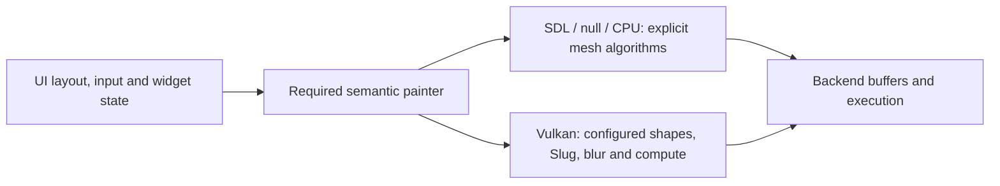

# Renderer-owned drawing boundary

25 October 2026. Baseline: `8f6e2c7` (the independently committed Vulkan
preparation, glyph residency and optional Kawase work).

Core now submits semantic drawing operations before tessellation or glyph
preparation. Every backend must supply a complete `render_painter`; all handlers
are pure virtual. There is no optional native hook selected by core and no
automatic tessellator for an incomplete backend.

The operation set includes raw meshes, rectangles, lines, rounded rectangles,
skin/fitted images, nine-slice images, polygons, sectors, arcs, blur, ordinary
text, ellipsis, wrapping, rings, strokes and gradients. Widget borders,
checkmarks and color-picker gradients submit these operations too. Showcase's
rounded gradient uses the same required backend contract; its old
Vulkan selection and fallback fan have moved from application code to the painter.
Text width and glyph-advance preparation also belong to the painter. Font source bytes are
available through a borrowed `font_bytes` view for custom representations.

`create_mesh_painter` is an explicit complete implementation chosen by a backend.
SDL3, null and the CPU renderer example choose it; Vulkan configures its own
native shape/text/blur handlers in its factory. The existing floating-point
operations, triangle topology, alpha, clipping, UVs and submission order were
moved without redesigning their algorithms. Core does not decide whether a
Vulkan draw uses SDF, compute or cached execution.

The painter owns draw-list/scratch/preparation storage. `context::dl` remains a
borrowed private-test/introspection alias and may be null. The context owns the
painter lifetime. Popup recorders have a separate complete mesh painter embedded
in their retained entry, avoiding a second painter allocation when the popup is
opened. Their old shifted raster/bitmap stream and effect restrictions remain.
The parent painter and binding state are restored after recording.

This changes the custom-backend API: each device must provide `create_painter`.
The existing measured showcase wrapper adds only factory forwarding; its test
bodies and assertions are unchanged. The CPU example is migrated in the same
revision. [Backend contract and migration](porting_a_backend.md#render_painter).

Six new headless regressions cover a complete backend with no CPU mesh/atlas,
all operation dispatch, unbaked logical state, hidden widget geometry, distinct
painter lifetimes/device rebinding, borrowed font stability and renderer-selected
measurement. Existing core/private performance/SDL/native golden tests retain
their assertions and references. Resource rebinding releases textures through the
old device and rebuilds the new renderer's cache; font sources remain alive for
painter teardown. Mesh blur scratch is prepared at the frame boundary. Tests check
source lifetime and texture release/rebuild explicitly. The no-mesh backend receives
text without loading a font or allocating an atlas; this distinguishes semantic
dispatch from merely moving already-prepared geometry to another class.

## Validation and measurement

Both full Debug and Release suites passed with Vulkan and formatting enabled:
core, pump, private allocation/performance regressions, software goldens, native
direct/staged/cache/interaction/fault/WSI tests, installed core/SDL/Vulkan
consumers, every example selftest, API drift and tutorial checks. The six new
headless regressions pass. New renderer slices were also checked explicitly with
clang-format 22.1.3. Existing test bodies, assertions and golden references were
not changed; the measured-device fixture adds one required factory-forwarding
method. The [validation receipt](perf/renderer_boundary_validation.json) checks
that exact test-source difference and seals the final source hashes.

The final native series uses AMD Radeon RX 9070 XT, driver 8389024, the actual
1360×860 showcase, Spiral at size 64, 5000 initial items, 180 frames and three Add
activations at 90/120/150. Six alternating before/after repetitions for each of
five modes retain all 10,800 frames. Timed runs have hidden WSI, VSync disabled
and no readback; this is not foreground pacing or Task Manager GPU-utilization
certification. Baseline binaries were frozen from `8f6e2c7`; no build or test ran
alongside the final timing series. Driver pipeline caches were not cleared.

The table reports medians of per-run values. GPU is the total of 180 completed
submission samples, not CPU frame time. Full process lifetime includes startup
and preparation and is not a process-to-first-present measurement.

| Mode | CPU mean, ms | Run maximum, ms | GPU total, ms | Process, ms |
| --- | ---: | ---: | ---: | ---: |
| Reference | 5.062 → 4.939 | 47.722 → 34.192 | 106.174 → 106.042 | 1265.9 → 1271.3 |
| SDF/Slug | 2.195 → 2.150 | 31.508 → 29.664 | 80.038 → 81.291 | 735.7 → 713.8 |
| Compute | 4.875 → 4.865 | 29.606 → 29.629 | 751.266 → 750.822 | 1232.4 → 1224.4 |
| Compute/cache | 5.393 → 5.364 | 31.025 → 29.785 | 871.223 → 876.397 | 1328.9 → 1329.0 |
| Adaptive | 2.266 → 2.202 | 30.150 → 30.069 | 81.278 → 80.798 | 750.8 → 739.4 |

This series shows no average CPU penalty from the required boundary. It does not
establish a universal speedup: SDF GPU total increased 1.6%, cache GPU total
increased 0.6%, and compute's median run maximum was slightly higher. Shader
programs and draw/vertex/index counts are unchanged; GPU clocks/residency were
not measured, so those differences are not assigned a specific cause. Upload
totals and frame-end metadata peaks match in every mode. The refactor adds no new
GPU algorithm. The earlier allocation/cache work has its own baseline and
[separate report](perf_vulkan_preparation.md).

Null and D3D11 controls use 16 balanced repetitions each, all 11,520 frames kept.
These values pool every frame and report the single worst frame, unlike the
native table's median of run maxima:

| Control | Mean, ms | Median, ms | Single worst, ms | Add mean, ms |
| --- | ---: | ---: | ---: | ---: |
| Null | 3.034 → 2.926 | 2.484 → 2.472 | 16.654 → 18.616 | 3.379 → 3.282 |
| D3D11 | 13.950 → 13.500 | 5.578 → 5.384 | 209.076 → 218.337 | 19.875 → 19.366 |

The control means improved 3.5% and 3.2%, respectively, while their individual
worst frames increased. Those outliers are retained, not removed or replaced by
averages. Remaining worst-frame spikes are not claimed fixed by an ownership
refactor. Forced compute/cache still costs more than SDF raster in this scene;
the existing renderer selection and visual domains remain explicit.

Eight final native image cases compare all 180 frames to frozen Reference and
SDF/Slug pixel data, including cache, adaptive, staged and 1150-item cases. All
1,440 comparisons passed. The 84-index union of each run's ten highest frames
and their ±2 neighbours is covered by those full-frame comparisons. The existing
native immutable fingerprints, legacy software goldens and separate Kawase
direct/staged comparisons also passed. `--update` was not used.

Retained evidence:

- [Native protocol, binary hashes, run summaries](perf/renderer_boundary_native.json)
  and [all 10,800 native frames](perf/renderer_boundary_native_frames.csv).
- [Null/D3D11 summaries and commands](perf/renderer_boundary_controls.json)
  and [all 11,520 control frames](perf/renderer_boundary_controls_frames.csv).
- [Final image matrix](perf/renderer_boundary_goldens.json),
  [source hashes, unchanged-oracle audit and peak union](perf/renderer_boundary_validation.json).
- [Full Debug suite](perf/renderer_boundary_debug.log),
  [full Release suite](perf/renderer_boundary_release.log),
  [serial qualification log](perf/renderer_boundary_qualification.log).

Earlier interrupted validation logs remain in `build-renderer-boundary/initial-*`
and `second-*`; they are not acceptance evidence. No timed rows from those runs
were substituted into the final series.
