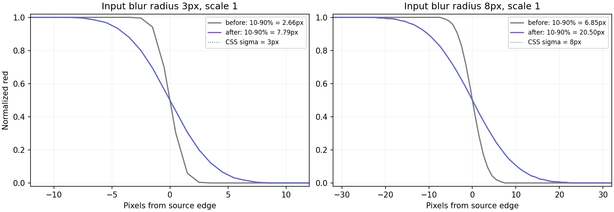
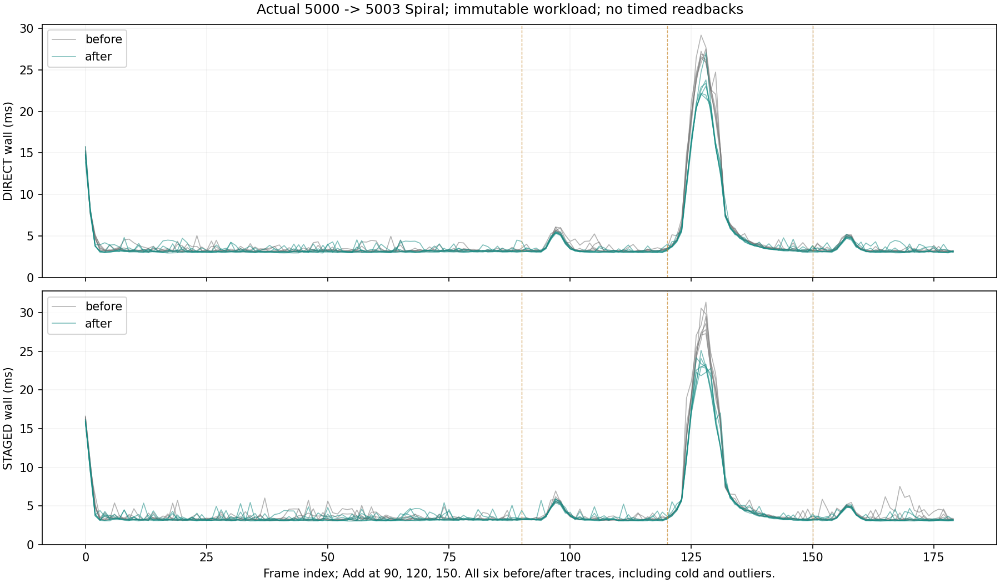

# Vulkan blur: CSS strength and bounded native preparation

Date: 2026-11-01. Branch: `codex/vulkan-native-harfbuzz`. Source base:
`309811fcaed86a420651d872ddf2452f6f48aff1`. Device: AMD Radeon RX 9070 XT; vendor/device
4098/30032; raw Vulkan driver value 8388996; Vulkan SDK 1.4.335.0.

The four reviewed costs are addressed without changing wide-blur, shape or text
pixels. Gaussian intentionally changes to CSS strength and the requested 8px
boundary. The complete old 5000-item Spiral remains byte-identical.

## Implementation

1. The complete indexed input is checked before recording a prefix. Dense and
   sparse subspans use an internal validated path, avoiding the second bounds
   scan without weakening late/negative-index rejection.
2. Streaming reuses existing equal-capacity upload arenas. Logical frame acquire
   semaphores wait for their final submission, while command pools track their
   own last use. Frame begin can choose an older compatible pool, retaining
   pipelining after a mid-frame continuation. One-slot/different-capacity cases
   keep bounded wait/reuse; neither the upload budget nor arena count increases.
3. `vulkan_prepare_blur` coalesces known scratch requirements before painting;
   the actual showcase uses it. A's requirements are independent of retained B,
   so a small Gaussian following wide Kawase does not promote all of A.
   Unknown requirements retain lazy growth. Oversized images retire at a window
   frame boundary after shrink, using normal GPU completion lifetime.
4. Only the last filter pass clips padding outside the mask plus its AA/bilinear
   apron. Quad/UV arithmetic and earlier sampling support stay fixed. The first
   overwrite-only filter rendering scope discards old scratch contents; resumed
   scopes LOAD earlier triangles. Scene/glyph rendering preserves its load policy.
   Effect tapes replay their full prefix, so partial scene history is not erased.

At frame 127, instrumented index visits fall **16,640,370 -> 8,349,684**.
DIRECT median validation time is **4.0924 -> 1.5991ms** across three diagnostic
runs. Its frame-127 slot wait is **1.5884 -> 0.0095ms**; STAGED is
**3.8046 -> 0.0098ms**. Backpressure still exists: STAGED frame 128 waits
4.1621 -> 1.6766ms. These diagnostics include instrumentation and are separate
from the production timing cohort below.

The first actual Spiral frame allocates **6 -> 2 images**, with Vulkan image
allocation requirements **14,016,512 -> 6,619,136 bytes**. These are allocations
within that frame, not a claim about all driver residency. Warm filter raster
coverage is **2,322,289 -> 1,944,549 pixels/frame (-16.27%)**. The previous
17,544,000-texel attachment LOAD coverage becomes zero for normal unsplit filter
scopes. That is API load coverage, not a measurement of physical VRAM traffic.

## Gaussian contract and visible change

[CSS Filter Effects defines blur length as Gaussian standard deviation](https://drafts.csswg.org/filter-effects/#funcdef-filter-blur).
Gaussian now uses framebuffer `sigma = logical_radius * render_scale`, with a
normalized discrete support of `ceil(3*sigma)` each side. Up to **8 framebuffer
pixels inclusive** uses Gaussian; larger radii use existing Dual Kawase.
The 49-tap maximum uses 25 bilinear fetches per axis; zero-weight pairs are
skipped. Coefficients retain binary32 precision in the 128-byte minimum Vulkan
push-constant budget. Alpha correction, rounded AA support and clipping remain.

At scale 1, the actual 3px edge's 10-90% transition grows **2.66 -> 7.79px**;
8px grows **6.85 -> 20.50px**, consistent with the requested sigma convention.
Discrete truncation, color space and browser edge policies can differ from a
particular browser's pixels. The existing below-0.5-logical-pixel no-op remains.
Kawase keeps its old `radius/3` variance target to preserve existing images;
strength is therefore not continuous across the 8px family boundary.



Correct stronger Gaussian requires more sampling. The independent GPU blur
interval measurements below include all 180 frames; values are medians of
three run means. Panel is 320x220; full is 1360x860. The 3/8px rows compare
different intended strengths; 15px compares the requested Gaussian-to-Kawase
policy change, so these are not equal-image speed comparisons.

| Region/radius | DIRECT before / after GPU ms | STAGED before / after GPU ms |
|---|---:|---:|
| panel, 3px | 0.0392 / 0.0459 | 0.0293 / 0.0292 |
| panel, 8px | 0.0326 / 0.0551 | 0.0422 / 0.0527 |
| panel, 15px | 0.0451 / 0.0382 | 0.0427 / 0.0372 |
| full, 8px | 0.1110 / 0.2413 | 0.1043 / 0.2411 |
| full, 15px | 0.1772 / 0.0972 | 0.1637 / 0.0969 |

The fullscreen 8px Gaussian is deliberately stronger and costs about 0.241ms
instead of 0.105-0.111ms. This revision does not claim every blur radius becomes
faster. In the fixed 5000-item Spiral all relevant radii remain Kawase and its
pixels are unchanged.

## Production 5000-item Spiral

The unchanged actual showcase test performs 180 fixed 1/60s frames, three real
keyboard Add activations at 90/120/150, and 5000 -> 5003 items. The two binaries
alternate for six repetitions per upload mode: **4320 timed frames**. Runs have
no readbacks and retain every cold/outlier frame. No builds, tests or visible
showcase ran during the qualified cohort. GPU time is completed submission
interval total / 180, not the delayed per-row GPU column. All source and
binary hashes are in the receipt; the measured candidate binary exactly matches
the final standard Release test binary.

Wall and p99 columns are medians of six run statistics; worst is the largest
observed frame across the entire six-run cohort. Paired change is the median of
matched before/after run-mean changes, which need not equal a ratio of medians.

| Upload | Wall before / after ms | Paired wall change | p99 before / after ms | Worst before / after ms | GPU before / after ms |
|---|---:|---:|---:|---:|---:|
| DIRECT | 4.3871 / 4.1261 | -5.99% | 24.3558 / 20.6989 | 29.1637 / 27.0573 | 0.8827 / 0.8931 |
| STAGED | 4.5147 / 4.2926 | -4.16% | 24.7394 / 21.9903 | 31.3471 / 25.1205 | 1.3954 / 1.3963 |

Cold medians: DIRECT **15.0923 -> 14.7693ms**, STAGED **16.3756 -> 15.9089ms**.
Total GPU intervals are nearly unchanged: DIRECT **+1.17%**, STAGED **+0.06%**;
these numbers do not support a general uncapped GPU-latency improvement claim.
The required upload work is unchanged, including the 72,675,408-byte peak.
Geometry from the unchanged insertion/spring motion still crosses the center;
the large scene therefore retains real tessellation/upload peaks.



An initial candidate is preserved separately. It improved paired wall time
3.22%/3.58%, but raised the DIRECT worst 27.9781 -> 28.9996ms and GPU totals
2.67%/4.05%. Its waits moved into the following logical frame. The final pool
selection/discard changes and their new regressions precede the final cohort.
Initial runs were not dropped or mixed into the final before distribution.

## Same-image filter controls

The final instrumented binary also runs adjacent default/keep-LOAD/full-filter
controls in alternating order, three repetitions. `keep-LOAD` disables discard;
`full-filter` additionally disables final scissor trimming. These flags exist
only in the isolated diagnostic wrapper, not the public renderer/showcase.
Values are summed blur GPU intervals per frame, median run means.

| Scene/radius/upload | Default GPU ms | Keep LOAD GPU ms | Keep LOAD + full quad GPU ms |
|---|---:|---:|---:|
| spiral, 0px, DIRECT | 0.5229 | 0.4779 | 0.4774 |
| spiral, 0px, STAGED | 0.5450 | 0.5533 | 0.5399 |
| panel, 8px, DIRECT | 0.0455 | 0.0488 | 0.0404 |
| panel, 8px, STAGED | 0.0512 | 0.0428 | 0.0481 |
| panel, 15px, DIRECT | 0.0424 | 0.0400 | 0.0465 |
| panel, 15px, STAGED | 0.0437 | 0.0468 | 0.0494 |
| full, 8px, DIRECT | 0.2574 | 0.2576 | 0.2550 |
| full, 8px, STAGED | 0.2620 | 0.2540 | 0.2640 |

These small GPU intervals are mixed: they do not establish a uniform isolated
F4 time improvement on this adapter. Raster/load work reduction is deterministic;
the complete production wall/p99 and bounded-rate resource results are reported
independently. The controls also pass all 180 immutable Spiral frames in both
upload modes; no quality/alpha/crop tolerance was relaxed.

## GPU resources at a matched rate

Three alternating before/after repetitions use hidden native WSI, VSync off and
the same 60Hz harness cap. PDH samples every 250ms and records only each child
PID. They are not foreground FPS certification. All engine/LUID/physical IDs,
zero samples and invalid statuses remain in raw evidence. Adapter instances are
never averaged together. The active adapter below is
`luid_0x00000000_0x1BD84E08_phys_0`, engine 0 / 3D.

| Upload | 3D median run mean before / after | 3D largest sample before / after | Peak dedicated before / after |
|---|---:|---:|---:|
| DIRECT | 3.850% / 3.288% | 7.023% / 6.535% | 191.95 / 190.70 MiB |
| STAGED | 5.701% / 4.040% | 10.436% / 9.725% | 255.21 / 255.21 MiB |

The other enumerated adapter (`...1BA04CC0_phys_0`) retains 0.1133MiB dedicated
usage and is listed separately in JSON. The 60Hz own-PID 3D reduction is about
14.6% DIRECT and 29.1% STAGED. This differs from the headless uncapped GPU
timestamp protocol and is not a claim that all workloads/GPU counters improve.

## Regression and visual validation

- Full `python tools/run_tests.py --vulkan --format --release` and Debug
  `python tools/run_tests.py --vulkan --format` pass: **35 native cases each**,
  core/pump/allocation/performance suites, unchanged SDL goldens, 1150/5000
  Spiral/peak images, all example selftests, installed consumers and doc checks.
- The new independent optimization target covers dense/sparse exact pixels,
  late negative/out-of-range input before any upload, equal/different arenas,
  next-frame pool reuse, preparation/image growth and scissor work. It forces a
  quad across rendering scopes, checks exactly one discard followed by LOAD,
  and compares its complete RGBA against one-draw output. Both upload modes,
  20/32-byte vertices and one/two frame-slot configurations pass.
- Only the two user-approved Gaussian contract files change existing tests:
  their sigma, support, 8px boundary probes and related fixtures/status text.
  All **80 other original test/oracle files** retain their pre-edit hashes.
  All **12 pre-existing unrelated report drafts** retain their hashes and are
  excluded from this commit. No `--update` mode was used.
- Frozen pre-optimization full frames compare exactly: **720 candidate Spiral
  RGBA comparisons** (180 x direct/staged x cache off/on), plus 360 baseline
  identity checks. Every timed cold/peak frame ID belongs to those 180 frames.
  All 360 original direct/staged capture hashes remain fixed.
- Gaussian references were captured before the preparation/raster changes:
  36 independent full-image/mask scenes, 1x/1.25x/1.5x/2x/3x/4x DPI,
  **576 exact frames and 144 idle hits**. Direct/staged output matches those
  frozen CSS references. CPU-kernel tolerances remain unchanged.
- **Eight** whole Kawase controls at 1x/1.5x/2x/3x DPI remain equal to the old
  binary; **16** unrelated shape/text/footer regions also remain exact.
  Instrumented default/full-filter controls add their independent all-frame
  checks; validated native WSI stresses another 360 frames without errors.
- Vulkan/HarfBuzz-OFF/SDL-OFF builds pass the base and all three blur targets,
  direct/staged where applicable. The fresh local configure initially hit an
  MSVC PDB-manager mismatch; explicit Embedded debug info avoids that machine
  issue without changing project configuration. All four GLSL programs match
  their manifest and pass `spirv-val --target-env vulkan1.3`.
- Standard no-argument showcase and both SDL demo windows opened and closed
  normally. Computer Use capture failed twice with `0x887A0005`; live visual
  certification is not claimed. Current application framebuffer PNG/BMPs were
  reviewed separately, including the regenerated native README image.
  Its only 128 changed pixels are CPU-time digits inside the performance HUD;
  the rest of that current Overview image is identical to the previous image.

## Evidence and reproduction

[Receipt and all run summaries](perf/vulkan_blur_optimizations.json),
[all final timed frames](perf/vulkan_blur_optimizations_frames.csv.gz) and
[raw validation/measurement bundle](perf/vulkan_blur_optimizations_raw.zip)
retain full logs, both candidate cohorts, per-blur/serial diagnostics, all PDH
samples, the 36 CSS goldens, compatibility controls and full-RGBA peak frames.
All 180 original frame hashes are included; the complete immutable references
remain in `build-vulkan-gaussian-fix/spiral-direct` and `spiral-staged`.
The raw bundle includes the isolated diagnostic sources; they are not compiled
into the library. User-profile path prefixes are redacted in archived text copies.

```powershell
python tools/compare_vulkan_blur.py `
  build-vulkan-blur-opt4/before/pui_vulkan_native_spiral_tests.exe `
  out/build/x64-release/Release/pui_vulkan_native_spiral_tests.exe `
  --reference build-vulkan-gaussian-fix/spiral-direct `
  --baseline-receipt build-vulkan-blur-opt4/baseline.json `
  --output build-vulkan-blur-repeat --runs 6
```

Use a new output directory; captures and baseline images are never overwritten.
Interactive use needs no Python: start the standard
`out/build/x64-release/Release/pui_showcase_vulkan.exe` directly.
