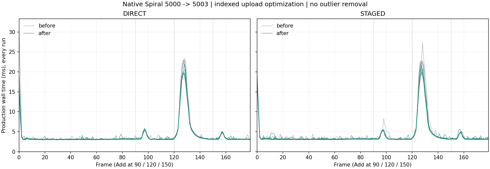

# Vulkan indexed upload: exact block planning and native vertex offsets

Date: 2026-11-01. Source baseline: `f13f31d785e7ae315a9e908274c5067008121194`. Branch:
`codex/vulkan-native-harfbuzz`. Windows native execution on AMD Radeon RX 9070 XT;
new regression logs record the actual vendor/device/driver identity.

## Changes

The validated large-draw path accepts eight-triangle blocks, refining a boundary
with the original scalar greedy rule. Block bounds and byte use only grow, so
every accepted prefix also fits. A first triangle that exceeds the arena returns
immediately to sparse fallback, without reading a speculative block. No heap
storage, new arena or increased upload budget is introduced. The complete public
input is still checked before any GPU prefix is recorded.

Dense spans copy original index bytes and pass their negated base through
`vkCmdDrawIndexed`'s signed vertex offset. This retains effective vertex indices,
attributes, primitive order and upload sizes. Only nonnegative source ranges
within the portable 24-bit index limit use the native offset; internal negative,
INT_MIN, larger and signed-boundary cases retain CPU rebasing. Borrowed Vulkan
devices need no additional feature enablement. Shaders, Gaussian strength,
Kawase, fonts, motion and rendering configuration are unchanged.

The actual Add still inserts at a random rank and moves later Spiral targets
through the visible stage. Its visible geometry burst remains real; this change
reduces preparation cost while preserving that animation.

## Matched production measurement

The unchanged showcase harness renders 1360x860, initial 5000 tiles, size 64,
Spiral, 180 fixed 1/60s frames, keyboard Adds at 90/120/150 and final 5003 tiles.
Six alternating before/after runs per upload mode retain **4,320 timed frames**.
No timed readbacks, concurrent builds/tests or other project windows occur.
All cold/outlier frames remain. This is offscreen native execution, not a
foreground presentation/FPS or per-PID GPU-utilization result.

Wall mean and p99 are medians of six run statistics. p99 uses the empirical
lower rank (index 177 of 180 sorted frames). Worst is the absolute maximum of
the entire six-run group. Paired change is the median of matched run-mean changes.
GPU is completed submission interval total / 180 logical frames; CPU/GPU overlap.

| Upload | Wall before / after ms | Paired wall change | p99 before / after ms | Worst before / after ms | GPU before / after ms |
|---|---:|---:|---:|---:|---:|
| DIRECT | 4.0585 / 3.9834 | -1.57% | 21.2257 / 18.3342 | 30.8159 / 22.0322 | 0.6181 / 0.6212 |
| STAGED | 4.1746 / 4.0570 | -3.15% | 21.2249 / 18.6521 | 27.4353 / 22.2412 | 1.0203 / 1.0107 |

The DIRECT before absolute maximum is the cold frame 0; it is retained, not
attributed solely to steady geometry preparation. Same-index medians across the
six repetitions isolate the recurring geometry peak without removing any frame:

| Upload | Frame 127 before / after ms | Frame 128 before / after ms |
|---|---:|---:|
| DIRECT | 22.4590 / 19.6881 | 22.5303 / 19.6345 |
| STAGED | 22.2640 / 19.7148 | 22.2277 / 19.5881 |

Total GPU intervals are nearly flat: DIRECT
**+0.50%**,
STAGED **-0.93%**.
This is a CPU preparation/peak-latency improvement, not a general GPU speedup.
Individual frames do not all become faster, and the actual geometry burst and
remaining peaks are retained rather than approximated away.

Every per-frame upload byte count agrees before/after, including the geometry
peak. Every timed draw-buffer allocation count is zero. Allocated upload-page
capacity is reported separately from uploaded bytes and is not total VRAM.
The source and binary hashes are sealed in the receipt. The measured candidate
binary matches the final standard Release native-Spiral executable exactly.



## Regression and image verification

- New `pui_vulkan_indexed_tests` compares all split tuples to the frozen scalar
  implementation across 1,260 dense/fan/reversed/random/sparse/degenerate/negative
  stream/stride/capacity combinations, including partial blocks and exact edges.
  Stable work counters reject a return to one serial capacity check per triangle;
  an oversized sparse first triangle also avoids speculative block reads.
- Actual Vulkan bind/draw hooks check uploaded index bytes, signed vertex offset
  and effective indices, then compare full overlapping translucent pixels with
  the normalized reference. Eight bases cover zero, ordinary positive, both
  24-bit edges, larger, negative, INT_MIN and near-INT_MAX values. Both strides,
  one/two frame slots and direct/staged paths give 64 exact pixel pairs.
- Isolated CPU builds pass green; disabling block acceptance fails the work
  regression; restoring unconditional CPU rebasing fails the offset regression.
  These expected failures remain in raw evidence and do not alter production.
- Full Release and Debug `--vulkan --format` gates pass with **37 native cases
  each**, original core/pump/performance/allocation suites, SDL goldens, 1150/5000
  Spiral/peaks, all example selftests, installed consumers and API/tutorial checks.
  The final Release gate includes the last sparse-first fast fallback. A prior
  Release pass is archived separately as preliminary, not used as the final gate.
- Vulkan with HarfBuzz OFF / SDL OFF passes the base and new direct/staged target.
  The 36 immutable CSS Gaussian cases also pass in both upload modes: 576 exact
  frames and 144 idle hits; all coefficients and reference bytes remain fixed.
- All 180 actual Spiral frames compare with immutable RGBA captures in both
  upload modes and candidate cache off/on: **720 candidate comparisons**, plus
  360 before-reference identity frames. Every timed peak/cold frame is covered.
  Full RGBA goldens for every observed maximum and its neighbours are archived.
- All **83 original test/oracle files** and **17 pre-existing untracked
  report drafts** retain their starting hashes. No golden update mode is used.
  Existing test bodies and existing report drafts are excluded from the commit.

## Evidence and reproduction

[Receipt and hashes](perf/vulkan_indexed_optimizations.json),
[all timed frames](perf/vulkan_indexed_optimizations_frames.csv.gz),
[complete logs, scalar source, new regressions and peak goldens](perf/vulkan_indexed_optimizations_raw.zip).
All 360 original capture hashes are retained; complete direct/staged references
remain under `build-vulkan-gaussian-fix/spiral-direct` and `spiral-staged`.

```powershell
python tools/compare_vulkan_indexed.py `
  build-vulkan-indexed-opt2/before/pui_vulkan_native_spiral_tests.exe `
  out/build/x64-release/Release/pui_vulkan_native_spiral_tests.exe `
  --baseline build-vulkan-indexed-opt2/baseline.json `
  --reference build-vulkan-gaussian-fix/spiral-direct `
  --output build-vulkan-indexed-repeat --runs 6
```

Use a new output directory. Interactive showcase launch still uses the ordinary
`out/build/x64-release/Release/pui_showcase_vulkan.exe` without Python.
