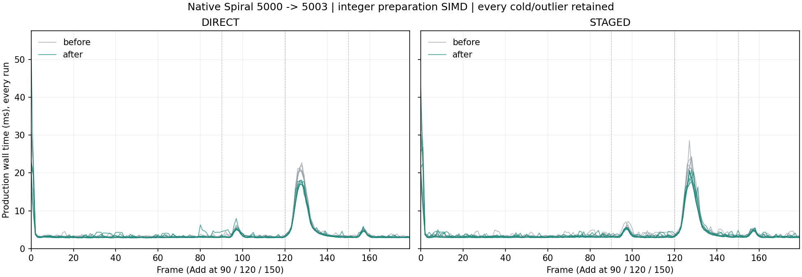

# Native Vulkan: SIMD index validation and exact span planning

Date: 2026-11-02. Source baseline: `6968612b055ed342c191d8c274b47f5721a4f8bc`. Branch:
`codex/vulkan-native-harfbuzz`. Windows execution on AMD Radeon RX 9070 XT;
actual device logs record vendor/device 4098/30032 and driver 8388996.

## Implementation

Full indexed input validation now compares 16 signed indices at a time with
SSE2. The 64-bit upper interval is calculated once and clamped to INT_MAX;
negative values never wrap into a valid range. Unaligned loads and the original
scalar tail preserve every bound check. Complete validation still precedes any
GPU prefix, upload or draw, with the same sticky rejection message.

Large span planning reduces signed min/max in four lanes over 192 indices,
then refines the boundary with the original greedy triangle rule. The initial
oversized sparse triangle rejects before any block lookahead. Original
conservative negative-range behavior, every split tuple and primitive order
remain fixed. The previous native vertex-offset/fallback policy is retained.

SSE2 is compiled only when the target guarantees it. Other targets retain
scalar validation and the previous 24-index block algorithm. The intrinsic
header is confined to the Vulkan implementation section; public declarations
and core/SDL paths remain independent. Private counters exist only in the new
test build. There is no new heap scratch, per-frame CPU-feature query, shader,
floating-point/architecture compiler flag, arena count or upload-budget change.
Shape construction, fonts, HarfBuzz/Slug, motion and Gaussian/Kawase are unchanged.

## Production 5000-item Spiral

The unchanged actual showcase harness runs 180 fixed 1/60s frames at 1360x860,
Spiral, size 64, 5000 -> 5003 tiles, with real keyboard Adds at 90/120/150.
Six alternating before/after pairs per upload mode retain **4,320 timed
frames**. Runs have no readbacks, concurrent builds/tests or other project
windows. Every cold and outlier frame is retained. These are production
executables, separately qualified from the earlier instrumented review probes.
The candidate exactly matches the final standard Release native-Spiral binary.

Mean and p99 are medians of six run statistics. p99 uses sorted index 177 of
180. Worst is the absolute maximum of all six runs. Paired change is the median
matched run-mean percentage, which can differ from the ratio of medians. GPU
is completed submission interval total / 180 logical frames; delayed per-row
GPU samples are not assigned to the current CPU frame. CPU/GPU intervals overlap.

| Upload | Wall before / after ms | Paired wall change | p99 before / after ms | Worst before / after ms | GPU before / after ms |
|---|---:|---:|---:|---:|---:|
| DIRECT | 4.2495 / 3.9335 | -7.15% | 20.6114 / 17.7394 | 31.4225 / 53.2625 | 0.6281 / 0.6250 |
| STAGED | 4.3226 / 4.0491 | -6.84% | 21.6482 / 18.5965 | 38.2992 / 42.5773 | 1.0386 / 1.0451 |

Same-index medians preserve the recurring geometry peak:

| Upload | Frame 127 before / after ms | Frame 128 before / after ms |
|---|---:|---:|
| DIRECT | 21.2296 / 17.4093 | 20.5504 / 17.4814 |
| STAGED | 21.6482 / 19.2197 | 22.4724 / 18.3535 |

Cold medians: DIRECT 30.0100 -> 21.9821ms;
STAGED 25.6435 -> 23.5252ms.
The absolute maximum increases: DIRECT 31.4225 -> 53.2625ms,
STAGED 38.2992 -> 42.5773ms.
Both candidate maxima occur at cold frame 0 in repetition 5. The median cold
frame and recurring geometry peaks improve, but this is not a universal
worst-frame improvement. No run or frame is excluded. These uninstrumented
timings do not identify the subphase responsible for the isolated startup
stalls, so they are not attributed to a particular allocator, driver or OS cause.
Completed GPU totals change
-0.50% DIRECT /
+0.63% STAGED.
These measurements do not certify foreground FPS, per-PID GPU utilization,
physical VRAM peaks or a universal per-frame speedup. All individual results
and maxima remain in the receipt and trace.

Every per-frame upload byte count agrees before/after, including the
72,675,408-byte peak. All timed Vulkan draw-buffer allocation counts are zero.
Peak upload-page capacities remain 68,681,728 bytes DIRECT / 135,790,592 bytes
STAGED; these capacities are not total VRAM. The actual Add still inserts at
a random rank and sends many animated Spiral targets through the visible
center. Its geometry burst remains; no shadows, shapes or animation are dropped.



## Regression and image qualification

- New `pui_vulkan_integer_tests` checks **538,320 validation cases** and
  **418,647 exact split tuples** against frozen scalar oracles. Each matrix
  also checks the explicit portable implementation. Four pointer alignments,
  vector/block boundaries, empty/tail lengths, negative/INT_MIN/INT_MAX bases,
  intervals extending past INT_MAX, dense/sparse/reversed/random/degenerate
  streams, two strides and tiny/large capacities are covered.
- Protected-page tails at 21 lengths detect reads beyond the final input.
  Integer work counters verify use of vector comparisons/reductions instead
  of noisy timing thresholds. Sparse first-triangle rejection performs no
  vector block work.
- Real GPU guards reject invalid values at positions 0/15/16/the final index
  of a 90,000-index draw before any upload, draw or submission. Direct/staged,
  20/32-byte and one/two-slot combinations provide **64 rejection cases**.
  Dense/sparse translucent streams compare exact full pixels against independent
  small reference batches, with no draw-time buffer allocation: **eight pairs**.
  Existing indexed tests retain their separate native-offset/fallback witnesses.
- Isolated green CPU regressions pass. Disabling just SIMD validation or just
  SIMD planning makes the respective bounded-work regression fail as expected.
  A separate build excludes the intrinsic header and all intrinsic code; the
  new CPU/GPU suite passes both upload modes with `SIMD=0`. This checks the
  portable branch on Windows, not an actual ARM/Linux/macOS execution claim.
- Full Release and Debug `python tools/run_tests.py --vulkan --format` gates
  pass, **39 native cases each**, existing core/pump/performance/allocation
  suites, SDL goldens, 1150/5000 Spiral and peak references, all example
  selftests, installed consumers, API/tutorial drift and formatting. The new
  test's portable printf casts and Windows header guard are refreshed and
  rechecked in both configurations after the full gates; production code
  remains the same qualified version. The initial supplementary SDL-OFF build
  exposed Windows min/max macro pollution in this new test; its failed log is
  retained separately. NOMINMAX fixes the test bootstrap without changing any
  test expectation or production code.
- HarfBuzz OFF / SDL OFF passes the base Vulkan test plus the new direct/staged
  regressions. Immutable Gaussian goldens pass in both upload modes: 36 cases,
  1x through 4x DPI, **576 exact frames and 144 idle hits**.
- Frozen Spiral references compare all 180 complete frames in both upload
  modes with candidate cache off/on: **720 candidate RGBA comparisons**, plus
  **360 before-reference identity frames**. Every timed cold/peak frame is
  included. No golden update, image tolerance or reference bytes are changed.
  Full RGBA references for every observed maximum and its neighbours are archived.
- All **84 original test/oracle files** and all **22
  pre-existing unrelated report drafts** retain their initial hashes. Only
  implementation, the new independent regression, test registration and scoped
  documentation/evidence are included in the commit.

## Evidence and reproduction

[Receipt, full run summaries and source hashes](perf/vulkan_integer_optimizations.json),
[every timed frame](perf/vulkan_integer_optimizations_frames.csv.gz),
[raw logs, frozen source, regressions and peak RGBA](perf/vulkan_integer_optimizations_raw.zip).
All 360 immutable direct/staged frame hashes and 36 Gaussian reference hashes
are retained. Complete Spiral references remain under
`build-vulkan-gaussian-fix/spiral-direct` and `spiral-staged`.

```powershell
python tools/compare_vulkan_indexed.py `
  build-vulkan-simd-opt2/before/pui_vulkan_native_spiral_tests.exe `
  out/build/x64-release/Release/pui_vulkan_native_spiral_tests.exe `
  --baseline build-vulkan-simd-opt2/baseline.json `
  --reference build-vulkan-gaussian-fix/spiral-direct `
  --output build-vulkan-integer-repeat --runs 6
```

Use a fresh output directory. The standard native showcase remains directly
runnable as `out/build/x64-release/Release/pui_showcase_vulkan.exe`.
