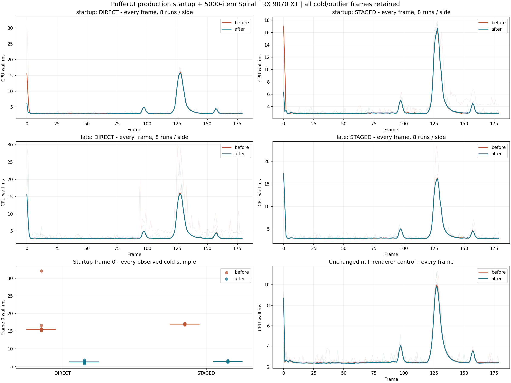

# Vulkan startup preparation and exact rounded-fan reuse

Date: 2026-11-02. Baseline: `9b2bedd1220f75e661d25fa409903f54f3b21275`; branch `codex/vulkan-native-harfbuzz`.
Windows, MSVC Release, AMD Radeon RX 9070 XT, vendor/device 4098/30032,
driver 8388996. Production source and binary hashes are in the receipt.

## Changes

Known initial Spiral scenes prepare CPU geometry storage and every completed
native upload slot before the first frame clock. The new
`vulkan_prepare_surface_geometry(surface, capacity)` accepts an idle, ready
surface and retains the existing extent-dependent limits, budgets, direct/staged
storage and late continuation fallback. All slots are checked before mutation;
recording, in-flight group/slot serials, dirty/zero-size surfaces and active
painting decline. This entry does not submit, wait, reset command buffers or
trim another surface. Global budget pressure declines softly; actual native
allocation/map errors retain their existing sticky failure behavior. A false
return can leave a bounded or partial reservation.

The application performs its explicit loading wait before native preparation.
The bootstrap callback runs after fonts/theme and before selftest VSync policy;
otherwise a dirty WSI swapchain would silently prevent preparation. Offscreen
VSync changes no longer dirty a surface that has no presentation mode. The
ready-checking atomic exercises the actual SDL bootstrap ordering. The model,
animation time, RNG and UI frame count are not advanced. Existing CPU
resize-to-commit preparation is retained, including its memory touches.

Rounded fans retain the exact original vertex, UV, color and index arithmetic.
Fixed corner directions use the existing immutable arc table, except the first
angle is evaluated at use to preserve signed-zero behavior under changing FP
rounding modes. Known internal fans use the center and 16 emitted endpoints
for the original bounds; nonfinite input falls back to the complete ordered
scan. Arbitrary user meshes always keep the full scan, including 73/324 meshes.
No shape, AA segment, shadow, primitive order, font or shader is changed.

## Protocol and startup accounting

The actual showcase runs 180 fixed 1/60s frames, 1360x860, size-64 Spiral,
5000 -> 5003 items, with real keyboard Adds at 90/120/150. Eight alternating
before/after pairs per mode retain **20,160 timed frames**
across 112 process starts. The startup workload is the same source compiled
against frozen old headers/examples and current sources; the baseline-only
macro reproduces the missing old prepare callback. The original native Spiral
and null harnesses remain unchanged and are measured separately. A same-binary
late/preflight control isolates setup placement. Timing has no readbacks or
concurrent project build/test/window. Every frame and outlier is retained.

Mean and p99 are medians of eight run statistics; p99 is sorted element 177.
Worst is the absolute maximum across all runs. Paired change is the median
matched run-mean change. GPU is completed interval total / 180; delayed samples
are not attributed to the current CPU frame. CPU and GPU overlap.

| Upload | Frame 0 before / after ms | Frame 1 before / after ms | Setup before / after ms | Setup + frame 0 before / after ms | Setup + first two before / after ms |
|---|---:|---:|---:|---:|---:|
| DIRECT | 15.5207 / 6.2154 | 8.4019 / 3.2123 | 129.0528 / 141.1714 | 144.5735 / 147.6079 | 152.9115 / 150.8243 |
| STAGED | 17.0021 / 6.3045 | 10.4284 / 3.2395 | 128.3189 / 144.3149 | 145.4944 / 150.6194 | 156.0478 / 153.8430 |

**Preparation moves existing work into setup. It does not eliminate that work
or establish faster total application startup.** Setup, setup + frame 0 and
setup + the first two frames above are medians of per-run sums, not sums of
independent medians. Full process times and explicit preparation times remain
in the receipt. Both native slots are prepared up front; the old path paid the
second slot on frame 1. Historical 53.2625 ms had no subphase trace, so this
report does not retrospectively assign its exact cost to an allocator/driver.

Startup 180-frame wall/GPU results:

| Upload | Mean before / after ms | Paired mean change | p99 before / after ms | Absolute worst before / after ms | GPU before / after ms |
|---|---:|---:|---:|---:|---:|
| DIRECT | 3.6525 / 3.5517 | -2.52% (8/8 improve) | 15.5207 / 14.6554 | 32.0960 / 16.4914 | 0.5905 / 0.5884 |
| STAGED | 3.6719 / 3.6201 | -1.69% (8/8 improve) | 15.8621 / 15.1009 | 17.5611 / 17.8086 | 0.9496 / 0.9473 |

Frame-0 medians improve by
59.95% DIRECT /
62.92% STAGED.
The startup cohort's STAGED absolute maximum nevertheless rises from
17.5611 to
17.8086 ms;
no universal worst-frame reduction is claimed.

## Unchanged late-hint harness and null control

The original native harness still calls the paint callback directly; it does
not opt into application setup. Its frame 0 remains a real cold preparation
case. This measures rounded-fan reuse without silently excluding its old work.

| Upload | Mean before / after ms | Paired mean change | p99 before / after ms | Absolute worst before / after ms | GPU before / after ms |
|---|---:|---:|---:|---:|---:|
| DIRECT | 3.6464 / 3.6446 | +0.07% (4/8 improve) | 15.4993 / 15.4968 | 29.5987 / 29.3803 | 0.5899 / 0.5907 |
| STAGED | 3.7164 / 3.7026 | -0.47% (6/8 improve) | 15.9796 / 15.7303 | 23.3783 / 17.4048 | 0.9572 / 0.9558 |

Same-index recurring geometry peaks in that unchanged harness:

| Upload | Frame 127 before / after ms | Frame 128 before / after ms |
|---|---:|---:|
| DIRECT | 15.9198 / 15.6334 | 15.8064 / 15.6559 |
| STAGED | 15.8967 / 15.7303 | 16.2681 / 16.1617 |

The same candidate binary, with only preparation placement switched:

| Upload | Same executable late / preflight frame 0 ms | Late / preflight setup + first two ms | Paired 180-frame mean change |
|---|---:|---:|---:|
| DIRECT | 15.5787 / 6.2839 | 153.3941 / 149.1157 | -1.20% |
| STAGED | 17.2280 / 6.2259 | 156.5812 / 152.9150 | -2.70% |

The unchanged null-renderer actual showcase control:

| Upload | Mean before / after ms | Paired mean change | p99 before / after ms | Absolute worst before / after ms | GPU before / after ms |
|---|---:|---:|---:|---:|---:|
| NULL | 2.8425 / 2.8195 | -0.53% (7/8 improve) | 9.2313 / 9.0699 | 11.3519 / 11.2160 | n/a |

The unchanged DIRECT harness has a +0.07%
paired mean change and only 4/8 improved pairs:
this cohort does not establish a sustained DIRECT throughput improvement.
The bounded work regressions establish removal of the redundant operations;
measured aggregate benefits are modest and depend on the preparation boundary.

These are measured cohort results, not a universal per-frame or worst-frame
guarantee. All absolute maxima are listed below, including regressions. The Add
animation still sends many targets through the visible center and retains its
geometry burst. Per-frame geometry, draw/submission counts and upload bytes
match where fields are common. This change does not claim reduced physical
VRAM, per-process 3D utilization or foreground FPS. Startup moves storage earlier
and can increase memory held before the first frame.



## Regression and visual qualification

- New fan regressions compare **80,000 complete streams** and **400,000 bounds**
  against independent unchanged scalar references across four FP rounding modes,
  extreme/nonfinite values, signed zero, prefixes, UVs and radii. A warmed 1,000
  fans perform exactly 8,000 direction evaluations and 17,000 bounds visits with
  no allocation; nonfinite fallback and arbitrary-mesh full scanning are pinned.
  Isolated direction/bounds slow-path mutants each fail the respective bound.
- New native preflight regressions cover direct/staged, 20/32-byte vertices,
  one/two slots, all-slot in-flight/recording guards, no-op reuse, extent/resize,
  budget pressure, bounded/oversized requests and native allocation/map failures.
  Actual translucent pixels match reference rendering. The 180-frame startup
  regression pins CPU storage pointers and every native geometry buffer handle.
- Full Release and Debug `python tools/run_tests.py --vulkan --format` pass:
  **45 native cases each**, existing core/pump/performance/allocation suites,
  SDL goldens, 1150/5000 Spiral and peak references, all example selftests,
  installed consumers, API/tutorial drift, Python telemetry tests and formatting.
- SDL OFF / HarfBuzz OFF builds and passes base Vulkan plus direct/staged
  preflight regressions. Immutable CSS Gaussian goldens pass in both modes:
  36 cases at 1x through 4x DPI, 576 exact frames and 144 idle hits.
- **2,520 complete immutable Spiral RGBA comparisons** cover before/after,
  startup/original harnesses, direct/staged, candidate cache off/on and late
  control. Every comparison checks all 180 frames, including frame 0 and all
  observed peak indices. Complete RGBA for all observed maxima and neighbours
  is archived; all 360 original direct/staged reference hashes remain fixed.
- Actual standard executable Overview and Effects screenshots are exact against
  frozen production. The standard 5000-item CLI and new ready-asserting atomic
  selftests pass. The two-window demo launches and exits normally after a
  bounded three-second smoke. The atomic README image is generated and reviewed.
  Hidden selftests/captures are not foreground performance certification.
- All **85 original test/oracle files** and **27
  pre-existing unrelated report drafts** retain their hashes. Existing test
  bodies, tolerances, fonts, shaders and golden bytes are unchanged.

Final full gates are separate from earlier failed new-fixture/overlapping-build
attempts. Those logs are archived too. Corrections were in new fixtures and the
bootstrap ordering, without weakening existing expectations. The supplementary
fresh CMake compiler probe initially hit MSVC's C1902 PDB-manager mismatch;
embedded debug information fixes that build setup. Production flags are unchanged.
The demo does not parse `--selftest`; the first supplementary invocation timed
out. Its final smoke instead verifies both windows and sends normal close
requests only to the newly launched owned process, then requires exit zero.

## All-run maxima

- startup / direct / before: 32.0960 ms at frame 0, repeat 0.
- startup / direct / after: 16.4914 ms at frame 128, repeat 4.
- startup / staged / before: 17.5611 ms at frame 127, repeat 7.
- startup / staged / after: 17.8086 ms at frame 128, repeat 2.
- late / direct / before: 29.5987 ms at frame 125, repeat 7.
- late / direct / after: 29.3803 ms at frame 0, repeat 7.
- late / staged / before: 23.3783 ms at frame 127, repeat 7.
- late / staged / after: 17.4048 ms at frame 0, repeat 1.
- preparation-control / direct / before: 26.2787 ms at frame 127, repeat 7.
- preparation-control / direct / after: 41.3012 ms at frame 128, repeat 7.
- preparation-control / staged / before: 17.7502 ms at frame 0, repeat 4.
- preparation-control / staged / after: 17.6571 ms at frame 128, repeat 5.
- null / null / before: 11.3519 ms at frame 128, repeat 5.
- null / null / after: 11.2160 ms at frame 127, repeat 0.

Every per-run maximum and all 20,160 timings remain in the machine-readable
evidence; no sample was trimmed or rerun to replace an adverse observation.

## Evidence and reproduction

[Receipt and hashes](perf/vulkan_startup_optimizations.json),
[all frames](perf/vulkan_startup_optimizations_frames.csv.gz),
[raw measurements, frozen sources/binaries and peak RGBA](perf/vulkan_startup_optimizations_raw.zip).

```powershell
python tools/compare_vulkan_startup.py `
  build-vulkan-startup-opt/before out/build/x64-release/Release `
  --baseline build-vulkan-startup-opt/baseline.json `
  --reference build-vulkan-gaussian-fix/spiral-direct `
  --output build-vulkan-startup-repeat --runs 8
```

Use a fresh output directory. The raw archive includes the frozen old headers,
examples, original test sources, baseline executable hashes and matched startup
build command. Normal users launch the Release showcase directly:

```powershell
& "out/build/x64-release/Release/pui_showcase_vulkan.exe" --page 1 --tiles 5000 --lab-mode 4 --lab-size 64
```

No Python launcher is required. See the resource-preparation atomic, native
documentation and tutorial chapter 10 for explicit application integration.
