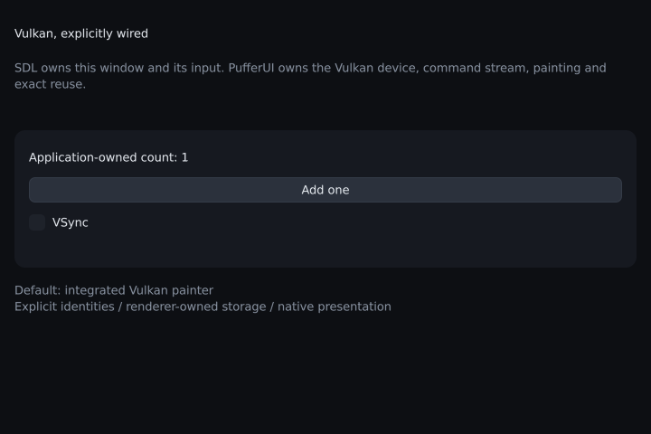

# 10. Vulkan without an example bootstrap

Goal: open a native Vulkan window with the integrated painter, while owning the
window, platform adapter, context, frame loop and teardown in your own program.

← [Tutorial index](README.md) · [Vulkan backend contract](../vulkan.md)



The complete, buildable program is
[`examples/tutorial/vulkan_manual.cpp`](../../examples/tutorial/vulkan_manual.cpp).
It includes the public library and SDL headers directly. It does not include
`example_common.h`, `tut.h`, `example_run` or `sdl3_app`. The `application` struct
in this chapter is ordinary application code; it is not a required library type.

## Build and run the real program

Use a C++20 compiler, CMake, the repository's initialized SDL3 submodule, and a
Vulkan 1.3 SDK/driver. On Windows, use Developer PowerShell for Visual Studio:

```powershell
cmake --preset x64-release -DPUFFERUI_WITH_VULKAN=ON -DPUFFERUI_WITH_HARFBUZZ=ON
cmake --build out/build/x64-release --target pui_tut_vulkan_manual
& ".\out\build\x64-release\Release\pui_tut_vulkan_manual.exe"
```

`PUFFERUI_WITH_HARFBUZZ=ON` builds the pinned HarfBuzz shaping and upstream Slug
GPU outline renderer. Fresh Vulkan configurations enable it by default;
use `-DPUFFERUI_WITH_HARFBUZZ=OFF` explicitly for bitmap text with the same
integrated shape painter. Ordinary application runs need neither Python nor command-line
painter flags. For a driver discovery problem, see the
[Windows loader instructions](../vulkan.md); an explicit
`VK_DRIVER_FILES` override is a per-process diagnostic, not an application dependency.

The device must satisfy the integrated painter's feature/format requirements,
including a graphics/compute queue, Vulkan 1.3 dynamic rendering,
synchronization2 and timeline semaphores. The GPU painter additionally requires
the documented storage-image formats and descriptor limits. Unsupported creation
reports an error; it does not silently select a different painter. See the
[GPU painter requirements](../vulkan_gpu_painter.md) before lending an engine's device.

## Link from your own project

This is an ordinary consumer CMake file, without the repository's example macros.
Place a checkout at `external/pufferui`, copy `vulkan_manual.cpp` to `main.cpp`,
and initialize the checkout's SDL submodule:

```cmake
cmake_minimum_required(VERSION 3.21)
project(my_vulkan_ui LANGUAGES C CXX)
set(PUFFERUI_BUILD_TESTS OFF CACHE BOOL "" FORCE)
set(PUFFERUI_BUILD_EXAMPLES OFF CACHE BOOL "" FORCE)
set(PUFFERUI_WITH_SDL3 ON CACHE BOOL "" FORCE)
set(PUFFERUI_WITH_VULKAN ON CACHE BOOL "" FORCE)
set(PUFFERUI_WITH_HARFBUZZ ON CACHE BOOL "" FORCE)
add_subdirectory(external/pufferui)

add_executable(my_vulkan_ui main.cpp)
target_compile_features(my_vulkan_ui PRIVATE cxx_std_20)
target_link_libraries(my_vulkan_ui PRIVATE pufferui::vulkan)
target_compile_definitions(my_vulkan_ui PRIVATE
    PUFFERUI_ASSET_DIR="${CMAKE_CURRENT_SOURCE_DIR}/external/pufferui/assets")
```

Build with `cmake -S . -B build` and `cmake --build build --config Release`.
The Vulkan target carries its SDL, SDK and optional HarfBuzz dependencies and
public feature definitions. Link this one PufferUI variant in the executable.
The asset definition supplies a deterministic font path; a shipped application
should deploy its chosen font and use its own asset path.

For an installed package, replace the `add_subdirectory` configuration with
`find_package(pufferui CONFIG REQUIRED COMPONENTS vulkan)`, keep the link to
`pufferui::vulkan`, and point `PUFFERUI_ASSET_DIR` at your deployed assets.
The installed package's HarfBuzz/SDL feature set is determined when the library
is built. Do not manually define `PUFFERUI_ENABLE_HARFBUZZ` to pretend it is present.

## Supply the platform adapter

SDL owns the native window and loads the platform Vulkan loader when a window
is created with `SDL_WINDOW_VULKAN`. The adapter supplies its loader entry point,
instance extensions, surface creation and physical output size. PufferUI owns
the returned Vulkan surface; SDL continues to own the native window.

<!-- src: examples/tutorial/vulkan_manual.cpp -->
```cpp
struct sdl_vulkan_host final : vulkan_host
{
    SDL_Cursor *cursors[5]{};
    PFN_vkGetInstanceProcAddr instance_proc_addr() override
    {
        return reinterpret_cast<PFN_vkGetInstanceProcAddr>(SDL_Vulkan_GetVkGetInstanceProcAddr());
    }
    std::span<const char *const> instance_extensions() override
    {
        Uint32 count = 0;
        const char *const *names = SDL_Vulkan_GetInstanceExtensions(&count);
        return {names, count};
    }
    VkSurfaceKHR create_surface(VkInstance instance, void *window) override
    {
        VkSurfaceKHR surface = VK_NULL_HANDLE;
        SDL_Vulkan_CreateSurface(static_cast<SDL_Window *>(window), instance, nullptr, &surface);
        return surface;
    }
    // ...
```

`output_size` returns pixel dimensions, and returns zero while minimized. UI
layout uses logical coordinates. The source also caches the five system cursors
and releases them while SDL is still initialized. The host object must outlive
the device and every surface that calls it.

## Create the window, device and UI context

Initialization explicitly calls `SDL_Init`, creates a resizable high-density
Vulkan window, then creates these objects in order:

1. `render_device`: owns Vulkan instance/device/queue resources in this example.
2. `render_surface`: owns the native surface, swapchain and scene target.
3. `context`: owns UI state, fonts and its renderer-provided painter.
4. `window`: a context-owned UI window associated with the SDL handle/surface.

The actual defaults are sufficient. No application-level preset is involved:

<!-- src: examples/tutorial/vulkan_manual.cpp -->
```cpp
        vulkan_device_opts options;
        options.host = &host;
        options.validation = selftest;
        // ...
        device = create_vulkan_device(options);
        if (!device) return false;
        surface = create_vulkan_surface(device, {.window = native});
        if (!surface) return false;
        ctx = create_context(device, surface);
        if (!ctx) return false;
```

`vulkan_device_opts{}` selects `INTEGRATED`, `tile_cache=true` and
`whole_program_cache=true`, with `native_observation=false`. It selects `vector_text=true` when the Vulkan
library was built with HarfBuzz, and `false` otherwise. Direct uploads, two
frame slots and legacy blur retain their existing defaults. Kawase blur remains
an explicit choice through `options.blur = vulkan_blur_mode::KAWASE`.

The integrated painter records GPU commands and runs tile binning and SDF/Slug
compute painting from the first changed frame. Certified identical output skips
the painter. Exact output/function/glyph reuse and the native replay needed for
pixels outside compute eligibility belong to the renderer;
application code continues to submit UI operations. See the
[integrated architecture](../vulkan_integrated_painter.md) for eligibility,
budgets and native replay rules.

The source initializes the client rectangle from SDL's actual size/position,
sets the render scale to `SDL_GetWindowDisplayScale`, and sets the input scale
to display scale divided by pixel density. It then loads the bundled font,
sets the theme and clipboard, and starts SDL text input. These are explicit
application responsibilities when using the low-level entry points.

## Route input and handle DPI/resize

The loop polls SDL events and passes each one to the library's public event
adapter. This is an event router, not an application or example bootstrap:

<!-- src: examples/tutorial/vulkan_manual.cpp -->
```cpp
        while (SDL_PollEvent(&event))
            if (sdl3_route(app.ctx, &event)) app.running = false;
        if (!app.running || app.win->close_requested) break;
```

`sdl3_route` feeds pointer, button, wheel, keyboard, text/IME and focus input to
the correct UI window. Move/resize/display-scale/pixel-size events update its
client rectangle and scale. Drawing from `win->area` therefore reflows after a
resize. The renderer obtains the framebuffer's pixel dimensions from the host;
do not substitute the logical client size for those dimensions.

An application with another event system can call the individual public input
functions instead; see [the backend porting contract](../porting_a_backend.md).
Do not feed both the router and the same individual input events.

## Draw and present one frame

SDL's performance counter supplies the interactive clock. The selftest uses
fixed 1/60-second steps so input and captures are repeatable. Each frame has an
explicit boundary:

<!-- src: examples/tutorial/vulkan_manual.cpp -->
```cpp
        begin_frame(app.ctx, *app.win, now, dt);
        {
            app.build_ui(); // All UI scopes are destroyed before end_frame.
        }
        end_frame(app.ctx); // Submits and presents the native Vulkan surface.
```

The UI function creates `ui u(ctx)`, cuts rectangles from the current window
area, and calls ordinary widgets with explicit IDs. Model data stays in the
application: pressing `"increment"_id` changes `count`. No core draw-list
preparation or backend-specific vertex allocation is required in this loop.

`end_frame` already presents the native surface. Do not also call
`SDL_RenderPresent` or present that swapchain yourself. The loop waits for an
event for up to 120 ms when `needs_redraw(ctx)` is false, and sleeps while the
window is minimized. An animated scene should call `u.request_redraw()`.

The example starts interactive runs with VSync enabled and its checkbox checked.
It calls `device->set_vsync` only on initialization or when that checkbox changes.
The native FIFO presentation policy and UI state thus agree. Selftests start
uncapped to avoid waiting for a monitor; they are functional checks rather than
foreground frame-pacing measurements.

## Destroy in the right order

The source unwinds partially failed initialization through the same explicit
`shutdown()` used on normal exit. Stop text input, then release UI state before
its renderer, and native GPU resources before SDL unloads the loader:

<!-- src: examples/tutorial/vulkan_manual.cpp -->
```cpp
        if (ctx) destroy_context(ctx); // Fonts, painters, windows and their UI state go first.
        ctx = nullptr;
        win = nullptr;
        if (surface) device->destroy_surface(surface);
        surface = nullptr;
        if (device) destroy_vulkan_device(device); // Waits for its owned GPU work.
        device = nullptr;
        host.release_cursors();
        if (native) SDL_DestroyWindow(native);
        native = nullptr;
        if (sdl_initialized) SDL_Quit();
```

The surface and SDL window are borrowed by the UI window. Destroying the
context does not replace the application's responsibility to destroy them.
The destructor also calls `shutdown()`; nulling the handles makes a second call
safe. If an engine lends Vulkan handles, the engine retains ownership and must
respect the [borrowed-device and external-image lifetime rules](../vulkan.md).

## Select an independent diagnostic configuration

To reproduce the original triangle/bitmap renderer explicitly, configure before
device creation:

```cpp
pui::vulkan_device_opts options;
options.host = &host;
options.painter = pui::vulkan_painter_mode::REFERENCE;
options.tile_cache = false;
options.whole_program_cache = false;
options.vector_text = false;
```

For an independent analytic raster oracle, select `SDF_RASTER`, keep vector
text at the same setting as the candidate, and disable both caches. Selecting
an enum alone does not reset the other public option fields. The showcase's
explicit `--vulkan-painter` switches reset those feature flags as a diagnostic
command-line policy; the low-level API respects exactly what the caller sets.

## Test the application directly

```powershell
& ".\out\build\x64-release\Release\pui_tut_vulkan_manual.exe" --selftest --frames 8 --resize 760x520
& ".\out\build\x64-release\Release\pui_tut_vulkan_manual.exe" --selftest --frames 8 --screenshot vulkan.bmp
```

The hidden-window selftest pushes an actual SDL press/release onto the saved
button rectangle, checks the application-owned count, routes a resize, checks
the resulting client size, and requires zero UI/validation errors. It is part
of `examples_selftest` and the generated native test cases. `--no-script`
disables the test click; `--size WxH` changes the initial window dimensions.
This path needs a real Vulkan-capable window system, even when the window is hidden.

`pui_vulkan_default_tests` separately compares all 24 frames of the unconfigured
factory against an uncached native SDF reference, including a local change and
stationary reuse, in direct and staged configurations. Existing diagnostic tests
select their original feature flags explicitly; their assertions and committed
pixel oracles remain fixed. The actual 5000-item Spiral and peak-frame coverage
continues in the native/integrated suites described in the
[validation report](../perf_vulkan_integrated.md).
