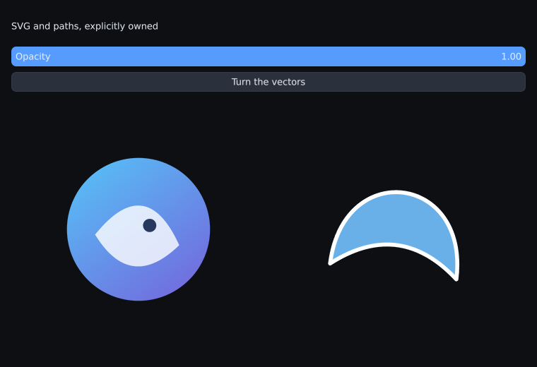

# 11. SVG and paths without example shorthand



Run: `pui_tut_vector_manual` (Vulkan enabled). The complete application is
[`examples/tutorial/vector_manual.cpp`](../../examples/tutorial/vector_manual.cpp).
It includes no `example_common.h` and uses no example bootstrap or gallery
helper. It owns the SDL window, device, surface, context, immutable sources,
model, event loop and teardown. The public `create_sdl3_vulkan_device` factory
supplies SDL's Vulkan platform adapter; chapter 10 shows an application-owned
adapter when integrating a different window system.

Build and run from the repository:

```powershell
cmake --preset x64-release -DPUFFERUI_WITH_VULKAN=ON
cmake --build out/build/x64-release --target pui_tut_vector_manual
& "out/build/x64-release/Release/pui_tut_vector_manual.exe"
```

For an installed library, use `find_package(pufferui CONFIG REQUIRED COMPONENTS
vulkan)`, link your executable to `pufferui::vulkan` and SDL3, and give your own
font path instead of the repository's `PUFFERUI_ASSET_DIR`. Fresh Vulkan builds
enable HarfBuzz/Slug. An explicit HarfBuzz OFF configuration still draws the
same semantic resources through the portable vector painter.

## Load and prepare once

The application calls `load_svg` during initialization and checks its structured
error. It keeps the returned `image` owner. SVG sources can include gradients,
clips, isolated groups and strokes; unsupported features fail explicitly.
For generated graphics the same application creates an immutable C++ path:

<!-- src: examples/tutorial/vector_manual.cpp -->
```cpp
        const path_command commands[] = {{path_verb::MOVE, {16, 96}},
                                         {path_verb::CUBIC, {16, 16}, {112, 16}, {112, 96}},
                                         {path_verb::QUADRATIC, {64, 56}, {16, 96}},
                                         {path_verb::CLOSE}};
        const auto source =
            create_path({.commands = commands,
                         .fill = {.kind = vector_paint_kind::SOLID, .tint = {116, 193, 255, 230}},
                         .stroke = {.kind = vector_paint_kind::SOLID, .tint = {255, 255, 255, 255}},
                         .stroke_options = {.width = 3, .join = path_line_join::ROUND},
                         .view_box = {0, 0, 128, 128}});
```

The commands are copied; the local array does not need to outlive this function.
`prepare_vector` then selects and stores the renderer's representation **before
the first frame clock starts**:

<!-- src: examples/tutorial/vector_manual.cpp -->
```cpp
        const vector_prepare_opts preparation{.max_pixel_size = {256, 256},
                                              .max_instances = 8,
                                              .resource_budget_bytes = 16 * 1024 * 1024};
        // Resource setup runs before the first begin_frame. Draws reuse it.
        return static_cast<bool>(u.prepare_vector(icon, preparation)) &&
               static_cast<bool>(u.prepare_vector(path, preparation));
```

Extent is in framebuffer pixels. Include DPI and the maximum transform scale.
The tutorial clamps each preview to the prepared extent after resize/DPI changes.
A zoomable application can request a larger preparation between frames; check
the result before using the new scale. Preparation is loading work and belongs
in startup measurements.

## Submit each frame

The model owns opacity and angle. Ordinary controls update them; `draw_vector`
submits the destination rectangle, affine transform and style. The UI does not
reparse XML, flatten curves or encode Slug data. Native Vulkan resolves affine
coverage on the GPU; the portable renderer reuses its prepared texture.

<!-- src: examples/tutorial/vector_manual.cpp -->
```cpp
            const auto status = u.draw_vector(
                {center.x - size * .5f, center.y - size * .5f, size, size}, i ? path : icon,
                {.transform = rotation, .style = {.opacity = opacity}});
```

Always inspect the returned status. A missed preparation is a reported
`NOT_PREPARED` error rather than an allocation or partial drawing hidden inside
the frame. Palette variants used by the portable painter must also be prepared.

## Input and lifetime

The application's SDL event loop calls `sdl3_route`, handles close/minimized
windows and calls `begin_frame`/`end_frame`. VSync is configured once at startup.
Idle input can wait without repeatedly drawing an unchanged screen. All UI
scopes end before `end_frame`.

During shutdown the application releases both painter bindings, destroys its
source owners, then destroys the context, surface, device and SDL window.
Device destruction waits for its owned GPU work. A copied source pointer is not
another owner: use `retain_vector` when ownership really is shared.

The standalone selftest sends a real SDL click to the rotation button, resizes
the window, draws eight frames and requires zero UI/validation violations:

```powershell
& "out/build/x64-debug/Debug/pui_tut_vector_manual.exe" --selftest --frames 8 --resize 800x560 --screenshot vector.bmp
```

The [SVG/path contract](../vector_paths.md) lists supported features, limits,
backend choices and the independent golden/lifetime tests. The full
[`vector_gallery.h`](../../examples/vector_gallery.h) adds palette preparation,
gradient badges, dashed strokes and clipping using the normal example runner.
