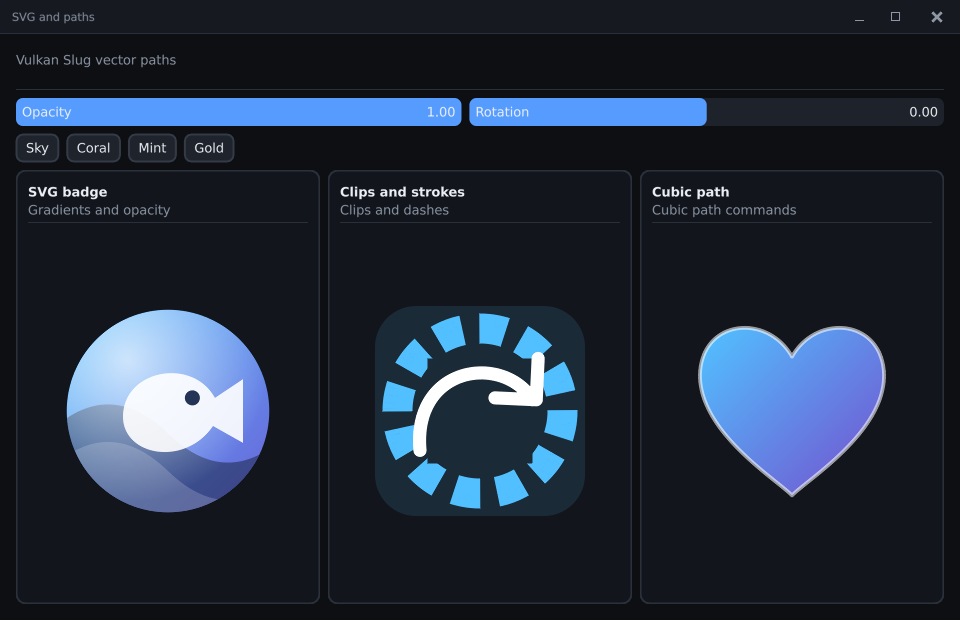

# SVG and path resources

`load_svg` and `create_path` create immutable, explicitly owned sources. UI
submission uses `prepare_vector`, `draw_vector` and `release_vector`; preparation,
storage, coverage, batching and execution belong to the selected renderer.
SVG drawing does not require a font, a font face or a glyph atlas.



See the [complete application tutorial](tutorial/11-svg-and-paths.md),
[`vector_manual.cpp`](../examples/tutorial/vector_manual.cpp) and the
[`vector_gallery`](../examples/vector_gallery.h). Run the gallery directly:

```powershell
& "out/build/x64-release/Release/pui_ex_vector.exe"
& "out/build/x64-release/Release/pui_ex_vector_vulkan.exe"
& "out/build/x64-release/Release/pui_showcase_vulkan.exe" --vectors
& "out/build/x64-release/Release/pui_tour.exe" --vectors
```

The opt-in showcase/tour gallery keeps the original pages and their images
stable. Its controls exercise currentColor, isolated opacity and rotation.
`pui_ex_vector_vulkan --portable-vectors` selects the portable implementation for
an explicit comparison. The startup defaults of ordinary showcase pages stay
the same.

## Ownership and frame boundaries

1. Load XML or create a `path_source`. Inputs are copied; borrowed command,
   stop and dash arrays can then go out of scope. Check `vector_result` before
   using its `image`. Failed loads never return a partial document.
2. With a context selected, call `ui(ctx).prepare_vector(image, options)`
   **outside** a UI frame. Include framebuffer DPI and intended affine scale in
   `max_pixel_size`. Count this work as setup/loading time.
3. During frames call `draw_vector(destination, image, options)`. No hidden
   parsing, CPU rasterization or outline encoding occurs in this call.
   A larger/unprepared extent or currentColor variant returns `NOT_PREPARED`;
   schedule preparation between frames. Clipped, transparent and zero-area
   draws are harmless no-ops.
4. Outside frames, `release_vector` drops that painter's binding. Destroy the
   application's source with `destroy_vector(handle)`, which clears the handle.
   A prepared renderer or deferred overlay retains its own source ownership.
   Native buffers and descriptors retire after their last recorded submission;
   source destruction never frees in-flight storage.

Copying a handle does not add an owner. Use `retain_vector` for another explicit
owner and call `destroy_vector` once per owner. Context destruction or device
rebinding releases its prepared bindings. Destroy contexts/surfaces before their
device. A device owns its shared native residency and completion timeline.

`max_instances` reserves CPU/native batch storage. Immediate draws can exceed
the hint by flushing bounded batches. Deferred overlay recording checks its
prepared capacity and returns a structured error before recording a prefix
that cannot be replayed. Prepare the required palette/currentColor variants in
advance for the portable painter; native paint metadata can resolve currentColor
at draw time.

## Supported icon/logo SVG subset

| Area | Supported |
| --- | --- |
| Geometry | `path` M/L/H/V/C/S/Q/T/A/Z, relative commands, `rect`, rounded rect, `circle`, `ellipse`, `line`, `polygon`, `polyline` |
| Coordinates | affine transforms, nested SVG viewports, viewBox, preserveAspectRatio alignment/meet/slice, `defs`, local `use`, `symbol` |
| Paint | solid CSS subset, currentColor, linear/radial gradients, stops/stop alpha, local gradient templates, gradientTransform, user/object-bounds units, pad/repeat/reflect |
| Stroke | width, butt/round/square caps, miter/round/bevel joins, miter limit, dashes and dash offset, fill/stroke order |
| Composition | nonzero/evenodd fill and clip rules, clipPath unions/intersections, nested clips, isolated group opacity, fill/stroke opacity |
| Style | inherited presentation properties and inline declarations, supported property cascade/important, display/visibility, scoped SVG/xlink namespace aliases |

This is an icon/logo importer, not a browser SVG engine. External references,
images, text, scripts, filters, masks, patterns, markers, animation, stylesheets,
full CSS, nonzero radial focal radius and unsupported style properties return
`UNSUPPORTED`. XML parsing performs no external I/O. Unknown graphical namespaces,
invalid references/cycles, malformed numbers and nonfinite coordinates fail
explicitly. Inert metadata can be ignored; graphical content is never silently
dropped as a substitute for implementing an unsupported feature.

SVG `use` x/y is appended to its transform before its own clipping. Referenced
SVG/symbol viewport defaults come from the referenced element; explicit non-auto
use dimensions override them. This follows the relevant
[SVG2 use-element rules](https://www.w3.org/TR/SVG2/struct.html#UseElement).

`create_path` retains MOVE/LINE/QUADRATIC/CUBIC/CLOSE commands, fill rule,
solid/gradient paint and stroke options. Affines use column-vector coordinates:
`x' = a*x + c*y + e`, `y' = b*x + d*y + f`. The draw transform operates in
logical destination coordinates; the renderer applies framebuffer scale.

## Renderer choices and limits

The mesh/SDL/null painter prepares a retained RGBA texture. Curves and strokes
are flattened and rasterized only during preparation; rows use geometric clip
intersections before AA integration. Premultiplied isolated layers preserve group
opacity; the final texture follows the device's straight-alpha contract.

Vulkan with HarfBuzz and `vulkan_device_opts::vector_paths=true` uses a separate
font-independent Slug graphics pipeline. It encodes contours with upstream
`hb_gpu_draw`, retains outline/paint metadata, and draws affine instances.
Complex winding/stroke/clip contours are normalized before encoding. Isolated
groups use preallocated bounded offscreen targets. This path is independent of
text shaping, text gamma, glyph coverage caches and the existing shape shaders.
It does not add a compute painter or tile binning. Explicit HarfBuzz OFF or
`vector_paths=false` selects the complete portable painter.

Both caches are bounded to 64 MiB/256 entries, with per-preparation resource
budgets. Native accounting includes retained assets, shared layer storage and
retired allocations; upload arenas have their own existing bounded budget.
Parser defaults are 4 MiB XML, 262144 commands and depth 64. Prepared extents
are at most 4096 pixels per axis. Preparation has additional bounded geometry,
intersection and sampling work limits; limits can reject complex inputs even
when their final image is small. `hb_gpu_draw` also has a 16-bit packed texel
address limit per encoded outline. All such failures return `LIMIT` and keep a
previous successful preparation usable.

Prepared CPU geometry and temporary raster scratch can coexist during loading;
`resource_budget_bytes` is not a whole-process peak-memory cap. Prefer preparing
at the actual required extent and releasing unused bindings. Do not assume
Slug is faster than a cached textured quad for a static, fixed-size icon:
measure the intended transform, overlap, instance count and upload mode.

Third-party painters implement all five vector methods in `render_painter`.
`inspect_vector`, shape/clip/operation views expose immutable borrowed source
data without implementation headers. Views remain valid while a source owner
is alive; retain it when storing a binding. The generic mesh painter remains an
explicit complete backend choice. See [porting a backend](porting_a_backend.md).

## Verification

`pui_vector_tests` checks importer semantics, curve/stroke geometry, source and
cache ownership, failure recovery, clip AA and allocation-free repeated draws.
`pui_vulkan_vector_data_tests` adds encoding and the actual native painter:
`--gpu`, `--painter`, `--lifecycle`, `--overlay`, `--bounds`, `--faults`. The native tests
exercise direct/staged, cache off/on, 1x/2x/4x DPI, affine reflection/rotation,
group opacity, mesh ordering, suspended/recreated targets and safe retirement.
Text gamma changes do not affect path coverage. Buffer/map/descriptor failures
keep prior bindings intact and clean partial resources; native device errors
retain the existing sticky-error policy.

```powershell
& "out/build/x64-debug/Debug/pui_vulkan_vector_data_tests.exe" --goldens tests/golden/vector
```

The 21 new 64x64 RGBA fixtures cover seven independent scenes at three DPI
settings. The test also compares all 84 mode images exactly. These fixtures
were captured on the qualified adapter; cross-driver raster equality is not
promised. `--capture-reference NEW_DIRECTORY` refuses an existing directory.
It never overwrites these or any previous golden. The new feature has no reason
to regenerate existing primitive, text, blur or Spiral images.

The [qualification and performance report](perf_vector_paths.md) retains all
old-scene frames and the native/texture tradeoff measurements. Slug is the native
SVG/path default for analytic coverage quality; composed fixed-size SVGs can be
substantially cheaper with the prepared texture configuration.

`pui_vulkan_vector_data_tests --bench [--portable] [--staged] [--complex]` emits
180 readback-free frame records. Simple mode submits 5000 single-fill curves;
complex mode submits 96 gradient/clipped/isolated SVG instances. Setup, drawing
C++ allocations, upload allocations, completed GPU totals and renderer residency
are reported separately. These compare representation tradeoffs for new content;
exact old-scene before/after qualification uses the unchanged Spiral harness.
