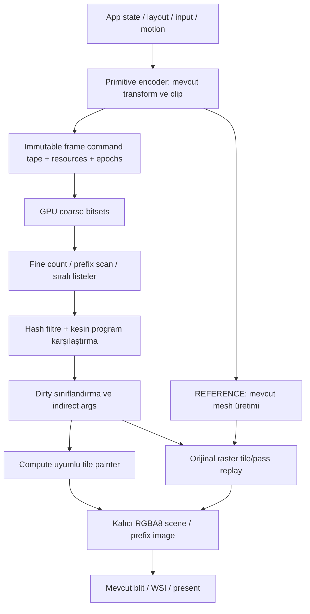

# Vulkan GPU komut akışı, tile binning ve compute painter

Tarih: 24 Ekim 2026. İncelenen kaynak: `8c62fc4204e89ac93343593b4ff94907f6b2f18b`.
Güncel kullanıcı kararı: **uygulama yetkili ve doğrulandı.** Basit şekillerde
SDF'ye bağlı görüntü değişikliği artık kabul ediliyor. Kullanıcı ayrıca
HarfBuzz shaping + Slug GPU yazı çizimini istedi. Eski test/golden gövdeleri
değişmez; eski REFERENCE yolu R0 ile, yeni SDF/Slug compute/cache yolu ise
bağımsız dondurulmuş yeni SDF/Slug raster referansıyla tam RGBA karşılaştırılır.
SDF ve istenen yeni metin çizimi dışındaki davranışlar korunur. Aşağıdaki
katı eski-piksel maddeleri tarihsel tasarım kısıtıdır; SDF/Slug için bu açık
istisna geçerlidir. Güncel kanıt, ölçülen gerilemeler ve destek sınırları
[teslim doğrulamasında](vulkan_gpu_painter_qualification.md) kayıtlıdır.

Güncel uygulama sözleşmesi [vulkan_gpu_painter.md](vulkan_gpu_painter.md)
içindedir. Gerçek GPU coarse/fine binning, sıralı komut listeleri, indirect
dispatch, SDF interpreter, GPU history karşılaştırması ve sınırlı adaptif seçim
uygulandı. Slug glifleri ve güvenli hesaplanamayan piksel suffix'leri raster
yolunda kalır. Eski genel üçgen renderer'ın tümünü compute ile çizdiğimiz
iddia edilmez. Zorunlu compute/cache, SDF raster'dan pahalı çıkabildiği için
opt-in kalır; varsayılan REFERENCE değişmez.

Aşağıdaki ayrıntılı G0–G9 tasarımı tarihsel çıkış kapılarını ve genişletme
yönlerini korur. Güncel destek kapsamı, uygulanan fallback ve sınırlamalar
uygulama sözleşmesinde ayrıca tanımlıdır. Eski baseline
`perf/vulkan_compute_baseline.json` tek başına aday hızlanması kanıtı değildir.
Roadmap `~/.opencode/plan/pufferui-roadmap.md` içindedir. Yeni kullanıcı isteği
uygulama ve nihai commit'i açıkça yetkilendirmiştir.

## 1. Amaç, referans ve başarı tanımı

Amaç, immediate-mode UI davranışını koruyarak GPU'nun sıralı boyama komutlarını
tile'lara ayırması, kesin girdileri karşılaştırması ve gerekli tile'ları compute
ile boyamasıdır. 5000 öğelik Spiral'de CPU geometri üretimi ve upload maliyetini
azaltmak da hedeftir; sadece GPU hash eklemek bu maliyeti ortadan kaldırmaz.

Referans native backend bir üçgen rasterizer'ıdır. `vulkan_draw.inl::paint`,
20 byte core vertex'ini 32 byte float-renkli vertex'e çevirir ve
`vkCmdDrawIndexed` çağırır. `vulkan_cache.inl` CPU'da kanonik kayıt tutar;
per-triangle GPU binning veya compute painter içermez. Çalışma ağacındaki
deneysel GPU modülleri bu referans yolundan ayrı değerlendirilir. Ana draw listesi
texture/clip'e göre büyük batch'ler oluşturduğundan backend'de her batch'i tek
komuta çevirmek yeterli yerellik sağlamaz. Yeni semantik komut yolu, uygun
primitive'lerde tessellation'dan **önce** başlamalıdır.

Referanslar:

- R0: `8c62fc4`, native Vulkan DIRECT, CPU cache kapalı. Aynı cihaz/sürücü,
  shader/font/input ve çıktı koşulları altında değişmez görüntü referansı.
- R1: aday binary içindeki zorunlu REFERENCE modu. R1'in R0 ile eşitliği önce
  doğrulanır; yeni ortak encoder'ın hatası iki yeni modu birden etkileyemez.
- Mevcut SDL testleri ve committed golden'lar bağımsız, değişmez kontrol olarak
  kalır. Önceki cross-API parity istisnası, compute-vs-native karşılaştırmasına
  taşınmaz: compute, mevcut native Vulkan çıktısıyla **birebir** eşleşmelidir.

Başarı üç ayrı kapıdır: (a) algoritmanın gerçekten çalışması, (b) RGBA byte
eşitliği ve doğru fallback, (c) bütün maliyetleri içeren ölçülmüş fayda. Bu
kapılardan biri başarısızsa diğerinin geçmesi yeterli değildir. Bütün kareleri
raster fallback'ten geçiren aday, compute painter tamamlandı sayılmaz.

### 1.1 Mevcut ölçümün işaret ettiği yer

`docs/perf/vulkan.json` / `vulkan_frames.csv` tarihsel ölçümdür; yeni baseline
yerine kullanılmaz. RX9070XT, 5000 Spiral DIRECT Add ortalaması 5.677913 ms;
CPU cache 5.998177 ms'dir. Tekil en kötü DIRECT kare run1/frame127:

| Alan | Tarihsel değer |
| --- | ---: |
| Toplam CPU frame | 62.696800 ms |
| Build bölümü | 62.210700 ms |
| End bölümü | 0.428200 ms |
| Slot wait / Present CPU çağrısı | 0.007100 / 0.323900 ms |
| İstenen vertex / index | 1,963,931 / 8,351,448 |
| Yüklenen geometri | 96,255,536 byte |

Build aralığı UI, geometri, flush, backend kayıt/dönüşüm/yükleme hazırlığını
birlikte içerebilir; bu tek değer bütün sıçramanın yalnızca tessellation olduğunu
kanıtlamaz. G0 profilinde bunlar ayrılır. GPU sorguları bugün gecikmeli completed
submission değerleridir; CPU frame127 ile kendiliğinden hizalı kabul edilmez.
Yeni yolun faydası bu bütün CPU frame ölçüsünde de görünmelidir.

## 2. Makaleden alınan ilke ve PufferUI uyarlaması

[Blick makalesi](https://blickeditor.com/blog/caching-an-immediate-mode-ui),
kompakt GPU boyama komutlarını coarse/fine tile listelerine ayırıyor; komut
içeriği/sırası ve bağımlılıklar değiştiğinde ilgili tile'ı yeniden boyuyor.
Compute painter tile programını yorumluyor. Metal örneğinde komutlar 64 byte;
GPU değişen tile listesiyle çalıştırılacak iş miktarını da üretiyor. Analitik
şekiller, shape group ve alpha barrier bu dilin ayrı özellikleri. Yazının hash
kestirmesine burada kesin içerik karşılaştırması eklenir. Makaledeki güç
ölçümleri PufferUI için bir hız veya pil ömrü hedefi değildir.

Aşağıdaki tasarım PufferUI'ye özgü öneridir. Makaledeki görsel semantiği aynen
taşımak yerine mevcut görüntünün semantiğini uygular. Özellikle mevcut alpha
çarpımlarını grup opacity'sine veya feather mesh'lerini ideal SDF'ye çevirmek
yasaktır. Yeni renderer bu dönüşümlerin eşit olduğunu varsayamaz.

## 3. Görüntü sözleşmesi ve en önemli teknik risk

| Konu | Değişmeyecek davranış |
| --- | --- |
| UI ve etkileşim | Layout, hit rect, açık kimlik, animasyon, sıralama, öğe sayısı ve zaman adımı |
| Geometri | Mevcut feather, rounded fan/ring topolojisi, border ring, shadow kapsamı, transform/DPI işlem sırası |
| Renk | Mevcut gamma, RGBA8 kanal anlamı ve `/255.0f` dönüşümü; otomatik sRGB veya premultiplied dönüşümü yok |
| Blend | RGB `src.rgb * src.a + dst.rgb * (1-src.a)`; alpha `src.a + dst.a * (1-src.a)`; mevcut kuantizasyon noktaları |
| Sıra | Orijinal painter order ve primitive order; front-to-back yeniden sıralama yok |
| Clip | Mevcut x/y/w/h ayrı truncation ve target kesişimi; boş clip hiçbir piksel boyamaz |
| Texture/text | Aynı atlas coverage, UV, nearest/linear/clamp, içerik/sampler revizyonu ve update sırası |
| Efekt | Blur örnek sayısı, pyramid seviyeleri, prefix girdisi ve bilinear blit aynı |
| Sunum | Çözünürlük/DPI/format ve VSync politikası değişmez; scene cache swapchain içeriğine dayanmaz |

Donanım rasterizasyonunun kapsam/interpolasyon hesabını ve fixed-function
blend'ini bir compute shader'ın aynı formülle yazması byte eşitliğini garanti
etmez. Üstelik RGBA8 attachment her fragment yazısında kuantize olur; bütün
katmanları float register'da biriktirip sadece sonda RGBA8'e çevirmek farklı
sonuç verebilir. `NoContraction` tek başına rasterizer/blend eşdeğerliği sağlamaz.
Bu risk [Khronos rasterizasyon](https://docs.vulkan.org/spec/latest/chapters/primsrast.html),
[blend](https://docs.vulkan.org/spec/latest/chapters/framebuffer.html) ve
[sayısal hesap](https://docs.vulkan.org/spec/latest/chapters/fundamentals.html)
sözleşmeleri dikkate alınarak ele alınır; taşınabilir bir bit eşitliği vaadi yoktur.

Bu yüzden üç yürütme biçimi planlanır:

1. **REFERENCE:** mevcut native rasterizer; oracle ve tam fallback.
2. **GPU_RASTER_CACHE:** GPU binning/karşılaştırma/dirty işleri çalışır; boyama
   aynı graphics pipeline'ı ve orijinal geometriyle yapılır. Compute painter
   değildir; yalnızca GPU preprocessing'in bağımsız doğruluk ve maliyet aşamasıdır.
3. **COMPUTE_COMPAT:** GPU per-pixel komut yorumlayıcısı gerçekten çalışır.
   Yalnızca doğrulanmış format/komut/cihaz kapsamı compute'a alınır. Diğer
   tile/pass'ler orijinal rasterizer'da kalır. SDF analitiği ayrıca eşitlik
   kapısını geçmedikçe etkinleştirilmez.

İlk compute sürümünde bir tile programında desteklenmeyen tek komut varsa
**tile'ın tamamı** raster'a gider. Aynı tile içinde keyfî compute/raster
parçalarını birleştirmez; ara quantization ve sıra riski böylece sınırlanır.
Karmaşık target/blur zinciri için başlangıç fallback birimi bütün scene frame'idir.
Bu politika Spiral'de compute kapsamını sıfıra düşürürse bu açık bir başarısız
kapsam kapısıdır; GPU painter teslimi diye raporlanamaz.

## 4. Veri akışı ve katmanlar

### 4.1 Frontend seam: tessellation'dan önce yakalama

Backend'in `draw()` girişinden şekil keşfetmek ana çözüm değildir; oraya
gelindiğinde pahalı CPU mesh'i üretilmiştir. `draw_primitives.inl` ve ilgili
ring/text emission noktaları, private `paint_packet` encoder'ına uygun primitive
bilgisini sunar. `draw_triangles` her zaman desteklenen legacy escape hatch'tir.

- Public widget/UI çağrıları aynı kalır. Private sink yalnızca Vulkan varyantında
  derlenir; core/SDL/null hot path'e per-primitive heap, hash veya zorunlu sanal
  çağrı eklenmez. Sink'e erişim gerekiyorsa tek optional hook ve typed forward
  declaration kullanılır; Vulkan SDK tipleri ana declaration'a girmez.
- Sink REFERENCE modunda mesh yolunu değiştirmez. Komut tanımı/serialization
  tek yerde bulunur; renderer ismi veya widget label'ından kimlik üretilmez.
- Pending eski mesh batch'i ile yeni packet'ın sırası açıkça korunur. Semantic
  packet, legacy draw flush, clip/texture değişimi, target, update, blit ve
  readback aynı monoton event dizisini paylaşır; iki bağımsız sıra tutulmaz.
- G1 shadow modunda eski mesh de üretilir. Böylece packet'ın kapsadığı gerçek
  vertex/index aralığı, bounds, clip, renk/UV ve painter sırası doğrulanabilir.
- Mesh üretimini atlamak ancak G5/G6 eşitliği geçince açılır. Kaç primitive'in
  gerçekten tessellation'ı atladığı ayrıca ölçülür; komut sayısı bunun yerine geçmez.
- Overlay recorder, özel render_device wrapper ve desteklemeyen backend sink
  sunmuyorsa eksiksiz mevcut yola döner. Pointer cast ile Vulkan varsayılmaz.

### 4.2 Komut ABI'si: sabit başlık, değişken payload

Başlangıç önerisi 16 byte hizalı, **64 byte** private GPU başlığıdır; 64 byte'a
sığmayan şekil verisi ayrı payload arena'dadır. Bu bir public C++ ABI değildir.

| Byte | Alan |
| --- | --- |
| 0–15 | opcode, flags, event serial low/high |
| 16–31 | konservatif pixel-space bounds: x0/y0/x1/y1 float bitleri |
| 32–47 | payload byte offset/size, resource table index, integer clip index |
| 48–63 | primitive ordinal low/high, target/pass version index, compatibility class |

CPU `u64` ile offset/size hesaplar, sınır kontrolünden sonra shader'ın `u32`
alanına indirger. Float bitleri, signed zero ve orijinal renk verisi korunur;
padding hash'lenmez. C++ offset/size assert, GLSL std430 layout, schema version
ve shader manifest birlikte doğrulanır. CPU serileştirme ve GPU decode testleri
aynı tanım tablosundan beslenir; aynı field listesi elle çoğaltılmaz.

İlk opcode aileleri:

- `LEGACY_TRIANGLES`: orijinal vertex/index referansı, draw state ve primitive
  aralığı. Özel geometri ve desteklenmeyen primitive'ler için eksiksiz fallback.
- `RECT_COMPAT`, `ROUNDED_FAN_COMPAT`, `RING_COMPAT`, `GLYPH_QUAD_COMPAT`,
  `IMAGE_QUAD_COMPAT`: mevcut şeklin görünümünü tanımlar; adındaki COMPAT, SDF
  ile yeni görünüm üretme izni değildir. Her aile bağımsız doğruluk kapısına sahiptir.
- `CLEAR`, `COPY` ve resource/target değişimleri tape olaylarıdır. Painter
  opcode'u gibi her tile için rastgele tekrar edilemez; epoch sınırında yürütülür.
- `GROUP_BEGIN/END`, `ALPHA_BEGIN/END` için dil genişleme alanı ayrılır.
  Bugünkü görünümü değiştiren group opacity/shape union eklenmez. Mevcut UI bu
  semantiği üretmediği için bunlar G5/G6 başarısının şartı değildir; gelecekte
  açık API ile eklenirse etkiledikleri bütün tile'larda dengeli sınırlar taşınır.

Legacy blob'ların her tile listesinde kopyası tutulmaz; listeler sadece komut
indeksi taşır. Komut indeksi değişse bile içerik eşitse temiz tile kalabilmelidir;
salt array index/offset cache anahtarı değildir. Payload ve bağımlılıkların tam
eşitliği karşılaştırılır; değişken arena offset'i kendi başına semantik değildir.

### 4.3 Kaynak ve pass tabloları

Resource key: object generation, içerik revision, sampler/filter revision,
format/extent, o olaydaki erişim version'ı. CPU pointer/VkImage handle tek başına
kimlik değildir. 64-bit generation/revision GPU'da iki u32 olarak taşınabilir;
shaderInt64 zorunlu tutulmaz. Wrap bütün ilgili history'yi invalid eder.

Descriptor set ve image, tape tüketimi/timeline tamamlanana kadar yaşar.
External image mevcut import/release sözleşmesini korur; üreticinin semaphore'u
compute sampled read öncesinde de beklenir. Producer'ın import boyunca sessiz
güncelleme yapmasına izin verilmez. Texture update, önceki draw tüketilmeden
öne taşınmaz; aynı handle için olay anındaki içerik kullanılır.

## 5. GPU binning: deterministik ve bütçeli

### 5.1 Grid ve başlangıç parametreleri

Deney başlangıcı fine 32×32 px, coarse 256×256 px. 1360×860 çıktıda 43×27 =
1161 fine tile, 6×4 = 24 coarse bölge vardır. 16/32/64 fine ve 128/256/512
coarse seçenekleri G3 mikro ölçümünde denenir; genel sonuç görülmeden sabitlenmez.
Raster ve compute aynı tile sınırını kullanır. Tile/command alanları fiziksel
pikseldir; mantıksal koordinata ikinci DPI uygulaması yapılmaz.

### 5.2 Dispatch dizisi

1. **Reset:** count, flags, dirty/route mask ve bütün indirect args sıfırlanır.
   Önceki frame argümanı kalıp yanlış işi tetikleyemez.
2. **Coarse mark:** her komutun conservative bounds'ı coarse grid'e dağıtılır.
   Bitset'te bit komut sırasını temsil eder; atomic OR yalnızca membership içindir.
   Sıra atomic append'in çalışma zamanından türetilmez.
3. **Fine count:** her fine tile coarse bitset'in set bitlerini artan komut
   serial'ıyla tarar, kendi pixel bounds'ıyla kesişenleri sayar. Başlangıçta
   scalar/32-bit workgroup yolu vardır; subgroup ballot sadece aynı sonucu
   veren ve özellikleri sorgulanmış optimizasyondur.
4. **Exclusive scan:** tile sayılarından global offset üretilir. `u32` toplam
   wrap etmeden overflow kontrolü yapılır; count/offset/capacity doğrulanır.
   Block toplamları carry/overflow flag ile hesaplanır; wrap etmiş toplam bir
   kapasite kontrolünden geçirilip küçük allocation sanılmaz. CPU'nun checked
   üst sınırları da command/tile başına sayaç taşmasını önceden dışlar.
5. **Fine emit:** aynı ordered traversal ile command index dizisi yazılır.
   Count ve emit aynı bounds predicate'ini kullanır. Bellek sırasından bağımsız
   sonuç test edilir; her tile'ın listesi global painter order'ın alt dizisidir.
6. **Compare/classify:** ordered program/dependencies önce hash filtrelerinden,
   sonra kesin içerik karşılaştırmasından geçer; dirty ve compute/raster route
   belirlenir. Değişen listedeki silinmiş/taşınmış komut eski tile'ı da kirletir.
7. **Compact/args:** dirty tile indeksleri ve compute/raster/overflow iş listeleri
   oluşturulur. Liste sırası tile'lar bağımsız olduğundan serbest olabilir;
   tile içi komut sırası asla serbest değildir. Deterministik scan tercih edilir.

Bounds; feather/shadow, clip, gerçek dönüşüm ve sampling footprint'ini içerir.
G1'de orijinal transformed mesh bounds'ına karşı containment testi yapılır.
Genel keyfî geometri için gerçek vertex bounds'ı kullanılır; yuvarlak şekli
sadece ideal rect'inden binlemek kabul edilmez. NaN/non-finite/uyumsuz format
mevcut guard/referans davranışına gider; bounds'u küçülterek gizlenmez.

### 5.3 Kapasite ve taşma: görünür öğe limiti yok

Bitset yaklaşık `coarse_count * ceil(command_count/32) * 4` byte'dır. Örneğin
30,000 **varsayımsal** komut için 24 coarse bölgede 90,048 byte; gerçek Spiral
komut sayısı G0'da ölçülür. Milyonlarca triangle'ı bağımsız şekil sanan bir
temsilin bedeli ayrıca raporlanır. Fine liste maliyeti `sum(tile_count)*4` byte;
5000 öğenin aynı yerde üst üste binmesi worst-case kabul edilir.

Başlangıç GPU bookkeeping hard budget önerisi device başına 64 MiB:
current/previous program, coarse/fine liste, scan scratch, hash, route/dirty
mask, indirect args ve slot'ların in-flight tutulan payı **birlikte** sayılır.
Mevcut CPU cache bütçesinden ayrı bir GPU kalemidir; ikisi açıksa ikisi de
raporlanır. GPU cache deneyinde CPU cache normalde kapalıdır. Upload budget
256 MiB kalır; kaynaklar sayımlardan çıkarılarak maliyet saklanmaz. Persistent
pixel/prefix görüntüleri ayrı, önerilen toplam 64 MiB sınırına sahiptir; çok
pencere/DPI/format artışı bu toplamdan tüketir. Bunlar henüz ölçülmemiş başlangıç
limitleridir; G0/G3'te maliyet ve gerçek VkMemoryRequirements ile doğrulanır.

CPU üst sınır hesabı bütçeyi aşarsa pass başında tam raster seçilir. GPU fine
count gerçek kapasiteyi aşarsa emit sınır dışına yazmaz; pass'in fallback flag'ini
set eder. Şimdiki aynı frame'de, CPU readback beklemeden eksiksiz raster replay
çalışır: G2–G5'te eski mesh retained tutulur; GPU compute argümanını sıfırlar ve
orijinal draw başına hazırlanan indirect argümanları gerçek indexCount'a çevirir.
Normal durumda fallback draw'ların indexCount'u sıfırdır. Orijinal buffer/state/
texture/clip bağları ve draw sırası CPU command buffer'da kayıtlıdır.

`vkCmdClearColorImage` GPU flag'ine göre koşullu çalışmaz. Cache açıkken onu
her frame kaydetmek temiz tile'ları da siler; overflow sonrası clear'ı atlamak
ise eski alpha'yı tekrar biriktirir. Bu yüzden G2/G3 fallback paketinde clear
ve copy olaylarının route'u da çözülür: dirty tile/full-pass clear için blend
kapalı fullscreen/tile fill ve GPU indexCount argümanı; copy için mevcut blit
quad/pipeline'ının indirect kaydı. Clear fill'in bütün 256 kanal değerinde
orijinal clear ile eşitliği ayrı test edilir. Uyum kanıtlanamazsa ilgili pass
cache/compute'a **CPU ön kararıyla** hiç alınmaz. CPU'nun aynı frame dirty/overflow
flag'i okuyacağı veya Vulkan'da koşullu clear varmış gibi bir varsayım yapılmaz.
Hiçbir scene write, kapasite/route sınıflandırması bitmeden başlamaz.

İlk sürüm `multiDrawIndirect`, `drawIndirectCount` veya conditional-rendering
uzantısı gerektirmez; draw başına tek indirect çağrı ve firstInstance=0 yeterlidir.
Bu fallback kayıt/mesh hazırlama maliyeti toplam frame'e dahildir. Normal modda
hem compute hem fallback aynı tile'a yazamaz. Compute seçilen tile dışındaki
pixels'e hiçbir write yapmaz; overflow seçiminden önce scene değiştirilmez.

G6'da CPU tessellation atlanacaksa bir komut için fallback geometrisinin nasıl
elde edileceği ayrıca çözülmelidir. Sadece 'overflow olursa eski draw' denip
üretilmemiş mesh varsayılamaz. Seçenekler: güvenli üst sınırla önceden rezervasyon,
her zaman tutulan bit-eşit küçük template/vertex verisi veya önceden doğrulanmış
GPU mesh expander. Aynı CPU sin/cos'unu shader'da hesaplamak bit-eşit sayılmaz.
Bu üçünden biri kanıtlanmadan o komutun mesh üretimi kaldırılmaz. OOM/device
lost ise mevcut sticky error/recreate sözleşmesidir; kayıp komutla başarılı
frame/present raporlanmaz.

## 6. Kesin GPU cache ve history yaşamı

Her tile'ın programı ordered komut içeriği, semantik payload, resource versions,
integer clip, target/pass generation, output extent/format/gamma ve base-content
version'ını içerir. Hash'ler yalnızca filtre; aynı hash sonrasında program ve
bağımlılıklar GPU üzerinde eksiksiz karşılaştırılır. Zorlanmış collision testi
vardır. Epsilon'lu float karşılaştırması, rounded key veya salt hash hit yoktur.

Önceki full command tape'in bütçeli immutable snapshot'ı ve tile listeleri
saklanır. Güncel history buffer'ın üzerine GPU okumayı bitirmeden yazılmaz.
CPU, submit başarı durumunu ve submission serial'ını yayımlar; GPU sonuçları
aynı queue üzerindeki sonraki history read öncesinde barrier ile görünür olur.
Slot yeniden kullanımı timeline completion ister. Device lost/reset, başarısız
submit, resize/format/DPI/generation değişimi history'yi invalid eder.
Bu yayınlama, CPU'nun her frame GPU sonucunu okuyacağı anlamına gelmez.

Tile dirty ise geçerli base/clear'dan başlayarak o tile'ın bütün programı yeniden
çalışır. Yeni şekil önceki final tile'ın üstüne bir daha blend edilmez. Clear'sız
LOAD frame'inde önceki destination yeni render girdisidir: aynı alpha draw bu
frame tekrar birikmelidir, cache hit sayılmaz. Ya immutable base snapshot/version
saklanır ya pass tam referansta yürür. Empty program ve kaldırılan son öğe de
base piksellerini geri getirir. Dışarıdan write edilip history'ye bildirilmeyen
texture hiçbir zaman güvenilir cache girdisi değildir.

Cache iki seviyelidir: bütün tape+deps kesin eşitse painter skip; değilse tile
programları karşılaştırılır. Animasyon/input/focus/UIA/cursor ilerlemeye devam eder.
Skip etmek present veya source-image lifetime sözleşmesini kaldırmaz.

## 7. Compute painter: uyumluluk ve gerçek boyama

### 7.1 Çalışma modeli

Başlangıç local size 8×8 = 64 invocation; bir workgroup bir 32×32 fine tile'ı
4×4 pixel/Invocation döngüsüyle işler. Bu 1024 thread'lik zorunlu bir workgroup
değildir. Boyutlar/shared memory cihaz limitleriyle kontrol edilir; sabit subgroup
32/64 varsayılmaz. Dirty liste çok büyükse indirect dispatch 2D boyutlandırılır;
tile index hesabı ile device maxComputeWorkGroupCount sınırları doğrulanır.

Her piksel programı orijinal painter order'da yürütür. Alpha, coverage, glyph ve
texture örnekleri aynı sırada hesaplanır; source straight alpha kalır. İlk sürüm
front-to-back çevirme, opacity early-out, komut birleştirme ve katmanların float
olarak tek final blend'ini kullanmaz. Matematiksel olarak eşdeğer görünenler bile
aynı kuantizasyon sonucu kanıtlanmadan açılamaz. Clear/copy overwrite semantiği
normal alpha blend'den ayrı opcode/epoch davranışıdır.

Texture örnekleri implicit fragment derivative varsaymaz. Mevcut tek mip/nearest/
linear/clamp davranışına uygun explicit LOD/koordinat kullanılır; mevcut hardware
sampling'e karşı altpiksel/atlas seam golden'ları zorunludur. Sampler array'sinde
pixel başına farklı descriptor seçmek otomatik taşınabilir değildir; capability
ve etkinleştirme ayrımı aşağıda açıklanır.

### 7.2 Komutların devreye alınma sırası

| Sıra | Deney | Gerekli kanıt / başarısızlık davranışı |
| --- | --- | --- |
| A | Integer-aligned, düz renkli opaque rect/copy alt kümesi | Coverage ve tüm kanal değerleri; uyumsuz hal tile raster |
| B | Fractional rect ve translucent overlap | Sample/edge rules ve her fragment sonrası RGBA8 sonucu; eşit değilse raster |
| C | Legacy rounded fan/ring/line/sector coverage | Orijinal feather, diagonal/seam, radius clamp ve topoloji; ideal SDF varsayımı yok |
| D | Glyph/image textured quad | UV interpolasyon, atlas white texel, sampler, gamma/DPI; her update epoch'u |
| E | İsteğe bağlı analytic SDF evaluation | C/D referansını byte-eşit üretirse izin; 'daha pürüzsüz' farklı kenar kabul değil |

C için shader'ın polygon/mesh coverage yorumlaması ile parametric compatibility
coverage alternatifleri ölçülür. Gerekirse orijinal CPU'da hesaplanmış az sayıdaki
boundary vertex'i payload'a konur; bu CPU maliyeti ve kalan upload açıkça sayılır.
GPU'da tessellation veya CPU trig yerine yeni trig kullanımı ayrı equality gate'dir.
Genel triangle compute rasterizasyonu deneydir; bütün Vulkan rasterizer'ları
bit-eşit taklit eden bir yazılım rasterizer'ı peşinen vaat edilmez.

### 7.3 Raster ile birlikte çalışmak

İlk güvenli karma yol disjoint tile route'tur: compute-compatible tile'lar
compute'ta, diğer dirty tile'lar graphics'te aynı orijinal programın tamamıyla
boyanır. Raster yolunda global event sırası dış döngü, disjoint tile scissor'ları
iç döngüdür. Her tile aynı clear/base'den başlar; bir tile'da hem raster hem
compute alpha birikimi yapılmaz. Scissor primitive coverage/interpolasyonunu
değiştirmediği sürece orijinal graphics pipeline korunur; yine de edge testleri
zorunludur. Orijinal draw'ı tile başına tekrarlamanın maliyeti ölçülür.

Core Vulkan indirect draw, scissor'u GPU buffer'dan otomatik değiştirmez.
İlk ispat yolunda CPU'nun kaydettiği draw×tile komutlarının sayısı ve GPU'nun
sıfır indexCount ile atladığı işler de maliyettir; tek dispatch varmış gibi
sayılmaz. Bu O(draw×tile) kayıt maliyeti G3'te yüksek çıkarsa önceden ayrılmış
slot/buffer'larla yeniden kullanılabilir command recording veya dirty mask
okuyan graphics shader varyantı ayrı deney olur. İkincisi orijinal shader
değildir; R0'a karşı yeni golden kapısını geçmeden uyumlu sayılmaz. Device-
generated dynamic state uzantısı minimum gereksinim yapılmaz. G3'ün ilk amacı
doğru GPU preprocessing referansı sağlamaktır; kendiliğinden kazanç vadetmez.

GROUP/ALPHA semantiği mevcut bağımsız draw'lara eklenmez. Gelecekte açık grup
komutları varsa tile bounds bütün grup kapsamını, begin/end komutlarını ve
bounded stack'i kapsar. Stack overflow tam raster/explicit unsupported olur;
grubu kesmek veya opacity'yi çocuklara dağıtmak yasaktır. Yeni görsel özellikler
bu performans projesinin otomatik kapsamı değildir.

## 8. Blur, atlas update ve target epoch'ları

Her sample-before-later-write, upload, readback, target/clip transition bağımlılığı
sıralı event tape'dedir. Texture update veya blur'ı her tile için bağımsız baştan
oynatmak yanlıştır; önceki tile'ın upload'ı sonraki tile'ın erken draw'ını değiştirir.

G2–G5 başlangıcı: değişmiş blur/copy/target zinciri olan scene frame'inde bütün
ilgili olaylar reference'ta çalışır. Bu G5/G6 için son çözüm değildir: gerçek
showcase'in blur kullanan kareleri bu yüzden sürekli fallback'e düşüyorsa kapsam
kapısı geçmez. Sonraki adım epoch bazlı yürütmedir:

1. Source prefix'i tüketen pass başlamadan o prefix aynı sırada üretilir.
2. Önceki frame'in final scene'i prefix diye kullanılamaz. Cache edilen her
   yeniden kullanılabilir prefix fiziksel immutable image veya yeniden üretim
   planına sahip olmalıdır; yalnızca bir version numarası yeterli değildir.
3. Mevcut blur blit shader'ları/sample count ve rounded composite korunur.
   Compute painter yalnızca uygun draw epoch'larını devralır.
4. Prefix/effect değişince downstream tile bağımlılıkları invalid edilir.
   İlk kapsam bütün effect zinciridir; bölgesel dependency daha sonraki ayrı deney.
5. Snapshot bütçesi yetmezse aynı frame tam raster yürür. G6'da gerekiyorsa
   bu fallback için retained mesh/uyumlu command expander hazır olmalıdır.
6. `read_pixels` istediği prefix'in compute/raster işini flush eder, ilgili
   completion'ı bekler ve aynı byte'ları döndürür; sonraki çağrı sırası korunur.

Bir epoch'u yalnızca `(target, sıra numarası)` ile önceki frame'e eşlemek yeterli
değildir: içerik ve dependencies kesin karşılaştırılır. Prefix reuse maliyeti,
copy byte'ları ve snapshot peak belleği kazançtan çıkarılmadan raporlanır.

## 9. Vulkan capability, descriptor ve senkronizasyon tasarımı

### 9.1 Ek gereksinimler

Mevcut Vulkan 1.3 native sözleşmesi korunur. Ortak graphics queue ayrıca COMPUTE
desteklemeli; yoksa explicit compute isteği açıklamalı unsupported, otomatik
opt-in denemesi reference'ta kalır. İlk sürüm ayrı async compute queue istemez.

- `VK_FORMAT_R8G8B8A8_UNORM` storage image desteği ve image usage ayrı sorgulanır.
  R0'daki `make_texture` target'a SAMPLED/TRANSFER/COLOR_ATTACHMENT ekler;
  STORAGE usage referans yolunda yoktur. Yeni usage ancak compute hedeflerinde açılır.
  Seçilen SPIR-V image formatının gerektirdiği ek feature varsa ayrıca
  sorgulanıp etkinleştirilir; format support biti enabled-feature beyanı yerine geçmez.
- `rgba8` storage shader view'u RGBA8 ile eşleşir; swapchain BGRA'yı aynı view
  gibi kullanmaz. Canonical RGBA8 scene'den mevcut copy/present yolu sürer.
  [Khronos storage image format sözleşmesi](https://docs.vulkan.org/guide/latest/storage_image_and_texel_buffers.html)
  izlenir. Producer'ın sampled-only external image'ına STORAGE usage zorlanmaz.
- Minimum sürüm tek texture/sampler'lı epoch'ları destekler. Çok texture'lı
  tile'da descriptor indexing olmadan sabit-atlas varsayımı yapılmaz: tile
  raster'a gider veya orijinal sırayı koruyan texture-homogeneous epoch'lara
  ayrılır. Sırayı texture'a göre yeniden sıralamak yasaktır.
- Nonuniform sampled descriptor indexing hızlı yolu yalnızca gerçekten
  etkinleştirilmiş feature'larla açılır; borrowed device'ta available bilgisi
  enabled yerine geçmez. Gerekli enabled feature beyanı native opts'a tek yerde
  eklenir. [Khronos shader resource indexing](https://docs.vulkan.org/spec/latest/chapters/interfaces.html)
  sözleşmesi kontrol edilir. Atlas repacking mevcut UV/filter çıktısını bozamaz.
- Int64, float atomics, buffer device address, fixed subgroup size, mesh shader,
  storage-image atomics ve formatless storage read/write zorunlu değildir.
  Painter farklı tile pixel'larına yazar; float color atomics gerekmez.

### 9.2 Kaynaklar ve ömür

Device: compute pipelines/schema, feature snapshot, bounded arena/retire ledger.
Surface/target: generation, kalıcı scene ve prefix images, current history head.
Frame slot: command/payload/resource upload, coarse/fine/list/scan scratch,
dirty/route masks, indirect args ve query aralıkları. History geçmiş programı
okuyan bütün in-flight submission'ların ömrünü kapsar. Ayrı pencere slot'u
bitince diğerinin kaynakları temizlenmez. Borrowed handle sahipliği değişmez.

### 9.3 Barrier tablosu

| Üreten → tüketen | İlişki |
| --- | --- |
| Host mapped write → GPU read | Gerekli non-coherent flush; submit öncesi host yazısı tamamlanır |
| Transfer reset/upload → compute SSBO read/write | TRANSFER_WRITE → COMPUTE_SHADER / SHADER_READ ve gereken WRITE |
| Coarse → count → scan → emit → compare | COMPUTE_SHADER / SHADER_WRITE → COMPUTE_SHADER / SHADER_READ/WRITE; dispatch'ler arasında |
| Args üretimi → indirect dispatch/draw | COMPUTE_SHADER / SHADER_WRITE → DRAW_INDIRECT / INDIRECT_COMMAND_READ |
| List/payload üretimi → painter | COMPUTE_SHADER / SHADER_WRITE → COMPUTE_SHADER / SHADER_READ |
| Önceki scene attachment write → compute load/store | COLOR_ATTACHMENT_OUTPUT / COLOR_ATTACHMENT_WRITE → COMPUTE_SHADER / SHADER_READ/WRITE; GENERAL layout |
| Compute scene write → raster LOAD | COMPUTE_SHADER / SHADER_WRITE → COLOR_ATTACHMENT_OUTPUT / COLOR_ATTACHMENT_READ/WRITE; attachment layout |
| Compute scene write → sampling/blur | COMPUTE_SHADER / SHADER_WRITE → FRAGMENT_SHADER / SHADER_SAMPLED_READ; sampled layout |
| Scene write → copy/readback/present | Gerçek son writer stage/access → TRANSFER_READ; mevcut WSI geçişi |
| History publish → sonraki frame compare | Shader write → shader read; aynı queue olsa da açık memory dependency |

Workgroup barrier bütün dispatch'ler veya workgroup'lar arasında global barrier
değildir. Dynamic rendering instance'ı compute başlamadan kapatılır. Gereksiz
`ALL_COMMANDS`, frame başına device idle veya CPU dirty-list readback yoktur.
[Khronos synchronization örnekleri](https://docs.vulkan.org/guide/latest/synchronization_examples.html)
barrier uygulamasının kontrol kaynağıdır. GPU-generated dispatch count için
[`vkCmdDispatchIndirect`](https://docs.vulkan.org/refpages/latest/refpages/source/vkCmdDispatchIndirect.html)
kullanılır; args buffer INDIRECT_BUFFER|STORAGE_BUFFER usage ve alignment/limit
kontrollerini taşır. Sıfır dirty işinde bütün boyutlar/guard kuralları geçerli
olur; önceki frame'in argümanı tekrar çalışmaz. 2D flatten fazla workgroup için
count guard uygular.

WSI acquire/present semaforlarının sahipliği, pacer yüzey ve interaktif VSync ON
politikası değişmez. GPU cache ile swapchain yeniden acquire edilmeden önceki
image içeriğinin korunduğu varsayılmaz. Ölçüm harness'indeki VSync OFF yalnızca
ayrı throughput protokolüdür; showcase varsayılanını değiştirmez.

## 10. Adaptif seçim: maliyeti görünür tutmak

Karar epoch/frame başlamadan conservative eligibility ve bütçeyle verilir.
İlk kare, history invalid, yüksek dirty oranı, fazla örtüşme, küçük iş veya
uzun fallback listesi tam raster seçebilir. Ama küçük static repaint'in ucuz
olması, hareketli Spiral için kazanç kanıtı değildir.

G3/G5'te **FORCE** modu maliyetin tamamını gösterir; adaptive bypass benchmark'ı
gizleyemez. G8'de hysteresis ve delayed GPU telemetriyle adaptive eklenir.
Başlangıç deneyi iki büyük full miss sonrası 64 frame cooldown olabilir;
mevcut CPU cache politikası otomatik kopyalanmaz. Eşikler tuning serisinde seçilir,
bağımsız confirmation serisinde dondurulur. Policy girdisi, seçilen route ve
fallback reason her frame raporlanır. Cache off/on iki katmanının kontrolü
birbirinden bağımsız ve testlerde açıktır; çift cache muhasebesi saklanmaz.

GPU preprocessing kazancı, CPU packet encode, retained fallback mesh, snapshot,
exact compare, descriptor ve synchronization maliyetlerinin toplamından büyük
olmalıdır. CPU command count azalırken GPU painter süresi/art arda submission
beklemesi artıyorsa yalnızca encode hızına bakılarak kazanç ilan edilmez.

## 11. Dosya sahipliği ve entegrasyon

Bu tablo **önerilen nihai sahipliktir**. Bazı dosyalar çalışma ağacında deneysel
olarak vardır; bu tabloda yer almak tamamlandıkları anlamına gelmez. Bu plan
talebinde yeni implementation dosyası veya API oluşturulmaz.

| Alan | Planlanan yer |
| --- | --- |
| Private packet schema/serializer, eligibility | Yeni `impl/paint_commands.inl`; typed forward hook gerekirse küçük declaration |
| Primitive emission ve batch-order seam | `draw_primitives.inl`, `draw_context.inl`; ring/text sahibi slice'ta tek emission noktası |
| Native feature/options/stats | `vulkan_native.inl`, `vulkan_device.inl`; SDK-free seçenek enum'u gerekiyorsa ana declaration |
| GPU tape/history/epoch ownership | Yeni `impl/vulkan_commands.inl`, mevcut `vulkan_cache.inl` ile açık mod ayrımı |
| Binning/scan/compare/indirect kayıt | Yeni `impl/vulkan_binning.inl` |
| Compute pipeline/painter/route | Yeni `impl/vulkan_compute.inl`; `vulkan_draw.inl` bağımsız reference kalır |
| Storage image, descriptors ve usage | `vulkan_resources.inl` |
| Arena, gerçek allocation ledger, retirement | `vulkan_memory.inl`, frame slot state |
| Shader'lar | `src/shaders/vulkan/` altında coarse/count/scan/emit/compare/args/painter `.comp` |
| Shader build | Mevcut `compile_vulkan_shaders.py` ve manifest; SPIR-V checked-in, compiler/source/flags SHA |
| Tek implementation TU / amalgamation | `pufferui.h` include sırası ve `src/pufferui_impl.cpp`; yeni ikinci TU yok |
| Yeni testler | `test_vulkan_commands.cpp`, `test_vulkan_binning.cpp`, `test_vulkan_compute.cpp`, `test_vulkan_compute_spiral.cpp` ve private fault slice |
| Ölçüm aracı | Yeni `tools/compare_vulkan_compute.py`; eski `compare_vulkan.py` ve sonuçları sabit |
| Kullanım | Compute atomic + README indeks/chapter + tour satırı; opts kullanım dokümanı |

Yeni test hedefleri bir kez `pui_add_vulkan_test` ile kayıt edilir; JSON registry
runner/CI/selftest tüketir. Private schema test ve telemetriye aynı üyeleri elle
üç yerde saydırmaz. Null/SDL/source-compatible tüketiciler yeni SDK istemez.
Installed native, borrowed device, native-header-first ve amalgamated consumers
özellik açık/kapalı test edilir. Tüm yeni çok parametreli API'ler opts struct alır.

## 12. Regresyon ve golden doğrulama planı

### 12.1 Üç bağımsız görüntü karşılaştırması

1. R0 frozen binary → R1 aday REFERENCE. Ortak frontend değişikliği oracle'ı
   sessizce değiştiremez. R0 exe/source/shader/font hash'leri capture'dan önce sabitlenir.
2. R1 → GPU_RASTER_CACHE, cache off/on. Binning/order/dirty/fallback doğruluğu.
3. R0/R1 → COMPUTE_COMPAT force-full, ardından COMPUTE_COMPAT cache on/adaptive.
   İki compute modu birbiriyle eşit olsa bile R0'dan farklıysa kapı başarısızdır.

Her RGBA kanalında byte eşitliği istenir: mismatch pixels=0, max channel delta=0.
SSIM, yalnızca RGB karşılaştırma, alpha'yı atma, epsilon, diff blur veya yeni
golden yazarak farkı kabul etme yoktur. Mevcut committed golden'lar/update modu
kullanılmaz. Yeni native baseline manifest'i değişmez R0 çıktısına aittir.
Referansın kendi tekrarları değişiyorsa önce nondeterminism çözülür; tolerans artmaz.

### 12.2 5000 Spiral ve tepe kareler

Asıl sahne gerçek `examples/pui_showcase.cpp` helper'larını kullanır. Mevcut
`test_vulkan_spiral.cpp` gövdesi/oracle'ı değiştirilmez; yeni compute harness bu
senaryonun bağımsız kopya test tanımını veya yeni ortak **yeni-test** helper'ını
kullanır. Mevcut testin anlamı gevşetilmez.

- 1360×860; layout sayfası; Spiral mode=4; başlangıç 5000 öğe; lab_size=64;
  aynı seed/font/tema/HUD kapalı; dt=1/60; 180 frame, numara 0–179.
- Klavye Enter Add press 90/120/150, release 91/121/151; son öğe sayısı 5003.
  Aynı uygulama semantiği ve `vulkan showcase` etiketi bütün Vulkan varyantlarında aynı.
- **Bütün 180 frame** R0/R1/aday RGBA olarak karşılaştırılır; yalnızca seçili
  sakin kareler değil. 1150 öğe/1153 son sayı da aynı protokolle kontrol edilir.
- Ek peak capture kümesi: 0, 89–93, 119–129, 149–153; mevcut on peak oracle
  aynen çalışır. Tarihsel frame127 özellikle dahil edilir.
- Her timing serisindeki her varyantın top10 karesinin **birleşimi** alınır;
  eşit maksimumlar korunur. Bu indeksler aynı input/time ile ayrı correctness
  koşusunda tekrar render edilir, ±2 komşu da karşılaştırılır. Tekil tepenin
  wall-clock gecikmesi tekrar oluşmasa bile o karedeki görüntü doğrulanır.
- Yeni 3600-frame dizi: 20 deterministik 180-frame çevrim. Bir varyantta model ve
  history her çevrim reset olur; diğerinde model/history korunur, global zaman
  monoton artar, her çevrimin 90/120/150 offset'inde Add ve sonraki frame release
  vardır: 5000 başlangıç, 60 Add, son sayı 5060. Slot reuse, cooldown,
  generation ve uzun süreli belleğin testidir; kısa 180-frame sonuçla karıştırılmaz.
- Her başarısızlık reference/actual/diff RGBA PNG/BMP, ilk hatalı pixel/channel,
  frame/input, tile program, resource revisions, route ve flags döker.

Mevcut harness'in requested draw/vertex/index eşitliği yeni pre-tessellation
yolu için fiziksel iş sayısı metriği olamaz. Eski testte değiştirilmez. Yeni
testte model/input/primitive semantic digest ve shadow-mode expanded legacy
stream eşitliği kontrol edilir; fiziksel upload/vertex sayısı düşebilir ve ayrı
telemetri olur. Hash tek başına semantic doğruluk oracle'ı değildir; gerektiğinde
tam kayıt/expanded stream karşılaştırılır.

### 12.3 Hedefli regresyon matrisi

| Alan | Yeni pozitif/negatif testler |
| --- | --- |
| Schema/order | CPU encode/GPU decode, offsets, endian/float bits, karışık packet/mesh flush, sıralı transparan overlap |
| Binning | Tile sınırı ±subpixel, negatif/fractional/boş clip, feather/shadow, order, 0 komut, taşınma/silinme/reorder |
| Arithmetic | Count/scan toplam sınırları, non-multiple dispatch, capacity=0, devasa bounds, u32 offset overflow |
| Cache | Zorlanmış aynı iki hash/farklı payload, aynı offset/farklı content, farklı offset/aynı content, dependency revision |
| Destination | Clear değişimi, no-clear alpha accumulation, empty/remove-last, partial LOAD ve same-size recreate |
| Painter | 256 kanal değerleri, fractional edge/diagonal, shared triangle seam, rounded fan/ring, çok katmanlı alpha ve her yazı sonrası quantization |
| Texture | Nearest/linear, atlas white texel, glyph seam, draw-update-draw, atlas spill, sampler değişimi, external ready/release |
| Epoch/effect | Blur öncesi/sonrası yazı, aynı target'a tekrar write, prefix snapshot eviction, aynı final/farklı erken prefix, readback mid-frame |
| Route/fallback | Mixed disjoint tiles, unsupported opcode/format, 5000 center-overlap overflow, args reset, compute ve raster çift write yasağı |
| Lifetime | 2+ window, overlay recorder, 2+ slot, history retire, resize/DPI/zero extent, generation wrap, borrowed enabled-feature eksikliği |
| Fault | Arena/storage/descriptor OOM, count overflow, pipeline failure, submit/device loss, invalid history publish ve retry |

Testlerin hatayı yakaladığı red control ile gösterilir: örneğin list order swap,
exact compare bypass, stale texture revision, eski indirect args, overflow
fallback'i kapatma, prefix yerine final kullanma. Kaynak baseline bu amaçla
değiştirilmez; test-only fault/hook veya geçici ayrı control build kullanılır.

Tam kapı: mevcut core/pump/perf/memory/preparation/showcase, 22 golden,
16 performance fingerprint, 24 core pixel, 1150/5000 Spiral ve on peak; bütün
Vulkan/external/cache/interaction/WSI/fault/consumer testleri; yeni compute testleri;
Debug/Release, clang-format22.1.3, API/tutorial drift ve examples_selftest.
Gerçek showcase smoke/capture ve validation+sync validation ayrı correctness
koşusudur. Yeni native golden'ın aynı driver/reference manifest'i yoksa sonuç
'doğrulanmadı'dır; test başarılıymış gibi skip edilmez. Linux lavapipe doğruluk
kontrolüdür; RX9070XT performans kanıtı sayılmaz.

## 13. Ölçüm protokolü: önce/sonra, bütün kareler

### 13.1 Dondurulacak ortam

Yeni benzersiz çıktı klasörü; eski `docs/perf/vulkan*.json/csv` değişmez.
R0/R1/candidate exe, source commit+diff, CMake/compiler/flags, shader/SPIR-V ve
font hash'leri; gerçek vendor/device/driver/UUID, Vulkan API/enabled features,
descriptor yolu, direct/staged, tile/arena/policy ayarları ve image format/extent
manifest'e yazılır. Device adı tek başına karşılaştırma kimliği sayılmaz.
Manifest seçimi process-only olur; sistem sürücü/güç/VSync ayarı değiştirilmez.

Build/test/capture/validation/trace ve timing birbirinin üstüne bindirilmez.
Validation kapalı ana süre ölçümü, validation+sync açık ayrı correctness koşusu.
Ölçüm aracı frame/input/son öğe sayısını doğrular ve değişen binary hash'inde durur.

### 13.2 Varyant ve tekrar matrisi

En az altı **eşleştirilmiş** tekrar; tek binary aday için modlar ayrı process'te:

| Kod | Mod | Ayırdığı maliyet |
| --- | --- | --- |
| R0 | Frozen DIRECT, CPU cache off | Değişmez mevcut uygulama |
| R1 | Candidate REFERENCE | Frontend/entegrasyon overhead |
| A/A | İkinci R0 reference | Zamanlama gürültüsü/kontrol drift'i |
| B | GPU_RASTER_CACHE force | GPU preprocessing, aynı raster boyama |
| C | COMPUTE_COMPAT force-full, cache off | Yalnızca komut/compute yolu |
| D | COMPUTE_COMPAT, GPU tile cache on | Kesin compare/cache ek maliyet ve kazanç |
| E | COMPUTE_COMPAT adaptive | Son kullanıcı politikası |

Başlangıçta DIRECT sabit; STAGED ayrı alt deneydir, aynı hız karşılaştırmasına
karıştırılmaz. Eski CPU cache ayrıca isteğe bağlı kontrol olarak koşar, C/D/E'de
kapalıdır. Null ve native D3D11 aynı uygulama workload kontrolüdür; Vulkan subtitle
farkı nedeniyle cross-backend eşit command microbenchmark diye sunulmaz.

Hem 1150 hem 5000 için her varyant 180 frame × 6 run. Yedi ana varyant için
15,120 Spiral frame; null+D3D11 altı tekrar eklendiğinde +4,320. Bu sayılar
planlanan minimumdur, tamamlanmış ölçüm değildir. Sıra run'lar arasında dengeli
rotation/reverse ile dağıtılır; R0 ve A/A kontrolleri adayları bracket eder.
Mod açılmıyorsa o varyant 'unsupported/not implemented' olur, REFERENCE sonucu
compute etiketiyle yazılmaz. Invalid ortam koşusu da kaydıyla saklanır.

Üç ayrı gözlem rejimi:

1. Ana karşılaştırma: mevcut hidden-window WSI, VSync OFF, 1360×860, 180 frame.
   Frame0 preparation dahil, process elapsed startup/shutdown dahil.
2. Offscreen aynı input: acquire/present etkisini ayırır; birinci yerine geçmez.
3. Görünür foreground showcase: VSync ON (FIFO), focus/occlusion/refresh-rate
   kaydı; ayrıca unpaced probe istenirse ayrı. Odaksız kareler saklanır ama
   foreground FPS/latency sertifikası olarak kullanılmaz. İnteraktif başlangıç
   ayarı değiştirilmez; FPS sayacı GPU queue gecikmesi sanılmaz.

İncelenen kaynakta `Tile size` slider alt sınırı **64**'tür; ana size=64 senaryosu
zaten kullanıcının en küçük boyut koşuludur. Bu alt sınır G0 manifest'ine kaynak
satırı/değeriyle kaydedilir. Ek etkileşim replay'i minimumu doğrudan model ataması
yerine gerçek slider input'uyla seçer; aynı boyut için ikinci bir bağımsız hız
kazanımı sayılmaz. İlave 0'dan 5000'e deterministik büyüme testi allocation/
prepare sınırlarını kapsar; reset/tekrar/memory-state protokolü ayrıca tanımlanır.

### 13.3 CPU/GPU ve bellek telemetrisi

Mevcut begin/build/end/total korunur. Ek ayrım:

- CPU: layout/motion, primitive encode, legacy tessellation, transform/copy,
  canonical/resource preparation, upload/flush, command recording, acquire/
  slot/budget wait, submit/present çağrısı. Profiling maliyeti ayrıca A/A ölçülür.
- GPU: reset/upload, coarse/count/scan/emit, hash/exact compare, dirty compaction/
  args, compute painter, raster fallback, blur/copy/present öncesi copy aralıkları.
- Sayaç: semantic commands/family, effective legacy-equivalent work, gerçek
  vertices/indices/upload bytes, tessellation-skip sayısı, dirty/clean tiles,
  compute/raster pixels/tiles/epochs, fallback reason, collision, overflow,
  retained mesh byte, descriptor/dispatch count, CPU/GPU cache hit.
- Bellek: requested/allocated/resident-capacity ayrımı; mevcut upload toplamı,
  geometry-local alt kümesi, yeni GPU arena/current/history/scratch/indirect,
  prefix images, CPU command storage, in-flight ve retired peak. Bir allocation
  iki ayrı ledger'da toplanmaz. Her cihazın gerçek memory requirements'ı kullanılır.

GPU query'leri `(surface generation, frame, epoch, submit serial, query range)`
ile eşlenir; delayed completion sonra ilgili frame kaydına eklenir. Her frame
WAIT query readback yoktur. Timestamp valid bits/period/wrap kontrolü ve destek
yoksa NA raporu vardır. Üst üste binen CPU/GPU aralıkları toplanıp yapay frame
yaratılmaz. Diagnostic ETW gerekiyorsa yeni trace/QPC anchor kullanılır; eski
ve kayıp-event içeren trace yeni koşuya mal edilmez.

### 13.4 Rapor ve kabul/reddetme kuralları

Bütün frame0–179, cold startup/resize, steady60–89, Add90–179 ve press/release
komşuları ayrı raporlanır. Ortalama, median, per-run p95/p99, maximum ve bütün
run'lardaki absolute maximum sunulur. En kötü frame'lerin input/state/route,
CPU/GPU/alloc/driver attribution'ı eklenir; outlier filtreleme veya warm-only
sonucu bütün frame hedefi gibi gösterme yoktur.

Eşleştirilmiş run farkları ve A/A gürültü bandı kullanılır; 6×180 frame'i 1080
bağımsız deney sanan anlamlılık hesabı yapılmaz. A/A kötü drift gösterirse eski
veri korunur ve yeni confirmation penceresi açılır. Yeni adayın daha yüksek
tekil maksimumu 'gürültü' diye silinmez: attribution ve bağımsız tekrar gerekir.

Önerilen karar kapıları:

- **Görsel:** tüm karşılaştırmalarda 0 byte fark; guard/validation hatası=0;
  bütün fallback/overflow testlerinde kayıpsız sonuç. Bir piksel farkı reddeder.
- **Gerçek kullanım:** force compute'da 5000 Spiral'in Add/peak karelerinde
  family ve legacy-equivalent coverage gösterilir. Başlangıç hedefi toplam
  gönderilmiş legacy vertex işinin en az %80'ini temsil eden primitive'lerde
  CPU tessellation'ın atlanmasıdır. Bu ölçülmemiş bir G6 hedefidir; küçük opaque
  rect'leri boyayıp rounded mesh'i aynen üretmek bu hedefi karşılamaz. Eşik
  düşürülürse kapsam değişikliği diye açıkça raporlanır, eski başarı tanımı silinmez.
- **Performans:** 5000 Add ve bütün-frame mean iyileşmesi A/A sapmasından büyük
  olmalı; p95/p99, max, startup ve process elapsed ayrıca raporlanmalı. Sabit
  bir % hızlanma veya bütün kareler için 16.67 ms vaat edilmez. Geometri
  transferi düşse bile wall time kötüleşirse varsayılan açılmaz.
- **Regresyon:** R1/null/SDL maliyeti ayrıca kontrol edilir. Tepe kare veya null
  gerilemesi çözümlenmeden evrensel kazanım iddiası yok; mevcut native/SDL
  varsayılanları korunur. Temel kütüphane hot path'ine renderer overhead'i
  taşınmaması G1 çıkış şartıdır.
- **Kapsam/taşınabilirlik:** fallback yüzdesi açık; bütün kareler fallback ise
  compute painter teslimi başarısızdır. Bir GPU/driver'da geçmek bütün Vulkan
  cihazlarında exact compute desteği demek değildir. Destek matrisi sınırlı kalabilir.
- **Yayın:** correctness geçen ama fayda sağlamayan yol opt-in deney olarak
  kalır veya kapalı tutulur. GPU binning başarılı ama compute uyumsuzsa sonuç
  'GPU raster cache tamamlandı; compute painter tamamlanmadı' diye ayrılır.

Rapor artefact'ları: yeni `results.json`, her run ham CSV, birleşik `frames.csv`,
source/binary/shader/font manifest'i, GPU frame-query eşleme tablosu, bütün-frame
golden manifest'i, peak capture seti, diff'ler, mode/fallback coverage tablosu,
allocation peaks ve başarısız/confirmation koşu kayıtları. Tarihsel veriler
üzerine yazılmaz. Güç/pil ölçümü bu sürenin yerine geçmez ve ayrı telemetri
olmadan yapılmış sayılmaz.

## 14. Uygulama aşamaları ve tamamlanma kapıları

Sıra ve tarihsel durum roadmap'te G0–G9 olarak tutulur; buradaki tablo teknik
deliverable ve değişmeyen exit gate'i tarif eder. Önceki deneyler ilgili
aşamalarda yeniden incelenecek girdidir; hiçbir tam aşama veya bütün hedef
bu planla tamamlandı diye onaylanmaz. Uygulama daha sonra istenirse aşağıdaki
sıra izlenir; teslim commit'i ancak ayrıca yetkili kapsamda ve bütün kapılar
geçildikten sonra yapılır.

| Aşama | Çıktı | Bağımlılık ve geçiş kapısı |
| --- | --- | --- |
| G0 — Freeze ve attribution | R0/R1 reference snapshots, 180-frame baseline, CPU faz ayrımı, exact pixel probes | Önceki max dahil bütün kareler; yeni ölçüm ve immutable golden manifest; shader/driver sampling/blend risk envanteri |
| G1 — Komut ABI ve shadow encoder | Private packet schema, pre-tessellation seam, legacy escape, resource/epoch tape | G0; expanded stream/order/clip eşit, eski suite değişmeden, null/SDL overhead yok; mesh henüz kaldırılmaz |
| G2 — GPU coarse/fine ve bounded fallback | Bitset/count/scan/emit/ordered tile list, capacity flags, indirect fallback | G1; CPU oracle listeleriyle tam eşitlik, adversarial overflow, gerçek validation; painter hâlâ raster |
| G3 — GPU exact cache ve raster replay | History compare, dirty compaction, indirect args, GPU_RASTER_CACHE | G2; hash collision/dirty/removal/no-clear tests; 180-frame exact; preprocessing'in bağımsız before/after ölçümü |
| G4 — Sayısal compute compatibility lab | A/B/C/D primitive-family probes, blend/coverage/sampling sonuç tablosu | G1–G3; R0 vs force compute exact; her opcode için enabled veya raster-only kararı; başarısızlık saklanır |
| G5 — Gerçek compute painter | Per-pixel interpreter, disjoint routes, texture capability path, cache off/on | G4'te geçen aileler; compute gerçekten dispatch edip scene yazar; 180-frame golden ve fallback coverage açık |
| G6 — Spiral hot path ve epoch/effect | Büyük rounded/ring yükü için pre-tessellation bypass, prefix snapshots/replay, fallback mesh çözümü | G5; frame127/diğer peakler exact, en az %80 hedef coverage ve gerçek upload/CPU düşüşü; blur sürekli fallback olamaz |
| G7 — Sağlamlık/yaşam | Budget/OOM/wrap/non-coherent, external images, multiwindow/overlay/resize/DPI, 3600-frame | G6; tüm fault/lifetime testleri, hiçbir truncated list veya stale history yok |
| G8 — Adaptif seçim ve qualification | FORCE/full/cache/adaptive/A-A/null/D3D matrisi, bütün spike attribution | G7; bağımsız confirmation ve top10-union golden; fayda yoksa default değişmez |
| G9 — Paket/docs ve teslim | Atomic, README/tour, shader manifests, installed/amalgamated consumers, final report/roadmap | Tam Debug/Release+format+examples; destek matrisi ve tamamlanmayan işler açık; commit ancak kullanıcı isterse |

G4/G6'nın başarısı bugünden kesin değildir. Legacy feather/rounded blending
compute'ta byte-eşit üretilemiyorsa tüm şekilleri SDF'ye geçirip golden değiştirmek
yerine ilgili family raster kalır. Bunun yüzünden Spiral hedefi karşılanamazsa
tam compute hedefi **karşılanmadı** diye raporlanır; G2/G3'ün bağımsız GPU raster
cache kazanımı varsa ayrı değerlendirilebilir. Bu, ölçümden önce GPU yolunu
reddetmek değil; görüntü şartını gevşetmeyen bir teknik karar kapısıdır.

## 15. Açık deneyler ve bu turda yapılmayanlar

Ölçüm/kanıt gerektirenler: gerçek semantic command count; tile/coarse boyutu;
exact compare maliyeti ve command-offset bağımsız history eşleşmesi; sparse
değişim ve full-motion dirty oranı; family başına byte-eşit compute olasılığı;
descriptor nonuniform desteği; prefix snapshot maliyeti; tessellation'sız aynı
frame overflow fallback'i; direct/staged upload; arena budget ve adaptive eşikler.

Bu plan güncellemesinde yalnızca dokümantasyon hazırlanır. Çalışma ağacındaki
önceki encoder, compute binning ve sayısal uyumluluk denemeleri korunur;
çalıştırılmaları veya ilerletilmeleri bu talebin kapsamında değildir. Mevcut
test/golden'lar ve tarihsel ölçümler değişmez; uygulama aşamasında yeni baseline
ayrı kaydedilir. VSync ve varsayılan raster çıktısı korunur. Eski V5'in
'triangle rasterizer kalsın; compute SDF kapsam dışı' sınırı, yeni talep için
bu G0–G9 tasarımıyla genişletilmiştir; eski belgenin tamamlanmış işler kaydı
makaledeki compute renderer uygulanmış gibi yeniden adlandırılmaz.

## 16. Mevcut deneylerden tasarıma taşınan sınırlı kanıtlar

Bu bölüm yeni test sonucu değildir. Plan hazırlanırken mevcut yerel kayıtlar
ve deneysel kaynaklar okundu; bu turda yeniden derlenip çalıştırılmadı. Yerel
`build-vulkan-compute/` kayıtları gitignored geliştirme artefact'larıdır.
Nihai rapora alınmadan önce manifest, komut ve bağımsız tekrarlarıyla doğrulanır.

| Mevcut kayıt | Gözlem | Tasarıma etkisi / kanıtlamadığı şey |
| --- | --- | --- |
| `g2-coverage.log`, frame127 | 32,853 komut; 113,664 fine-list indeksi; rounded aile 1,729,078 / toplam 1,963,931 legacy vertex | Rounded yaklaşık %88 vertex işidir. Yalnız rect optimizasyonu Spiral hedefini çözmez; bu sayı CPU süresinin %88'i demek değildir. |
| `g4-exhaustive.log` | Düz FP32 blend deneyi 16,777,216 pikselin 1,730,163'ünde native sonuçtan farklı | Benzer formül exact compatibility kanıtı değildir; hata donanımın belirli bir iç algoritmasına kesin olarak atfedilemez. |
| `g4-native-lut.log` | Sonlu RGBA8 blend tablosu ile 16,777,216 pikselde sıfır fark; GPU kalibrasyonu 70.201 ms, tablo 16,842,752 byte | Sadece sınanan cihaz/sürücü ve 8bit kaynak/hedef/alpha alanı için aday yöntemdir. Fractional coverage, texture×color alpha, gradient ve başka driver kapsam dışıdır. |
| `vulkan_compute_baseline.json` | 5000 Add reference ortalaması 10.4741 ms; A/A 13.5223 ms | Büyük kontrol drift'i var. Yeni aday bu tek seriye bölünüp hızlanma diye raporlanamaz; dengeli confirmation gerekir. |
| Deneysel `rgba8_painter_job` kaynağı | Integer-aligned rect programı için storage-image interpreter taslağı bulunuyor | Kaynağın bulunması veya build edilmesi; gerçek Spiral, blur, tüm kareler, cache ya da sağlamlık kapısının geçmesi değildir. |

### 16.1 Blend uyumluluğu için karar ağacı

Önce donanım raster referansı ile saf compute arithmetic karşılaştırılır. Her
katmanda attachment kuantizasyonu, alpha kanalı ve kaynak float değerinin tam
bitleri korunur. Geçen domain açık bir compatibility class olarak kaydedilir;
bir shader'ın tek bir örnekte eşit olması bütün opcode'u etkinleştirmez.

Saf arithmetic sonlu 8bit domain'de geçmezse **isteğe bağlı cihaz kalibrasyonu**
değerlendirilir. RGB için `table[alpha][dst][src]`, alpha için ayrı küçük tablo
oluşturulur. Native referans GPU'da örnekler üretir, compute GPU'da paketler;
normal frame döngüsünde CPU tablo okuması yapılmaz. Başlangıç doğrulaması tablo
geçerliliğini ve kaynak domain'ini sınar. Calibration maliyeti startup/process
elapsed'e, tablo ve scratch gerçek metadata bütçesine eklenir. Yaklaşık 16 MiB
tablo; küçük UI'da daha az bellek/iş hedefini tersine çevirebilir. Bu nedenle
ölçülmeden varsayılan çözüm yapılmaz.

Tablo bir cihazın bütün blend davranışının modeli değildir. Aradaki alpha'yı
8bit'e yuvarlayıp tabloya sokmak mevcut feather/glyph çıktısını değiştirebilir;
buna izin verilmez. Per-instance gamma/format/blend state ve shader yolu domain
anahtarının parçasıdır. Driver/device değişince calibration geçersiz olur;
başka cihazdan disk tablosu yüklenmez. Eşitliği doğrulanamayan input raster'a
gider. Runtime calibration'ın geçmesi, bütün görsellerin golden kontrolünü
ortadan kaldırmaz.

### 16.2 Rounded geometriyi CPU'dan kaldırmanın ayrı yolu

Compute boyama ve CPU tessellation bypass farklı başarı ölçüleridir. Rounded
coverage compute'ta henüz eşit değilse bile **GPU mesh expander** ayrıca
değerlendirilebilir: mevcut arc-table float bitleri ve şekil parametrelerinden
orijinal vertex/index stream'i GPU'da oluşturulur, aynı graphics pipeline ile
çizilir. Bu raster destek yoludur; compute painter diye sayılmaz.

Uygulama sırası: önce rastgele radius/rect/scale/alpha/transform örnekleri,
sonra actual Spiral'in bütün180 karesindeki expanded vertex/index byte'ları,
ardından R0 piksel karşılaştırması. `precise`/NoContraction, farklı trig veya
cebirsel yeniden düzenleme tek başına yeterli değildir. Orijinal CPU'daki
yuvarlama sırası ve renk float bitleri gerektiğinde compact payload'da taşınır.
Orijinal primitive ve batch sırası korunur; her şekil için ayrı CPU draw kaydı
oluşturulmaz. Generated buffer'lar GPU overflow halinde de eksiksiz fallback
mesh'i sağlayabilmeli; kapasiteleri önceden güvence altına alınmalıdır.

Whole-tile fallback gerçek Spiral'de compute kapsamını sıfıra indirirse ikinci
bir **ayrı, kapılı deney** pixel bazında disjoint routing'dir. Her piksel için
o epoch'un ordered programı ya bütünüyle compute'ta ya bütünüyle raster'da
yürür. Sadece tek tek desteklenmeyen komutları raster'da araya sokmak yasaktır.
Raster shader route mask dışında aynı orijinal hesapları kullanır; bu yine
yeni shader olduğu için R0 golden kapısını yeniden geçer. Coverage sınırları
kanıtlanamayan piksel raster kalır; AA'yı değiştiren ideal şekil kullanılmaz.

Bu uzantı; route-mask üretimi, register/texture maliyeti, fragment discard,
erken test davranışı ve bütün epoch'ları kapsayan ortak bütçesiyle ölçülür.
Blend/clear/blur sırası ve tek-writer garantisi ayrıca test edilir. Fine-grained
route başarılı olsa bile gerçek compute piksel/komut kapsamı ve CPU geometri
atlama oranı ayrı yayımlanır. GPU mesh expander'ın tek başına hızlanması,
G5 compute painter ve G6 kapsam hedefinin tamamlandığı anlamına gelmez.

## 17. Uygulayıcı için yürütme, bellek ve teslim sözleşmesi

### 17.1 Frame ve epoch durum makinesi

Her yüzey için `IDLE → RECORDING → SEALED → CLASSIFIED → EXECUTING → SUBMITTED`
durumları vardır. SUBMITTED kaynakları timeline tamamlanınca RETIRED olur;
geçerli history önceki submission'a bağlı kalabilir. Frame slot'un retire olması
surface history'nin otomatik silinmesi anlamına gelmez. Yeni pencere aynı
device üzerinde kendi generation/history/scene sahipliğini taşır.

1. Frame başında eligibility, storage/capability ve checked CPU üst sınırları
   değerlendirilir; slot completion beklenir. Başarısızlık reference route'u
   scene değişmeden seçer. İlk allocation/calibration frame0'da gizlenmez.
2. Frontend immediate-mode çalışır. Immutable tape; draw, clear, update, sample,
   copy, target ve readback sırasını taşır. Sonradan değişebilen CPU pointer'ına
   payload referansı tutulmaz. Scope dışına çıkınca packet kapanır.
3. Sample-before-write sınırlarında epoch mühürlenir. Gerekli prefix üretilir;
   kaynak version/clip/extent ve bütün fallback bilgileri tamdır.
4. Reset, bin count/scan/emit, exact compare, classify ve args pass'leri çalışır.
   Bütün kapasite/route kararları scene write'dan önce tamamlanır. GPU sonuçları
   frame başına CPU'ya okunmaz; indirekt işler bu kararı tüketir.
5. Dirty compute ve raster route'ları tek-writer kuralıyla yürür. Sonraki blur,
   copy veya sample epoch'u doğru prefix'i görür. Orijinal final present/blit
   sözleşmesi korunur; cache'in scene'i swapchain buffer'ı değildir.
6. Başarılı submit history adayını ilgili serial ile yayımlar. Hata/OOM/submit
   failure history'yi geçerli saymaz. Sonradan device loss halinde bütün bağlı
   history kullanılamaz; başarılı görünümlü eksik frame üretilmez.

Olay sırasında readback istenirse ilgili prefix işleri tamamlanır; sonraki draw
başka epoch olarak sürer. Test readback'inde shader/transfer write → HOST_READ
dependency ve non-coherent invalidate ayrıca gerekir. Fence beklemek tek başına
cache bakımını veya doğru access barrier'ı yerine getirmez.

### 17.2 Buffer ve descriptor sözleşmesi

Başlangıç logical binding grupları aşağıdadır; nihai binding numarası private
schema'dan tek yerde üretilir. Pipeline layout sürümü manifest'te tutulur.

| Grup | Veri | Ömür / erişim |
| --- | --- | --- |
| Program | Sabit komut başlıkları, compact payload, clip/resource/pass tabloları | Sealed epoch; GPU read-only, history snapshot bitene kadar immutable |
| Bin scratch | Coarse bitsets, fine counts/offsets, ordered indices, scan scratch | Frame slot; compute write/read; bounds ve capacity bütün aşamalarda kontrol |
| History | Önceki exact program ve deps, tile program listesi, hash filtreleri | Surface generation; önceki frame slot'u ile alias edilmez |
| Control | Overflow/reason, dirty/route listesi, dispatch ve raster draw args | Her epoch reset; STORAGE ve gereken INDIRECT usage |
| Painter | RGBA8 scene storage view, uygun sampled images/samplers, varsa blend LUT | Scene/prefix ve resource version ömrü; format/feature etkinliği kontrol |
| Diagnostics | Zaman sorguları ve test-only sayaç/readback | Normal painter bağımlılığı değildir; gecikmeli frame/serial eşlemesi |

Önce scalar/portable algoritma exact oracle'ı geçer; subgroup scan/ballot,
parallel block scan ve cooperative yükleme daha sonra aynı listeyi üreten
optimizasyonlardır. Bin count/emit'e farklı bounds mantığı yazılmaz. CPU'da
tüm tile×command matrisini kurmak veya her tile'a payload kopyalamak yasaktır.

### 17.3 Ön bütçe hesabı ve kaynak rezervasyonu

Frame127'de kaydedilmiş 32,853 komut için64byte başlıklar 2,102,592 byte;
24coarse bölge ve1,027word bitset 98,592byte; kaydedilmiş113,664 fine index
454,656byte eder. Bu **3kalem toplamı** yaklaşık2.53MiB'dir; toplam renderer
belleği değildir. Payload, previous snapshot, bütün in-flight slot'lar, scan,
route/fallback args, descriptor allocation, alignment, LUT ve images ayrıca
eklenir.1360×860 RGBA8 görüntünün ham boyutu4,678,400byte'dır; gerçek Vulkan
allocation gereksinimi cihazdan alınır. Snapshot başına bu maliyet çoğalır.

Compact parametric komutların asıl amacı tam eski vertex blob'unu yeniden
yüklememektir. Shadow kayıtlarının bütün geometry payload'ı final metadata
bütçesine sığmak zorunda değildir; shadow yalnız tanı modudur. Final mod için
eski geometry'yi gizlice ikinci kez kopyalamak kabul edilmez. Retained/generated
fallback mesh'in hem belleği hem hazırlama süresi rapora girer.

Fine-list kapasitesi CPU'nun conservative bounds üzerinden checked toplam
üst sınırından rezervasyonla seçilebilir. Bu bounds yalnız ideal shape rect'i
olamaz; feather/clip/sampling kapsamı doğrulanır. Geçersiz/çok büyük üst sınır
aynı frame reference seçer. Daha düşük pratik kapasite seçilirse GPU overflow
fallback'i eksiksiz hazır olur. Allocation büyütme rendering'in ortasında eski
resource'u GPU hâlâ okurken serbest bırakmaz.64MiB sınırı her slot için ayrı
yeniden verilmez; LUT dahil device toplamı ve retired allocations sayılır.

### 17.4 Aşama teslim paketi ve karar kaydı

Her aşama küçük, incelemeye elverişli diff; yeni regresyonlar; değişmeyen eski
testlerin sonuçları ve tam komut/manifest kaydıyla biter. Sonraki aşamaya geçmek
yalnız build'in bitmesine dayanmaz. Deney başarısızsa family/route neden kapalı
kaldığı kaydedilir; golden değiştirilmez. Önce shadow, sonra force uncached,
sonra GPU cache, en son adaptive açılır; başarısız kapı atlanmaz.

Nihai kabul tablosunda ayrı satırlar bulunur: R1=R0, bütün180frame exact,
peak-union exact, eski golden/testler unchanged, actual compute scene writes,
family/route kapsamı, CPU tessellation bypass, startup/process maliyeti,
paired performance ve worst-frame attribution, memory/fault/lifetime,
installed/amalgamated consumers. Bir satırın başarısı diğerinin yerini almaz.
Planın kendisi bu satırlardan hiçbirini geçmiş saymaz ve uygulama başlatmaz.
