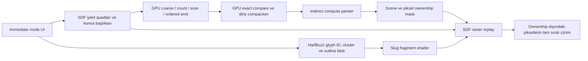
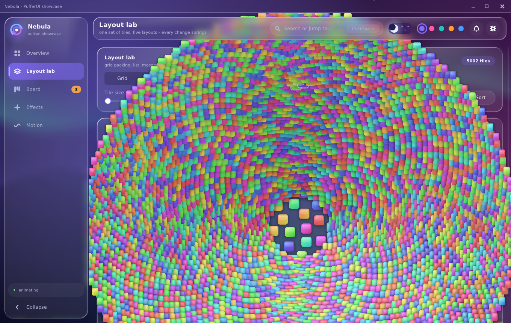

# Vulkan GPU painter, SDF ve HarfBuzz/Slug doğrulaması

24 Ekim 2026; R0 kaynak tabanı `8c62fc4204e89ac93343593b4ff94907f6b2f18b`.
Bu rapor yeni uygulamanın yerel kanıtıdır. Genel mimari ve destek sözleşmesi
[vulkan_gpu_painter.md](vulkan_gpu_painter.md), font sözleşmesi
[harfbuzz.md](harfbuzz.md) içindedir.

## Sonuç ve görsel sözleşme

SDF/Slug raster yolu 5000 öğelik Spiral'in Add dönemi ortalamasını iki ayrı
seride %60,23 ve %58,72 azalttı. Add döneminin mutlak maksimumu sırasıyla
25,5674 → 4,8940 ms ve 34,2505 → 8,0878 ms oldu. İlk kare dahil bütün serinin
mutlak maksimumu her koşuda iyileşmedi. Zorunlu compute ve GPU cache, bu sahnede
SDF raster'dan pahalıdır; özellikle ilk job/pipeline/history kurulumu yüksek
tepeler oluşturur. Compute/cache opt-in kalır. Varsayılan REFERENCE korunur.

Kullanıcı basit şekillerin SDF'ye ve metnin HarfBuzz/Slug'a geçmesine bağlı
görsel farkı kabul etti. İki referans birbirine karıştırılmadı:

- Eski REFERENCE: değişmez R0 binary/raw RGBA görüntüleri. Güncel REFERENCE,
  1150 ve 5000 öğede bütün 180 karede bunlarla birebir eşleşir.
- Yeni görünüm: ayrı dondurulmuş SDF/Slug raster binary ve raw RGBA görüntüleri.
  Güncel SDF raster, zorunlu compute, cache, staged ve adaptif yolun bütün
  kareleri bu bağımsız referansla birebir eşleşir.
- Mevcut test gövdeleri ve SDL BMP golden'ları değiştirilmedi. Yeni native
  referanslar, eski bir testi yeşile çevirmek için onun yerine konmadı.

Yeni compute yolu gerçek GPU coarse/fine binning, sıralı indeks listeleri,
dirty tile karşılaştırması/compaction, indirect dispatch ve piksel yazımı
gerçekleştirir. 5000 öğelik zorunlu compute koşusunda 2366 GPU batch ve
46.467.594 compute piksel yazımı doğrulandı. Slug glifleri GPU fragment
shader'ında eğrilerden çizilir. Compute şu anda güvenli, tam kaplı RGBA8
suffix'lerini işler; AA kenarları, glifler ve diğer uygun olmayan pikseller
aynı SDF raster programıyla çizilir. Bütün genel üçgen programının compute'a
taşındığı iddia edilmez.



## Ölçüm protokolü

Windows, MSVC Release `/O2` ve CMake Release IPO; Vulkan1.3 hedefi,
Vulkan SDK1.4.335.0/glslang16.0.0. Sorgulanan GPU AMD Radeon RX9070XT,
vendor4098/device30032/driver8389024. Bütün native ölçümlerde gerçek
adapter/driver kimliği doğrulandı; `VK_DRIVER_FILES` ve `VK_ICD_FILENAMES`
bu koşularda ayarlı değildi. Sistem sürücüsü/registry değiştirilmedi.
Aday build'de `PUFFERUI_WITH_VULKAN=ON` ve `PUFFERUI_WITH_HARFBUZZ=ON`.
REFERENCE satırında `vector_text=false`; SDF/Slug, compute ve adaptif
satırlarda `vector_text=true` kullanıldı.

Gerçek showcase yardımcıları,1360×860, Spiral mode4, tile size64 (slider'ın
minimumu),180 kare, `dt=1/60`. Enter90/120/150'de basılır,
91/121/151'de bırakılır;5000→5003 veya1150→1153 öğe. Add dönemi aşağıdaki
tablolarda90–179 karelerinin tamamıdır; yalnız üç tuş karesi değildir.

Her native seri yedi yol × yedi tekrar ×180 kare =8820 kare içerir.
5000 için bağımsız doğrulama serisi de aynıdır. 1150 serisi ve iki SDL kontrol
serisiyle son ölçümlerde toplam **37.980 zamanlanmış kare** tutuldu. Eski G0
ön ölçümleri ayrıca `perf/vulkan_compute_baseline*` içinde tarihsel kayıt olarak
korunur; sonuç tablolarına karıştırılmaz.

Sıra, her yolu her ordinalde çalıştıran dönen balanced Latin square'dir.
R0 ve A/A aynı dondurulmuş executable'ı kullanır. Aday executable'lar da
ölçüm öncesi kopyalanıp hash'lendi. Zamanlamada readback, capture, build veya
başka test yoktur. WSI penceresi gizlidir ve yalnız benchmark VSync'i kapatır.
Etkileşimli showcase'in VSync politikası değiştirilmedi. Bu gizli/unpaced
protokol, foreground60-FPS veya kullanıcı FPS'i sertifikası değildir.

`begin_ms`, `build_ms`, `end_ms` sınırları eski benchmark ile aynıdır;
`total_ms` bunların toplamıdır. Her ilk kare ve her aykırı değer dahil edildi.
GPU süreleri gecikmeli tamamlanmış submission örnekleridir; mevcut CPU
karesine veya ayrı GPU pass'lerine atanmadı ve CPU sürelerine eklenmedi.

## 5000 öğe: ana seri

Her satır1260 kare; süreler ms.

| Yol | Tüm kare ort. | Add ort. | Add p99 | Add maksimum | Tüm kare maksimum |
| --- | ---: | ---: | ---: | ---: | ---: |
| R0 | 4,727990 | 5,416847 | 24,1120 | 25,5674 | 34,6358 |
| R0 A/A | 4,720270 | 5,432070 | 24,0787 | 29,5558 | 35,6345 |
| Güncel REFERENCE | 4,806984 | 5,546349 | 24,2793 | 28,7314 | 34,1821 |
| SDF/Slug raster | 2,186989 | 2,154373 | 4,6362 | 4,8940 | 33,5345 |
| Zorunlu compute | 5,098342 | 3,980774 | 7,8554 | 8,4581 | 69,1297 |
| Compute/cache | 6,747968 | 4,766808 | 8,8088 | 9,8363 | 274,1678 |
| Adaptif | 2,269530 | 2,251192 | 5,1495 | 7,0791 | 30,7953 |

[Tam JSON](perf/vulkan_painter_timing_5000.json),
[bütün8820 kare](perf/vulkan_painter_timing_5000_frames.csv).

## Bağımsız 5000 doğrulama serisi

| Yol | Tüm kare ort. | Add ort. | Add p99 | Add maksimum | Tüm kare maksimum |
| --- | ---: | ---: | ---: | ---: | ---: |
| R0 | 5,427350 | 6,239543 | 27,9400 | 34,2505 | 39,1017 |
| R0 A/A | 5,970263 | 6,802905 | 33,7779 | 37,7033 | 50,9860 |
| Güncel REFERENCE | 5,373430 | 6,147960 | 26,6467 | 35,3924 | 39,0670 |
| SDF/Slug raster | 2,558452 | 2,575384 | 5,4848 | 8,0878 | 42,6467 |
| Zorunlu compute | 5,194973 | 4,037362 | 7,6947 | 8,5669 | 79,3715 |
| Compute/cache | 6,821988 | 4,808100 | 8,8120 | 10,5582 | 264,9341 |
| Adaptif | 2,521737 | 2,458161 | 5,3877 | 10,1757 | 48,8468 |

[Tam JSON](perf/vulkan_painter_confirm_5000.json),
[bütün8820 kare](perf/vulkan_painter_confirm_5000_frames.csv).

İkinci seride A/A Add ortalaması R0'dan yaklaşık %9,03 yüksektir. Güncel
REFERENCE ilk seride yaklaşık %2,39 yavaş, doğrulamada yaklaşık %1,47 hızlıdır.
Bu büyüklüklerden tek yönlü bir REFERENCE CPU kazanımı/gerilemesi çıkarılmaz.
SDF/Slug Add kazancı iki seride de büyüktür; buna karşın doğrulamadaki ilk-kare
maksimumu42,6467 ms ile R0'ın39,1017 ms değerinden yüksektir. Bu değer gizlenmedi.

## Tepe maliyetleri ve geometri

Ana serinin en kötü compute/cache karesi run0/frame0'dır:274,1678 ms.
CPU `sdf_prepare_ms`240,3677 ms, `sdf_record_ms`0,2631 ms,
`sdf_new_jobs=10`; ölçülen slot beklemesi0,1327 ms'dir. Hazırlık aralığı
job/buffer/descriptor/pipeline ve history kurulumu çağrılarını kapsar.
Bu aralık build ve end içindeki flush'lara yayılabilir; build süresine bir daha
eklenmez. Bu ölçüm tek tek Vulkan allocation ile pipeline çağrısını ayırmaz.
Shader derleme süresi veya ayrı GPU pass süresi olduğu iddia edilmez.

Zorunlu compute'un aynı serideki maksimumu69,1297 ms;37,4287 ms CPU hazırlık
ve10 yeni job içerir. 1150 compute/cache ilk-kare maksimumu364,9397 ms,
CPU hazırlığı326,2017 ms'dir. Compute/cache'in başlangıç masrafını Add
ortalamasından çıkararak bir kazanç oluşturulmadı.

SDF raster'ın ana serideki en kötü karesi de frame0'dır:33,5345 ms;
begin16,7910/build9,4004/end7,3431 ms. Doğrulamadaki42,6467 ms maksimumun
begin bölümü20,9635 ms'dir. İlk-kare maliyeti bu çalışmada tamamen çözülmedi.

Frame127, ilk tekrar, aynı gerçek sahne:

| Alan | R0 | SDF/Slug raster |
| --- | ---: | ---: |
| Vertex | 1.963.931 | 134.714 |
| Index | 8.351.448 | 210.954 |
| Upload byte | 96.255.536 | 11.292.447 |
|180 kare toplam vertex | 71.000.754 | 5.939.049 |

Vertex azalışı frame127'de yaklaşık %93,14, toplamda %91,64'tür. Upload
azalışı yaklaşık %88,27'dir; yeni48-byte vertex ve shape/Slug yükleri de bu
upload sayısındadır. Native SDF raster artık kullanılmayan komut bandını
ayırmaz/doldurmaz. GPU metadata64 MiB bütçesi ayrı gerçek allocation ledger'ıyla,
snapshot görüntüleri ayrı64 MiB cache bütçesiyle sınırlandırılır. Bu CSV'ler
özel GPU metadata allocation'larını kaydeder; toplam uygulama/RSS veya bütün
snapshot görüntülerinin ayrı peak dökümü olarak yorumlanmaz.

Finite RGBA8 blend kalibrasyon tablosu16.842.752 byte'dır ve metadata bütçesine
dahildir. Ana seride compute modlarının kalibrasyon medyanı yaklaşık8,78–9,51 ms;
process süresine dahildir, frame döngüsünden öncedir. Ana seride process medyanı
R0:1,2009 s, SDF/Slug:0,7352 s, force:1,3444 s, cache:1,6523 s,
adaptif:0,7477 s. Process süresi başlangıç ve kapanışı da içerir.

Adaptif mod bu Spiral'in küçük/karma/translucent batch'lerini çoğunlukla SDF
raster'a yönlendirir. Bu sahnede GPU cache'in faydalı olduğu varsayılmaz.
Kuvvetle compute seçilebildiği için bu karar forced maliyetini saklamaz.

## 1150 ve SDL kontrolleri

1150 Add ortalamaları: R0:4,328823; SDF/Slug:1,452926; force:4,002097;
cache:4,727348; adaptif:1,568293 ms. Tüm kare maksimumları sırasıyla
38,9172;38,1544;86,9609;364,9397;32,9661 ms.
[Tam sonuç ve tüm kareler](perf/vulkan_painter_timing_1150.json),
[CSV](perf/vulkan_painter_timing_1150_frames.csv).

Kontroller sekiz tekrar, baseline/candidate ayrı ve aynı backend içinde
karşılaştırılır. D3D11/Vulkan adapter veya piksel eşliği varsayılmaz.

| Kontrol | Add önce | Add sonra | Mutlak max önce | Mutlak max sonra |
| --- | ---: | ---: | ---: | ---: |
|5000 null |3,158526|3,198910|10,9462|11,0989|
|5000 D3D11 |19,764952|19,741848|215,4850|213,6877|
|1150 null |2,111807|2,098739|7,6805|6,7874|
|1150 D3D11 |10,115845|9,955287|91,2424|90,6240|

5000 null Add yaklaşık %1,28, mutlak maksimum yaklaşık %1,40 arttı. 1150 null
Add ve maksimum azaldı. Null/core için tek yönlü hızlanma veya bu küçük
farkların kesin kod nedeni iddia edilmez. D3D11'in frame127'deki200 ms üzeri
aykırı değerleri de korundu. Kontrol geometri/count/draw stream'i her karede
baseline/candidate arasında eşit doğrulandı.
[5000 JSON](perf/vulkan_painter_controls_5000.json),
[5000 bütün kareler](perf/vulkan_painter_controls_5000_frames.csv),
[1150 JSON](perf/vulkan_painter_controls_1150.json),
[1150 bütün kareler](perf/vulkan_painter_controls_1150_frames.csv).

## Golden, regresyon ve dağıtım kapıları

- Eski test gövdeleri değişmez: `git diff --exit-code -- tests` geçti.
  Mevcut22 SDL golden sahnesi,16 performans ve24 core piksel referansı,
  1150/5000 Spiral golden'ları ve eski10 tepe karesi geçti; `--update` kullanılmadı.
- Native eski/yeni iki referans × iki öğe sayısı ×180 =720 değişmez parmak izi
  [yeni oracle dosyasındadır](../tests/golden/vulkan_painter_rx9070xt.inl).
  [SHA256/FNV manifesti](perf/vulkan_painter_golden_frames.json) tam görüntü
  girdilerini kaydeder. Bu domain RX9070XT/driver8389024'tür; başka cihazda
  `--golden` başarı taklidi yapmaz, açık domain hatası döndürür.
- Son ölçümlerden sonra altı yol × iki öğe sayısı ×180 =2160 kare yeniden
  raw RGBA byte karşılaştırması ve immutable oracle ile geçti. İki5000 serisinin
  her run/mode top10 karesi ve ±2 komşusunun birleşimi71 indeks içerir;
  hepsi bu180 kare içinde doğrulandı.
  [Tepe birleşimi kanıtı](perf/vulkan_painter_peak_verification.json).
- 3600 kare/60 gerçek Add:5060 öğe, compute/cache ile bağımsız raster bütün
  karelerde eşit. Ayrı0→5000 büyüme ve ardından üç Add senaryosu da geçti.
- 10 komut regresyonu; GPU bin sırası/kapasite testleri; UINT_MAX dispatch bölme;
  zorlanmış hash çakışması, clip/target kimliği, kaldırılan komut;2 MiB upload
  sınırında metadata/geometry ömrü; düşük metadata/snapshot bütçeleri;
  CPU tape overflow sonrası eski shape işaretinin taşınmaması; zorlanmış GPU
  overflow'da hash/list okuması ve compute sahne yazımının durması doğrulandı.
- HarfBuzz ligature/joining/combining/font-store relocation ve shaped-glyph
  overlay fallback;180 kare field/caret/scroll/DPI/gamma/popup/recreation hem
  direct hem staged geçti. HB kapalı yapı açık vector-text isteğini reddeder.
- Tam Debug/Release mevcut işlevsel/golden/consumer/example paketleri geçti;
  son kaynakla bütün native Debug/Release matrisi yeniden geçti. Son format,
  Python tools ve Debug quick kapısı temizdir. ASan, HB kapalı native yapı,
  core ve Vulkan/HB amalgamated tüketiciler geçti. Dış `VkImage` atomic'inin
  SDF/compute BMP'leri birebir aynı; producer/release selftest'i geçti.
- Pinned HarfBuzz15.0.0 commit35f656a1a2bab548ea7f54a6dd3fba2b09680d14,
  shader/compiler/source receipt ve core/SDL/Vulkan installed consumers
  doğrulandı. HarfBuzz ve Slug lisans bildirimleri kaynakta ve pakette korunur.

[Son komutlar/exit/duration](perf/vulkan_painter_validation.json),
[kaynak hash'leri](perf/vulkan_painter_sources.json),
[ek test/build girdileri](perf/vulkan_painter_inputs.json),
[R0 receipt](perf/vulkan_painter_r0_receipt.json),
[R1 receipt](perf/vulkan_painter_r1_receipt.json).
Tam loglar, frozen binary'ler ve raw görüntüler yerel
`build-vulkan-compute/final-delivery`, `r0` ve `r1` altında korunur.

## Görsel inceleme ve kullanım

Frame127'nin değişmez referansları: yerleşim ve içerik korunur; SDF ve yeni
font renderer'ının kabul edilen piksel farkları vardır. Güncel candidate bu
yeni raster referansını bütün karelerde aynen üretir.




```powershell
python tools/run_vulkan_showcase.py -- --vulkan-painter sdf --vector-text
```

`--vulkan-painter compute` zorunlu yolu, `adaptive` muhafazakâr seçimi açar.
Genel paragraph bidi, mixed-script itemization, cluster-aware editing ve color
font paint bu teslimle tamamlanmış sayılmaz. DejaVu/Windows/RX9070XT kanıtı
diğer font/OS/driver kombinasyonlarının kalite veya performans sertifikası
değildir. Compute başlangıcında job/pipeline/history paylaşımı ve daha genel
primitive compute kapsamı sonraki optimizasyon adaylarıdır.
