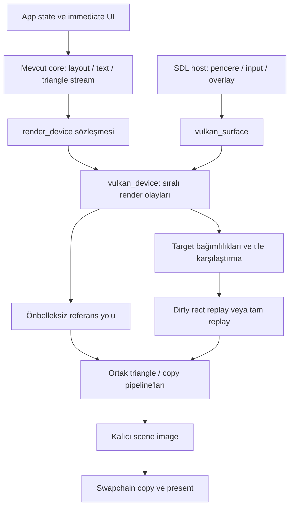
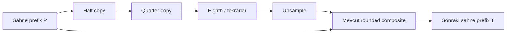

# Vulkan renderer ve döşeme önbelleği — mimari tasarım önerisi

Tarih: 22 Ekim 2026. Kaynak tabanı: `f625323` (r115).
Durum: **tasarım; uygulanmış bir renderer veya onaylanmış performans sonucu değildir.**
23 Ekim uygulama notu: Bu tarihli öneri teknik geçmiş olarak korunuyor. Native
backend, borrowed device/image arayüzü, SDL host ve CPU cache uygulaması artık
çalışma ağacında; güncel kullanım ve sınırlar [vulkan.md](vulkan.md) içindedir.
Windows/RX9070XT uygulaması ve seçilen V0-V4/V6 doğrulaması tamamlandı;
[ölçüm ve kabul raporu](vulkan_qualification.md) güncel kanıtları ve sınırları içerir.
V5 GPU preprocessing henüz uygulanmadı veya ölçülmedi. CPU cache sonuçları,
makaledeki compute painter'ın daha yavaş olduğunu göstermiyor; GPU komut
yorumlayıcısı, coarse/fine binning ve GPU dirty-tile dispatch yolu sonraki
ayrı deneyin kapsamıdır. Sonraki kullanıcı talebi dışarıdan
device/image desteğini ilk sürüme dahil etti ve API'ler arası görsel eşitlik
kapısını zorunlu olmaktan çıkardı. Aynı Vulkan cihazında cache/reference kesin
eşitliği korunur; mevcut SDL renderer varsayılan kalır. VMA yerine upload page
alt ayırıcısı, image'larda explicit dedicated allocation kullanılıyor; farklı
graphics/present family belgelenmiş unsupported sonuçtur. V5 GPU preprocessing
ölçümle gerekçelendirilmeden uygulanmayacak.
Uygulama sırası, bağımlılıklar ve çıkış kapıları tek plan olan
`~/.opencode/plan/pufferui-roadmap.md` içindeki Vulkan önerisi bölümündedir.
Bu belge o planın teknik sözleşmesini tanımlar.

## 1. Karar ve kapsam

Öneri, mevcut `render_device` / `render_surface` sözleşmesini uygulayan bir
Vulkan backend ve onun üzerinde kapatılabilir bir **piksel önbelleği** kurmaktır.
İlk sürüm, PufferUI'nin bugün ürettiği vertex ve index dizilerini kullanır.
Immediate-mode widget çağrıları, açık kimlikler, layout, input, animasyon ve
metin rasterizasyonu aynı kalır. Önce önbelleksiz Vulkan referansı doğrulanır;
önbellek ancak bu referansa karşı sıfır piksel farkıyla kabul edilir.

İki ayrı eşitlik kapısı vardır:

1. Mevcut SDL/D3D11 görüntüsü ile önbelleksiz Vulkan çıktısı: mevcut görseli
   koruma kapısı. Farklı API, rasterizer, derleyici ve GPU'lar arasında bu
   sonuç peşinen garanti edilemez. Fark çıkarsa tolerans artırılmaz veya eski
   golden değiştirilmez; uyumluluk araştırılır. Çözülemeyen platformda backend
   mevcut renderer'ın yerine varsayılan yapılamaz.
2. Aynı Vulkan cihazında, aynı girdi ve zamanda önbellek açık/kapalı: önbellek
   doğruluk kapısı. Her RGBA kanalında kesin eşitlik gerekir. "Gözle aynı"
   veya SSIM eşiği kabul ölçütü değildir.

Başarı tanımı yalnızca FPS değildir: en kötü kare, CPU duvar süresi, CPU çevrimi,
GPU süresi, sunum beklemesi, yüklenen byte ve bellek bütçesi birlikte ölçülür.
5000 Spiral'de çok sayıda şekil aynı anda hareket ettiğinden yüksek önbellek
isabeti varsayılmaz. Vulkan backend çekirdeğin CPU geometri üretimini kendiliğinden
ortadan kaldırmaz.

## 2. Blick makalesinden alınan fikir ve uyarlamanın sınırı

Moritz Falk'ın [Don't throw it all away: Caching an immediate-mode UI](https://blickeditor.com/blog/caching-an-immediate-mode-ui)
makalesi, arayüz tanımını her kare yeniden üretirken renderer'da değişmeyen
döşemelerin piksellerini saklamayı anlatıyor. Komut sırası ve doku içerik
revizyonları geçersiz kılmaya dahil. Coarse/fine binning ve GPU'nun ürettiği
değişen döşeme listesi boyama işini sınırlandırıyor. Analitik şekiller, shape
group ve alpha barrier, aynı ressamın ayrıca sunduğu çizim özellikleri.
Yazarın kısa M3 Pro deneyindeki yaklaşık %20 CPU+GPU güç azalması, kendi
iş yüküne ait; PufferUI veya Spiral için bir hız ya da pil ömrü vaadi değil.
Makalede otomatik cache açık/kapalı görüntü karşılaştırmasının henüz kurulmadığı
da belirtiliyor; burada bu doğrulama baştan zorunlu.

**Aşağıdaki mimari PufferUI için önerdiğimiz tasarımdır.** Makalenin SDF
boyayıcısını, front-to-back birleşimini veya alpha barrier semantiğini mevcut
üçgenlerimizin yerine taşımıyoruz. Bunlar kenar kapsamını, sayısal yuvarlamayı
ve saydamlık sonucunu değiştirebilir. Örneğin bugünkü bağımsız alpha çarpanlarını
grup opacity'sine çevirmek bir performans düzeltmesi değil, farklı bir görüntüdür.
İleride istenirse ayrı bir çizim özelliği ve ayrı bir görsel karar olarak ele alınır.

## 3. Mevcut sözleşme ve önemli entegrasyon ayrıntıları

Kaynaklar: `include/pufferui/pufferui.h:1310`, `impl/draw_context.inl`,
`impl/draw_primitives.inl`, `impl/sdl3.inl`, `docs/porting_a_backend.md`.

| Mevcut davranış | Vulkan karşılığı / korunacak koşul |
| --- | --- |
| `vertex`: x/y/u/v float, RGBA8; 20 byte | İlk uyumluluk yolu, gerekirse mevcut SDL dönüşümünün 32 byte float renkli sonucunu aynen üretir. Packed UNORM yolu ayrı optimizasyondur; 256 kanal değeri ve interpolasyon testi geçmeden açılmaz. |
| `draw`: triangle list; culling yok | `TRIANGLE_LIST`, `CULL_MODE_NONE`; orijinal index sırası, draw sırası ve pozisyonlar korunur. |
| Pozisyon ve clip backend'e piksel olarak gelir | DPI ikinci kez uygulanmaz; viewport ve projeksiyon y aşağı, sol üst başlangıcı korur. |
| `tex == nullptr` solid | Hazır 1×1 beyaz doku veya uyumlu solid pipeline; atlasın beyaz texeline core remap işlemi korunur. |
| Texture stream ve filter değişebilir | Kopyalanmış upload byte'ları, içerik ve sampler revizyonu; nearest/linear ayrımı. |
| Target + bilinear `blit` | Aynı kaynak/destination rectleri ve örnekleme konumu; blit kopyadır, alpha blend değildir. |
| Blur, o ana kadar çizilmiş sahneyi okur | Blur bir zaman/sıra bağımlılığıdır. Kare sonu sahnesiyle önceki blur girdisi değiştirilemez. |
| Readback eyedropper için kare içinde kullanılır | İlgili prefix'i gönder, sadece gereken tamamlanmayı bekle, RGBA8 sonucu döndür; global idle çağırma. |
| Çok pencere / host overlay | Ortak device, bağımsız surface, hedef ve cache nesilleri; popup başka pencerenin cache'ine karışmaz. |

Porting belgesindeki `begin_frame/end_frame` açıklaması global bir uygulama
karesi izlenimi verebilir. **Gerçek core bunları her pencerenin
`begin_frame(context, window)` / `end_frame(context)` çağrısında çalıştırır.**
`device->begin_frame()` ayrıca `surface->make_current()` çağrısından önce gelir.
Backend bu sıraya dayanmalıdır: gerçek surface frame'ini `make_current` başlatır;
device hook'u yalnızca ortak housekeeping yapar. `end_frame` geometriyi kapatır,
`surface::present` bir kez sunar, host overlay'ler sonra sunulur. Bütün
pencereleri görmeden kaynakları topluca sıfırlayan bir "global frame index" yanlış olur.

Mevcut `sdl3_app_init`, doğrudan `SDL_CreateRenderer` çağırıyor. Ona yalnızca
`renderer_name="vulkan"` vermek bu backend'i kurmaz. SDL pencere/input/clipboard/
chrome/UIA politikası ile SDL_Renderer kurulumu ayrılmalıdır. Var olan bootstrap
yolu aynı davranışı sürdürür; Vulkan yolu `SDL_WINDOW_VULKAN`,
`SDL_Vulkan_GetInstanceExtensions`, `SDL_Vulkan_CreateSurface` kullanır.
SDL3 event pump yeniden kullanılır; renderer başlatma ve overlay yüzeyi üretimi
uygun factory'ye bağlanır. Factory widget veya layout yardımcıları içermez.

## 4. Katmanlar ve sahiplik



| Nesne | Sahibi ve ömrü | Başlıca alanlar |
| --- | --- | --- |
| `vulkan_device` | Uygulama; context'ten daha uzun yaşar | Instance/device/queue dispatch, allocator, textures, pipelines, submission serial, retire list |
| `vulkan_surface` | Device oluşturur; `remove_window` sonrası, native pencere öncesi yok edilir | VkSurfaceKHR, swapchain generation, image views, per-image present semaphores, scene target, frame slots |
| `vulkan_frame_slot` | Bir surface'e ait; GPU tamamlanınca yeniden kullanılır | Command pool/buffer, acquire semaphore, fence/timeline değeri, upload pages, query aralığı, descriptor arena |
| `vulkan_texture` | Device; `texture_handle` bunu gösterir | Stable object generation, image/view/allocation, format, size, content revision, sampler revision, last-use serial |
| `vulkan_target` | Texture'nın target türü; bir pencereye bağlanabilir | Image layout/access state, dimensions, output generation, tile cache, pass/content revisions |
| `tile_cache` | Target generation | Önceki kesin girdiler, hash'ler, dirty list, kalıcı piksellerin geçerlilik maskesi, tüketilen bütçe |
| `upload_page` | Frame slot / device page pool | Mapped pointer, capacity/used, VkBuffer, allocation, completion serial; byte sıraları ayrışır |
| `retired_resource` | Device retire queue | Nesne türü, handle/allocation, son kullanım submission serial |

Raw pointer yalnızca non-owning referanstır; sahiplik ve destroy sırası yukarıdaki
tabloda açık. `unique_ptr/shared_ptr/weak_ptr` kullanılmaz. Vulkan/VMA/SDL
başlıkları ana declaration bölümüne sızmaz. Vulkan implementation, tek
`src/pufferui_impl.cpp` çeviri biriminin `impl/vulkan_*.inl` dilimlerine aittir.
Shader üretimi ayrı build girdisidir; ikinci bir `PUFFERUI_IMPLEMENTATION` TU yoktur.

Önerilen public yüzey taslağı; bu turda eklenmeyecek:

```cpp
struct vulkan_host; // platform yüzeyi üretir; typed, non-owning
struct vulkan_device_opts
{
    vulkan_host *host = nullptr;
    bool validation = false;
    bool tile_cache = false; // doğruluk kapıları tamamlanana kadar opt-in
    u32 frames_in_flight = 2;
    u64 upload_budget_bytes = 0; // 0: cihazdan türetilen sınırlı varsayılan
    u64 cache_budget_bytes = 0;
};
render_device *create_vulkan_device(const vulkan_device_opts &opts);
void destroy_vulkan_device(render_device *device);
```

`vulkan_host` platform factory'si draw, layout veya widget kimliği taşımaz.
İlk host SDL3'tür; native Win32/XCB entegrasyonları sonra eklenebilir. Cihazı
dışarıdan veren engine entegrasyonu ayrı bir native yardımcı başlığa konur;
Vk handle sahipliği `owned/borrowed` alanıyla açıkça belirtilir, destructor
ödünç device'ı yok etmez. İlk sürümün kapsamı bu advanced entegrasyonu içermez.
Core public API ve mevcut backend'ler cache protokolüne zorunlu hale getirilmez.

## 5. Vulkan temeli ve triangle uyumluluk yolu

İlk destek hedefi Windows/Linux, Vulkan 1.3 ve açıkça sorgulanıp etkinleştirilmiş
`dynamicRendering`, `synchronization2`, timeline semaphore özellikleridir.
Sürüm numarası bu özelliklerin otomatik etkin olduğu varsayımına dönüştürülmez.
Swapchain present desteği her surface için kontrol edilir. Ortak graphics/present
queue tercih edilir; farklı family durumunda sahiplik transferleri uygulanır.
Descriptor indexing, mesh shader, buffer device address ve subgroup boyutu
zorunlu tutulmaz. macOS/MoltenVK daha sonra portability özellikleri ve eşitlik
testleriyle ayrı destek kapısıdır; MVP'de desteklenmiş sayılmaz.
Offscreen testler normal `VkImage` target'larıyla çalışır; mevcut sürücüde
`VK_EXT_headless_surface` bulunması zorunlu değildir. WSI testleri gerçek
platform surface'ini kullanır; yazılımsal Vulkan sürücüsüyle CI koşusu ayrı
bir correctness rotasıdır ve native hız kanıtı sayılmaz.

Dynamic rendering, klasik render pass/framebuffer nesnelerini zorunlu kılmaz;
[Vulkan 1.3'e taşınmıştır](https://docs.vulkan.org/refpages/latest/refpages/source/VK_KHR_dynamic_rendering.html).
Bellek alt ayırması için lisansı ve sürümü sabitlenmiş VMA kullanılması önerilir;
sahipliği explicit C API üzerinden yürütülür. Bu tercih bir bellek yönetimi
abstraksiyonudur, smart pointer kullanımı değildir. Büyük bloklardan alt ayırma,
[Khronos memory allocation rehberinin](https://docs.vulkan.org/guide/latest/memory_allocation.html)
önerdiği temel yaklaşımdır. Loader SDL'nin sağladığı girişten yüklenir, instance
ve device dispatch tabloları ayrı tutulur; runtime SDK kurulumuna bağımlı olmaz.

Triangle pipeline durumları:

- Tek örnek, depth/stencil kapalı, culling kapalı; polygon fill, aynı vertex
  interpolasyon nitelikleri. Core'un kendi feather geometrisi korunur.
- RGB: `SRC_ALPHA`, `ONE_MINUS_SRC_ALPHA`, ADD. Alpha: `ONE`,
  `ONE_MINUS_SRC_ALPHA`, ADD; alpha'ya ikinci kez src alpha çarpılmaz.
  Copy/blit pipeline'ı blend kapalıdır. Renk ve alpha faktörleri Vulkan'da
  [ayrı alanlardır](https://docs.vulkan.org/refpages/latest/refpages/source/VkPipelineColorBlendAttachmentState.html).
- Mevcut SDL standard SDR UNORM yolunun örnekleme ve output renk dönüşümü
  kaynak/shader bazında eşlenir. Swapchain `SRGB_NONLINEAR` renk uzayı,
  image formatının `_SRGB` olmasını tek başına gerektirmez. Otomatik sRGB
  decode/encode eklemek mevcut UNORM çıktılarını değiştirebilir.
- Mevcut `/255.0f` renk dönüşümü ve shader çarpımları, division/FMA
  yuvarlamaları dahil referans alınır. Optimize derlemede fast-math açılmaz.
  Vulkan'da UNORM attribute veya shader'a taşınmış dönüşüm ancak ayrı eşitlik
  kapısından sonra kullanılır.
- Clip dönüşümü SDL referansındaki x/y/w/h ayrı integer truncation işlemini
  korur; ardından Vulkan'ın negatif offset yasağı için target sınırlarıyla
  integer kesişim alınır. `floor(x), ceil(right)` şeklinde başka bir politika
  sessizce seçilmez. Negatif/fractional clip ve DPI 1.25/1.5/2 testlenir.
- Projection için piksel merkezi ve viewport y yönü testlerle sabitlenir.
  CPU vertex'lere ikinci bir half-pixel veya DPI düzeltmesi eklenmez.
- Nearest/linear sampler ve clamp davranışı texture bazında kaydedilir.
  Blit için önce textured quad referansı kullanılır; `vkCmdBlitImage`'ın
  bilinear sonucunun birebir aynı olduğu varsayılmaz.
- Shader SPIR-V derlenmiş byte'ları repoda/build artefact'ında sabitlenir;
  shader compiler sürümü, giriş kaynağı SHA'sı, seçenekler ve SPIR-V hash'i
  ölçüm manifestine girer. İlk çizimde pipeline derlenmez; pipeline cache
  cihaz/driver UUID ve shader revision ile ayrılır, uyumsuz dosya atılır.

## 6. Kaynak yükleme, frame slot ve tamamlanma modeli

İki frame slot başlangıç tercihidir; swapchain image sayısıyla aynı kavram
değildir. Her surface kendi slot/cycle durumuna sahiptir. Device retire serial'ı
ise bütün pencereler arasında monoton artar. Frame slot tekrar kullanılmadan
önce kendi son submission'ı tamamlanmış olmalıdır; diğer pencerenin frame'i
bitti diye slot veya upload belleği temizlenmez.

Upload politikası:

1. Küçük UI/blur komutları, büyük geometri ve doku staging ayrı page sınıfları.
   İlk büyük sahne küçük draw'ların tamponlarını yüzlerce MB'ye büyütmez.
2. Kalıcı mapped host-visible sayfalar; `used` yalnızca kendi completion
   değerinden sonra sıfırlanır. Gerektiğinde yeni sayfa ayrılır; in-flight
   verinin üstüne yazılmaz. Varsayılan politika sınırlı bütçelidir.
3. Discrete GPU için host staging → device-local buffer copy yolu ve doğrudan
   host-visible vertex/index yolu ayrı ölçülür. UMA için gereksiz staging
   kaldırılabilir. Resizable BAR var diye her host-visible türün hızlı olduğu
   varsayılmaz. Seçim cihaz ölçümüyle yapılır.
4. Vertex ve index alt aralıkları ayrı hizalanır; `u32` index, mevcut akış
   korunur. Birden çok fiziksel upload sayfası var diye draw parçalanmaz:
   tek draw için contiguous buffer/aralık gerekir. Draw'ı bölen bir alternatif
   ayrıca tüm görsel kapıları geçmelidir.
5. CPU byte'ları `draw/update_texture` dönüşünden sonra artık geçerli olmak
   zorunda değildir: backend kendi staging/tape depolamasına kopyalar.
6. Non-coherent bellek flush aralıkları allocation sınırları ve
   `nonCoherentAtomSize` dikkate alınarak hizalanır; paylaşılmış atomda
   eşzamanlı başka frame verisi tutulmaz. Unmap implicit flush değildir;
   [resmî flush sözleşmesi](https://docs.vulkan.org/refpages/latest/refpages/source/vkFlushMappedMemoryRanges.html)
   uygulanır.
7. Bütçe dolarsa önce tamamlanmış sayfalar geri kullanılır; sonra eski,
   tamamlanmış cache kaynakları atılır; hâlâ yer yoksa yalnızca gerekli slot
   beklenir. Sayaç bunu `budget_wait` olarak raporlar. Sınırsız triple/quad
   büyük tampon ayırarak tepeyi gizlemek kabul edilmez.

Kalıcı geometry cache ilk sürümde yoktur. Aynı geometry byte'larını tekrar
yüklememek ayrı bir sonraki optimizasyon olabilir; hash hesaplama ve kesin
karşılaştırma maliyeti hesaba katılır. Hareketli bir rect'i GPU transform'una
çevirmek CPU aritmetik sırasını değiştirebilir; katı eşitlik yolunda kullanılamaz.

## 7. Sıralı olay akışı ve texture revizyonları

Backend, immediate çağrıları frame'e ait sıralı bir olay dizisine çevirir:

```text
set_target(scene)
clear(background)
draw(texture A, exact vertices, exact indices, clip)
update_texture(A, copied dirty pixels)
draw(texture A, ...)
blit(scene-prefix, half)
blit(half, quarter)
set_target(scene)
draw(quarter, blur composite, ...)
draw(glyph atlas, ...)
read_pixels(scene, requested rect)    // varsa burada tamamlanır
copy scene -> acquired swapchain image
present
```

`draw` olayında target generation, texture object generation, o andaki content
revision, sampler revision, clip, pipeline revision ve sıra numarası saklanır.
Raw pointer değeri tek başına kalıcı kimlik değildir: silinen texture adresine
yeni texture gelebilir. Generation wrap, cache'i boşaltır; sessiz ABA eşleşmesi
olmaz. Doku içerik değişimi aynı boyutta olsa da revizyon artırır.

**Kare içi upload sırası korunur.** Önceki draw eski atlası, sonraki draw yeni
atlası görecekse bütün upload'ları kare başına taşımak yanlıştır. İlk sürüm
tek graphics queue üzerinde draw → sampling-read-to-transfer-write bağımlılığı
→ copy → transfer-write-to-sampled-read bağımlılığı → draw sırasını kaydeder.
Render instance gerektiğinde kapatılıp `LOAD` ile yeniden açılır. Bu, farklı
texture versiyonları tahsis etmeye ihtiyaç duymadan sıralı semantiği korur.
Debug replay için gerekiyorsa eski içerik snapshot/revision zinciri de tutulur;
cache önceki frame'in örneklediği texture versiyonunu güncel versiyon sanmaz.

`destroy_texture`, CPU handle'ını kullanım dışı yapar fakat image, view,
descriptor ve allocation GPU'nun son kullanım serial'ından önce yok edilmez.
Descriptor set/pool da aynı retire kuralına tabidir. Sampler cache yaşam süresi
texture içeriğinden bağımsızdır; değişiklik cache anahtarına yansır.
Henüz submit edilmemiş tape de kaynak kullanımına dahildir: frame'in pending
referansları tutulur veya recording sırasında submission serial'ı rezerve edilir.
Sadece tamamlanmış submission'ları saymak, draw sonrası aynı frame'de destroy
edilmiş bir texture'ı erken serbest bırakabilir. Submit iptalinde pending
referanslar kontrollü bırakılır; başarılı submit'te retire serial'ına çevrilir.

## 8. Döşeme önbelleğinin kesin sözleşmesi

### 8.1 Neyi saklıyoruz?

Her render target kendi kalıcı, tam çözünürlüklü image'ını taşır. Swapchain
image'ının önceki içeriklerinin korunacağı varsayılmaz. Önbellek framebuffer'ın
ölçeğini, blur kalitesini, geometri çözünürlüğünü veya text coverage'ı düşürmez.
Başlangıçta tam scene üzerine bir ek tam kopya zorunlu değildir: korunan scene
image zaten final UI sonucudur; eski komut metadata'sı ayrıca saklanır.

İlk raster cache tasarımı tile/dirty-rect üzerinden **aynı triangle pipeline'ını
yeniden oynatır**. Compute shader ile SDF veya triangle rasterizasyonu taklidi
yapmaz. Hash ve binning CPU'da başlayabilir; GPU sınıflandırma ancak bu yolun
eşitliği ve maliyeti ölçüldükten sonra eklenir.

Önerilen başlangıç parametreleri deney girdisidir: 32×32 piksel fine tile,
256×256 coarse region. 1360×860 sahnede 43×27 = 1161 fine tile vardır.
16/32/64/128 alternatifleri 1× ve 2× DPI'da ölçülür; tek sabit "ideal" kabul edilmez.

### 8.2 Kanonik girdiler ve eşitlik

Bir tile'ın girdisi sıralı render işlemleri ve bu işlemlerin tam byte/dependency
içerikleridir. Gerekli alanlar: target generation/format/extent, clear rengi,
pipeline ve sampler revision, integer scissor, vertex/index verisi, kullanılan
texture içerik revision'ları, sıra/örtüşme, önceki pass dependency revision'ları.
Padding veya C++ struct belleği ham hash'lenmez: alanlar belirlenmiş little-endian
layout'a serileştirilir, float'lar bitleriyle taşınır. NaN/non-finite girdiler
mevcut core/backend davranışından ayrı bir cache kestirmesine sokulmaz; güvenli
tam replay yolu kullanılır. Geçersiz input guard'ları kaldırılmaz.

128-bit hash yalnızca hızlı bir aday filtresidir. **Hash eşitliği tek başına
görüntüyü koruma kanıtı değildir.** Katı modda eşit hash'ten sonra sıralı
kanonik girdi/dependency dizisi byte byte karşılaştırılır. GPU sürümünde bu
karşılaştırma GPU'da yapılır; CPU readback zorunlu olmaz. Farklı komutlar aynı
pikseli üretse de gereksiz repaint kabul edilir, yanlış cache hit kabul edilmez.
Testler zorla hash collision üreterek kesin karşılaştırmayı sınar.

İlk sürüm draw başına conservative bounds ve bütün draw payload kimliğini
kullanabilir. Ancak bugünkü core birkaç çok büyük draw ürettiğinden bir
vertex değişikliği geniş bir alanı dirty yapabilir. Bu sürüm doğrudur fakat
ince taneli kazanç sağlamayabilir; metrik bunu görünür kılar. Sonraki aşamada
orijinal triangle serial'ına dayalı tile dependency listeleri çıkarılabilir.
Widget label'ı veya widget kimliği gerekmemesi bu tasarımın avantajıdır.

### 8.3 Binning, sıra ve taşma

Bounds, zaten feather/shadow dahil gönderilmiş gerçek vertex'lerden çıkarılır.
GPU raster rounding ve scissor sınırlarında eksik kapsama yaratmamak için
conservative piksel payı kullanılır; fazla tile seçmek doğruluk sorununa yol
açmaz. Eski konum ve yeni konum ayrı karşılaştırılır: nesnenin ayrıldığı tile
da dirty olur. Kapanan popup, silinen son eleman ve boş liste testleri şarttır.

Paralel atomic append komut sırası garantilemez. GPU binning sonucu,
`(event_serial, draw_serial, original_triangle_serial)` sırasına göre deterministic
scan/compaction veya stable sort ile düzenlenir. İlk uyumluluk sürümü
triangle listelerini yeniden paketlemeden orijinal draw aralıklarını replay eder.
Primitive seviyesinde yeniden paketleme ayrı bir görsel kabul kapısıdır.

Replay döngüsünün dışı **olay sırası**, içi bu olayı gerektiren disjoint dirty
rect'lerdir. Bütün upload/target/blit olayları bir kez ve doğru sırada yürür.
Her tile için bütün frame tape'ini baştan sona bağımsız çalıştırmak yanlıştır:
ilk tile'ın upload'ı texture'ı değiştirince ikinci tile'ın erken draw'ı artık
eski texture içeriğini göremez. Bağımsız tile programları istenirse immutable
texture/pass snapshot'ları zorunludur; bunların maliyeti ayrı sayılır.

Tile başına sabit kapasite bir görüntü limiti olamaz. Count/prefix-sum ile
gereken yer belirlenir, sınırlı arena kullanılır. Bellek bütçesi veya sayaç
taşarsa **ilgili pass/target tam referans yoluyla yeniden çizilir**. Komut,
triangle, alpha katmanı veya blur örneklemi düşürülmez. 5000 öğenin merkezde
üst üste geldiği durum zorunlu overflow testidir.

### 8.4 Yeniden boyama ve adaptif seçim

Dirty tile önce kendi rect'inde aynı background/clear işlemiyle başlar ve o
tile'ı etkileyen tüm ilgili komutlar orijinal sırada replay edilir. Yeni şekli
eski piksellerin üstüne alpha ile bir kez daha çizmek yanlıştır. Unchanged
tile'a hiç yazılmaz. İlk sürüm bitişik dirty tile'ları tam integer rect'lere
birleştirir ve her rect için orijinal draw/index aralıklarını scissor ile replay
eder. Tam üçgen paketlerini her tile için tekrar göndermenin CPU/GPU maliyeti
raporlanır; aynı geometriyi bin kez replay ederek "cache hit" başarısı ilan edilmez.

Dirty oranı, rect sayısı, replay maliyeti ve geçmiş GPU süresine göre tam replay
seçilebilir. Karar **pass başında**, geçerli bütçe ve hysteresis ile verilir;
görüntüden ödün vermez. İlk kare, resize, format/DPI değişimi, cache bütçesi
taşması, force-full ve geçersiz metadata doğrudan tam repaint yapar.
Spiral'in Add tepesinde çoğu tile dirty ise cache bookkeeping bypass edilir.
Her pass sonucu için cache metadata'sı yalnızca başarılı submission sonrası
yayınlanır; yarım kalmış veya başarısız iş "valid" işaretlenmez.

Frame bütünü aynıysa ve texture/effect/target/presentation gereksinimi yoksa
boyama atlanabilir. Input işlemek, animasyon ilerletmek, odak/cursor/erişilebilirlik
güncellemek cache hit yüzünden atlanmaz. Var olan `needs_redraw`/idle kapısı
ile pixel cache farklı katmanlardır; idle davranışı başka bir değişiklik olarak ölçülür.

## 9. Blur, target bağımlılıkları ve cache tutarlılığı

PufferUI blur'u sahnenin bir prefix'ini okur; dolayısıyla frame sonu için tek
"scene revision" yeterli değildir. Her read/write sınırı bir **pass version**
üretir. Node kimliği `(target_generation, event_prefix, pass_sequence)` gibi
bir sıra bağlamına sahiptir; widget adından türetilmez. Node girdileri gerçek
src rect, dst rect, filter, alpha, DPI ve okunan source version'ıdır.



Girdi dirty bölgesi blur'un örnekleyebileceği alanla kesişiyorsa ilgili
down/up pass'leri ve composite geçersiz olur. Bilinear ayak izi, crop margin,
level, extra round-trip sayısı ve uv dönüşümü dikkate alınır. İlk doğru sürüm
küçük bir değişiklikte bütün blur zincirini yeniden çalıştırabilir; bu yalnızca
performansı etkiler. Yanlış küçük dirty rect ile blur çevresinde eski piksel
bırakılmaz. Sonradan bölgesel bağımlılık çözümü eklenirse mevcut blur oracle'ları
ve 22 golden sahnesiyle ayrıca doğrulanır.

Target cache için en güvenli başlangıç, bütün o target'a yazılmış prefix'in
tam girdisini karşılaştırmaktır. Target input'u değişince content revision
artırılır; downstream tile'lar bunu görür. Aynı target'a ileride yazmak,
önceki prefix'i örnekleyen node'un verisini geriye dönük değiştiremez.
Gerekirse ara snapshot tutulur veya pass hemen kaydedilip sıra korunur.

Özellikle **geçen frame'in final scene pikselleri, o frame'in erken blur
prefix'inin yerine kullanılamaz**. Final scene üstündeki daha sonra çizilmiş
yazı/kartlar blur girdisine sızar. MVP'nin kesin kuralı: target finalden önce
okunup sonra tekrar yazılıyorsa, o frame değiştiğinde ilgili bağımlılık zinciri
tam referans replay'e düşer; sırf final tile temiz diye prefix üretimi atlanmaz.
Frame bütünü ve bütün effect girdileri aynıysa final cache korunabilir.
Sonraki partial-cache sürümü her gerekli prefix için ayrı immutable image
version/snapshot tutar veya source read kapsamını tam yeniden kurup bu kapsamı
etkileyen sonraki pass'leri de dirty yapar. Yalnızca hash/dependency version'ı
saklamak, gereken prefix pikselleri fiziksel olarak artık yoksa yeterli değildir.
Snapshot bütçesi yetmezse tam replay seçilir. Bu konservatif başlangıç,
hareketli ve blur içeren showcase'de cache kazancını sınırlayabilir; rapor bunu
bir doğruluk şartı ve ölçülecek maliyet olarak açıkça göstermelidir.

## 10. Senkronizasyon, sunum ve readback

İlk sürüm tek graphics queue kullanır. Dedicated transfer/compute queue,
ownership ve queue arası semafor maliyetleri ölçülmeden eklenmez.
Barrier'lar operation çiftine göre üretilir; her geçişte `ALL_COMMANDS` ile
global bekleme yapılmaz. [Khronos synchronization örnekleri](https://docs.vulkan.org/guide/latest/synchronization_examples.html)
bu tablo için normatif API kullanımlarının kontrol kaynağıdır.

| Önce / sonra | Gereken ilişki |
| --- | --- |
| Host staging write → buffer/image transfer read | Host writes tamamlanmış ve gerekiyorsa flush edilmiş; submit görünürlük kuralları korunmuş |
| Transfer buffer write → vertex/index read | TRANSFER_WRITE → VERTEX_ATTRIBUTE_READ / INDEX_READ, uygun input stage |
| Transfer image write → sampled read | TRANSFER_DST → SHADER_READ_ONLY; TRANSFER_WRITE → sampled shader read |
| Color attachment write → blur sampled read | COLOR_ATTACHMENT_OUTPUT/WRITE → FRAGMENT_SHADER/SAMPLED_READ; layout geçişi |
| Shader sample → aynı image'a upload | Önceki read bitmeden transfer write başlamaz; sonra yeni sampling için görünürlük |
| Compute dirty list/indirect args write → indirect/graphics use | COMPUTE_SHADER/WRITE → DRAW_INDIRECT/INDIRECT_COMMAND_READ ve ilgili shader read |
| Sahne write → readback copy | Color write → TRANSFER_READ; copy sonrası HOST_READ, completion ve invalidate |
| Sahne read/copy → yeni frame write | Önceki read tamamlanmadan overwrite yok; shared scene image erişimleri queue sırasıyla düzenlenir |
| Swapchain acquire → color/copy destination | Acquire binary semaphore, image'ın ilk gerçek kullanım stage'inde beklenir |
| Swapchain write → present | PRESENT_SRC_KHR geçişi ve image'a ait render-finished binary semaphore |

**Present semaphore frame-slot başına tahsis edilmez.** Acquire semaforu slot'a,
present'in beklediği render-finished semaforu swapchain image'a aittir.
Bir graphics fence'in tamamlanması presentation engine'in semafor kullanımını
bitirdiğini kanıtlamaz. Image yeniden acquire edilip önceki kullanım güvenceye
alınmadan semafor tekrar sinyallenmez; [Khronos'un önerdiği model](https://docs.vulkan.org/guide/latest/swapchain_semaphore_reuse.html)
uygulanır. Timeline semaphore device işinin emekliliği içindir; WSI'nın binary
semafor sözleşmesinin yerine geçirilmez.

Swapchain yeniden kurma: framebuffer sıfırsa acquire yapma, olayı bekle;
OUT_OF_DATE durumunda yeniden oluştur, SUBOPTIMAL durumunu kayıtlı politikayla
ele al. Eski swapchain image/view ve present kaynakları WSI kullanımının da
tamamlandığı kanıtlanana kadar korunur. Desteklenen present fence/maintenance
uzantısı varsa kullanılır. Yoksa resize/shutdown gibi seyrek noktada açıkça
ölçülen conservative queue/device wait yolu seçilir; her karede idle yoktur.
Yeni generation bütün target cache'lerini ve eski output extent anahtarlarını bozar.

SDR format/renk uzayı destek matrisi başlangıçta sabit; HDR kendiliğinden
açılmaz. FIFO temel vsync seçeneği; vsync kapalı için desteklenen MAILBOX veya
IMMEDIATE açıkça seçilir ve latency/tearing etkisi raporlanır. Çok pencerede
yalnızca pacer yüzeyin vblank beklemesi hedeflenir; diğer present'ler için gerçek
platform desteği sorgulanır, mümkün olmayan davranış garanti edilmez.

Readback staging'i, row pitch ve RGBA/BGRA dönüşümünü açıkça işler. Eyedropper'ın
senkron sonucu gerektiğinde ilgili submission beklenir. Capture ölçüm dışında
ayrı koşuda yapılır; gerçek uygulama readback maliyeti ayrıca kaydedilir.

## 11. Bellek bütçesi, hata yolları ve eşzamanlılık

1360×860 RGBA8 scene = 4.462 MiB; aynı çözünürlükte bir ek debug reference
image daha aynı kadar tüketir. 1161 tile'ın 128-bit hash'i yaklaşık 18.1 KiB'dir;
asıl büyük maliyet hash değil, geometri ve kesin dependency metadata'sıdır.
5000 Spiral tepesindeki 1,963,939 vertex / 8,351,460 index, 20-byte core
formatında yaklaşık 37.46 + 31.86 MiB; 32-byte uyumluluk vertex'iyle vertex
payı yaklaşık 59.93 MiB olur. Bunlar canlı payload'dır, kapasite ve iki frame
slot'un tüm bellek bütçesi değildir. CPU core depolaması, staging, device-local
buffer, önceki cache girdileri ve retired kaynaklar ayrı sayılır.

Önbellek bütçesi bellek baskısında önce metadata/pixel cache'i bırakır ve tam
referans boyamasına döner. UI state, edit buffer, motion state veya font glyph
kimliği cache tahliyesiyle silinmez. Texture yaratma başarısızlığı mevcut
`nullptr` sözleşmesine uyar; `void draw` gibi hatayı dönemeyen çağrılar backend
hata durumunu kaydeder, diagnostic callback/status üzerinden raporlar.
Device lost durumunda yarım kare valid sayılmaz; uygulama eski frame'i
sunulmuş gibi kabul etmez. İlk sürüm için sessiz bir D3D fallback yerine
kontrollü durdurma/recreate yolu tanımlanır; fallback ayrı açık kullanıcı/app kararıdır.

Tek UI thread/context politikası korunur. Vulkan queue, descriptor pool ve
command pool'un host erişimi gerektiği yerde serialize edilir. Gelecekte
worker recording olursa thread başına command pool gerekir; bu tasarımın ilk
sürümünde paralel UI recording yoktur. Host callback'ten UI'ya reentrant
frame çağrısı yapılmaz. Native pencere başına cursor/platform çağrıları yalnızca
gerçek değişimde yapılır.

## 12. Dosya ve test mimarisi

Önerilen dosyalar; hiçbirisi bu turda implementation olarak oluşturulmadı:

| Alan | Sahip dosya / hedef |
| --- | --- |
| Küçük public factory/options | `include/pufferui/pufferui.h` |
| Vulkan private state/dispatch | `include/pufferui/impl/vulkan_device.inl` |
| Memory/upload/retirement | `include/pufferui/impl/vulkan_memory.inl` |
| Texture, targets ve ordered events | `include/pufferui/impl/vulkan_resources.inl` |
| Referans triangle ve copy recording | `include/pufferui/impl/vulkan_draw.inl` |
| Surface, WSI ve multiwindow | `include/pufferui/impl/vulkan_surface.inl` |
| Cache canonical input/binning/replay | `include/pufferui/impl/vulkan_cache.inl` |
| SDL native Vulkan host | `include/pufferui/impl/sdl3_vulkan_host.inl`; ortak host policy ayrı yardımcı |
| Shader kaynak ve sabit SPIR-V üretimi | `src/shaders/vulkan/`, `tools/compile_vulkan_shaders.*` |
| Opsiyonel build/package | `cmake/PufferUIVulkan.cmake`, `pufferui_vulkan` target; temel tüketici Vulkan SDK istemez |
| Private fake dispatch regresyonları | Yeni `tests/test_vulkan_*.cpp/.inl`; mevcut test gövdeleri değişmez |
| Native conformance/golden/perf | Yeni `pui_vulkan_tests`, `pui_vulkan_pixels`, `pui_vulkan_bench` |
| Kullanım | Yeni atomic renderer örneği, README indeks/chapter; görünüm değişirse ilgili capture kapısı |

Vulkan declaration macro sırası mevcut SDL `sdl3.inl` sınırını bozmaz. Sadece
bu backend'i isteyen consumer Vulkan dependency'sini bulur. Core-only, SDL-only,
installed package ve amalgamated-header consumer rotaları bağımsız doğrulanır.
Shared field list'leri tek helper/struct'ta tutulur; source/test/telemetry'ye
aynı üyeleri elle üç kez kopyalayan bakım yükü oluşturulmaz.

## 13. Zorunlu doğrulama matrisi

| Kategori | En az testler |
| --- | --- |
| Backend contract | Solid/textured draw, index base, winding, clip on/off/empty, clear, targets, bilinear copy, readback, caps |
| Sayısal eşitlik | 256 RGBA kanal değeri; translucent overlap; feather; degenerate triangles; fractional/negative clip; nearest/linear; gamma ve DPI; projection/pixel center |
| Texture yaşamı | Aynı frame draw-update-draw; aynı pointer adresinde yeni texture; filter değişimi; atlas spill/recreate; destroyed in-flight texture ve descriptor retirement |
| Cache invalidation | Move/remove/reorder; popup kapanışı; clear değişimi; aynı geometry'de texture içerik değişimi; blur prefix değişimi; target resize; aynı ölçüde yeni target generation |
| Cache güvenliği | Zorlanmış hash collision; tile list overflow; arithmetic overflow; descriptor/upload OOM; force-full; dirty→clean; cache eviction; başarısız submit'te metadata yayınlanmaması |
| WSI | 2+ pencere; overlay; minimized 0×0; DPI değişimi; hızlı resize; OUT_OF_DATE; surface kapatma; present semaphore yeniden kullanımı; acquire hatasında fence reset sırası |
| Eşzamanlılık | Ortak texture'ı kullanan iki pencere, farklı slot ömürleri; non-coherent atom paylaşımı; ayrı graphics/present family; validation layer synchronization denetimi |
| Görüntü | Mevcut 22 golden, 16 fingerprint, 24 core frame, 1150/5000 Spiral 4'er, 5000 peak 10; native 14 karşılaştırma karesi; showcase sayfaları, temalar, resize ve blur drift |
| Cache A/B | Aynı Vulkan cihazında scripted input ve zamanla **bütün 180 kare**; ek uzun scroll/hover/caret/atlas/resize dizileri; RGBA fark 0 |
| Performans | Null kontrolü; Vulkan cache off/on; SDL D3D11; soğuk ilk kare, 60–89 steady, 90–179 Add, tüm startup/resize spike'ları; 1150 ve 5000; p95/p99/max ve her raw frame |

Native cross-backend eşitlik ile Vulkan cache A/B eşitliği ayrı raporlanır.
GPU'lar arası tek evrensel BMP hash'i varsayılmaz; donanım/sürücü manifestleri
ve kendi referansları tutulur. Yeni Vulkan goldeni eklemek, eski D3D11
görüntüsünden farkı meşrulaştıran bir yol değildir.

Validation layer ve synchronization validation açık tanı koşuları, hız
ölçümünden ayrıdır. Device timestamp sonuçları gecikmeli/non-blocking toplanır;
her karede `GetQueryPoolResults(WAIT)` ile zamanlayıcıyı bozan CPU beklemesi yoktur.
Timestamp valid bits ve period kontrol edilir; desteklenmeyen sayaç "yok"
olarak raporlanır, sıfır ms sayılmaz.

## 14. Telemetry ve kabul kararları

Her ölçüm manifesti commit, compiler/flags, shader SHA, font SHA, device/driver,
API/features, output size/DPI, present mode, görünürlük/occlusion, thermal/power
ayarları ve test girdisini taşır. Her frame için en az:

```text
frame, tiles/items, begin/build/end CPU wall, thread cycles,
canonicalize/bin/hash/exact-compare/replay CPU,
GPU full draw/bin/hash/replay/copy timestamp intervals,
acquire_wait, slot_wait, submit_call, present_call,
draws, vertices, indices, upload_bytes,
dirty_tiles/total_tiles, replay_rects, overflow_fallbacks,
cache_hit_reason/miss_reason, live/retired/peak CPU+GPU bytes,
allocations, growth_bytes, readback_count, validation_error_count
```

GPU ve CPU iç içe aralıklar toplanıp sahte toplam üretilmez. Query aralığı,
queue beklemesi, driver submit CPU maliyeti ve presentation engine beklemesi
aynı şey değildir. Bu incelemede görülen kısa GPU aralığı / uzun `Present`
ayrımı, Vulkan değerlendirmesinde de korunmalıdır.

Eşleştirilmiş sıra AB/BA dönüşümlü; A/A kontrolü, cache off/on ve farklı
renderer karşılaştırmaları ayrı koşular. Capture ve build zamanlamadan ayrılır.
Tek bir aykırı değer silinmez. Ortalama düzelirken maksimum artıyorsa hangi
karenin, hangi aşamasının arttığı açıkça yazılır. Pacing gerekiyorsa hem
unpaced stres hem gerçek sunum modu sonuçları ayrı verilir.

Kabul: bütün mevcut testler değiştirilmeden geçer; yeni regresyonlar kendi
referansıyla geçer; görsel kapılarda fark 0; beklenmeyen validation hatası 0;
bellek sınırlı; gerçek iş yükünde ölçülmüş net yarar vardır. Dirty oranı yüksek
Spiral'de cache kazandırmıyorsa doğru sonuç cache'i o pass'te atlamaktır.
"Vulkan daha hızlıdır" veya "GPU cache 5000 Spiral sıçramasını çözer"
varsayımı bir çıkış kapısının yerini tutamaz.
